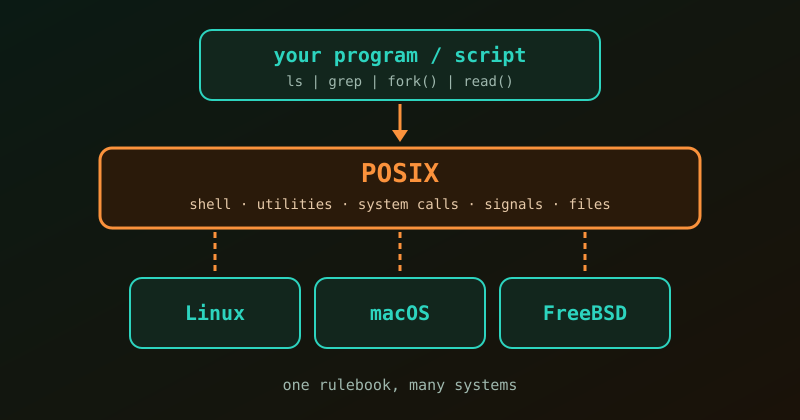

{fig-alt="A program box on top, a POSIX layer in the middle, and Linux, macOS and FreeBSD boxes below it."}

**POSIX** (Portable Operating System Interface) is a set of standards developed by the IEEE to make software portable across operating systems. In short, it is a shared rulebook. If a program or script sticks to the POSIX rules, it should run on Linux, macOS or a BSD system without being rewritten.

## Why POSIX Was Created

In the 1970s and 1980s the industry went through the "Unix Wars". Many operating systems were based on Unix, but each vendor changed things a little: different commands, custom system behaviours, unique flags. A script that worked on one company's machine could fail on another's.

To bring order, the first POSIX standard appeared in 1988 (IEEE 1003.1), aiming for predictability and compatibility across competing platforms.

## What POSIX Standardizes

We probably rely on POSIX every day without noticing. The standard covers these core areas:

- **Filesystem conventions.** `/` is the root directory, files have read/write/execute (`rwx`) permissions, and the Unix idea that devices and many resources are accessed like files is built into the interfaces.
- **Core command-line utilities.** Commands such as `ls`, `cd`, `grep`, `cat` and `chmod` exist and behave the same way on any compliant system.
- **Standard streams and redirection.** Standard input (`stdin`, 0), standard output (`stdout`, 1) and standard error (`stderr`, 2) are defined. This is why `command > output.txt` works everywhere.
- **System calls (C APIs).** Programs talk to the system through standard C interfaces: process creation (`fork`), execution (`exec`) and basic input/output (`open`, `read`, `write`).
- **Processes and signals.** Every process gets a process ID (PID), and processes communicate or terminate through signals such as `SIGTERM` or the one sent by `Ctrl+C`.

## POSIX Is a Standard, Not an Operating System

POSIX describes how a system should behave; it is not a system we can install. Operating systems differ in how closely they follow it:

| Category | Meaning | Examples |
|---|---|---|
| Fully certified | Passed the formal certification tests. | macOS, IBM z/OS, AIX |
| Mostly compliant ("POSIX-like") | Follows the rules closely but has not pursued formal certification. | Linux (Ubuntu, Fedora, ...), FreeBSD |
| Not POSIX | Built on a different design. | Windows NT (though WSL provides a POSIX-compatible environment) |

Systems like Linux also offer features far beyond the POSIX baseline, such as cgroups and namespaces. If we want maximum portability, we have to choose to stay within POSIX features.

::: {.callout-tip}
Writing shell scripts for portability? Use `#!/bin/sh` and avoid Bash-only features such as `[[ ... ]]` and arrays. Then the script is much more likely to run on any POSIX system.
:::

## Why It Still Matters

Modern cloud computing and DevOps lean heavily on POSIX conventions. Containers, deployment scripts and server tooling all assume POSIX-style files, permissions, processes and signals. Without this decades-old rulebook, automating infrastructure at scale would be far harder.

## References

1. [POSIX, Wikipedia](https://en.wikipedia.org/wiki/POSIX)
2. [System call, Wikipedia](https://en.wikipedia.org/wiki/System_call)
3. [POSIX explained like you actually need it](https://dev.to/viz-x/posix-explained-like-you-actually-need-it-not-like-a-textbook-5ajh), dev.to
4. [What is the meaning of POSIX?](https://stackoverflow.com/questions/1780599/what-is-the-meaning-of-posix), Stack Overflow
