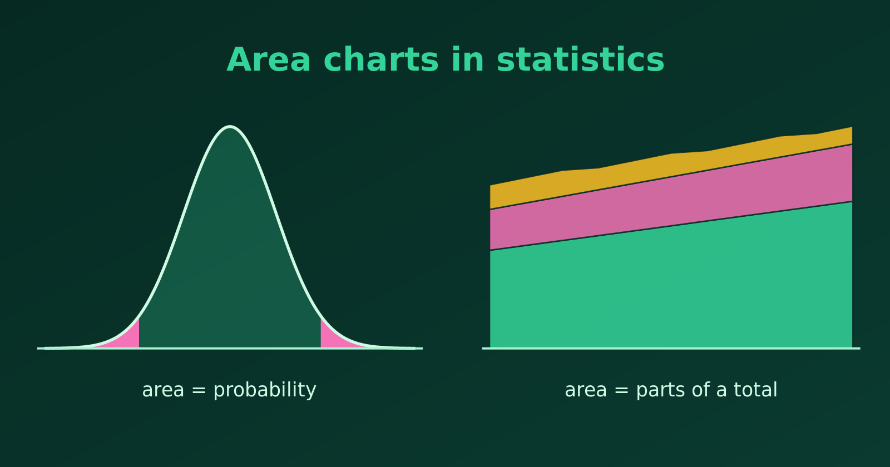

{.bk-adapt fig-alt="Left, a bell curve with both tails shaded. Right, a stacked area chart with three coloured bands growing over time."}

An area chart fills the space under a line with colour. That emphasises the **volume or magnitude** of the data, not only the change from one point to the next. Statisticians use area charts for three main jobs: showing probability, showing proportions of a total, and showing cumulative totals. Let's see each, with R.

## 1. Probability and Continuous Distributions

For a continuous random variable, the **area under the density curve is probability**, and the total area is $1$ (or $100\%$). Shading a region turns an abstract idea into something we can see.

- **P-values and significance.** Shading the tails of a distribution shows the rejection region for a significance level $\alpha$.
- **Confidence and coverage.** Shading the middle of a curve shows how much probability lies in an interval, such as the $68\%$, $95\%$ and $99.7\%$ zones of the [Empirical Rule](visualizing-empirical-rule.html).

Here is the two-sided rejection region of a standard normal test at $\alpha = 0.05$. The critical values are $\pm 1.96$.

```{r}
#| fig-width: 7
#| fig-height: 4
library(tidyverse)

z <- tibble(x = seq(-4, 4, length.out = 800), density = dnorm(x))
crit <- qnorm(0.975)   # 1.96

ggplot(z, aes(x, density)) +
  geom_area(fill = "lightblue") +
  geom_area(data = filter(z, x <= -crit), fill = "tomato") +
  geom_area(data = filter(z, x >= crit),  fill = "tomato") +
  geom_line() +
  labs(title = "Rejection region at alpha = 0.05 (shaded red)",
       x = "z", y = "Density")

# area in the two tails
2 * pnorm(-crit)
```

The two red tails together have area $0.05$, which is the probability of a "significant" result when the null hypothesis is true.

## 2. Parts of a Total over Time: Stacked Area Charts

When a whole is made of several groups, a stacked area chart shows each group's trend and the **total** at once. The top edge is the total, and the thickness of each band is that group's contribution.

For example, here are made-up yearly emissions of a factory, split by pollutant.

```{r}
#| fig-width: 7
#| fig-height: 4
set.seed(7)
emissions <- expand_grid(year = 2015:2025, pollutant = c("CO2", "NOx", "SO2")) %>%
  mutate(level = case_when(pollutant == "CO2" ~ 60, pollutant == "NOx" ~ 25, TRUE ~ 15) *
                 (1 - 0.02 * (year - 2015)) * runif(n(), 0.95, 1.05))

ggplot(emissions, aes(year, level, fill = pollutant)) +
  geom_area() +
  scale_x_continuous(breaks = seq(2015, 2025, 2)) +
  labs(title = "Factory emissions by pollutant (made-up data)",
       x = NULL, y = "Emissions (tonnes)", fill = NULL)
```

The total falls over the decade, and we can also see that CO2 is by far the largest part. A stacked area chart is best when the group order is fixed and the number of groups is small.

## 3. Cumulative Totals over Time

A line chart can hide the physical weight of accumulation. If the quantity adds up, such as rainfall during a season or the total number of cases in an outbreak, an area under the cumulative curve shows how much has built up.

```{r}
#| fig-width: 7
#| fig-height: 4
set.seed(3)
rain <- tibble(day = 1:90, mm = rgamma(90, shape = 0.4, scale = 8)) %>%
  mutate(total = cumsum(mm))

ggplot(rain, aes(day, total)) +
  geom_area(fill = "steelblue", alpha = 0.7) +
  geom_line(colour = "steelblue4") +
  labs(title = "Accumulated rainfall over a 90-day season (simulated)",
       x = "Day", y = "Total rainfall (mm)")
```

## Overlapping Areas: Use Transparency

Areas that are **not stacked** need care. If we draw two independent groups on the same axes with solid fills, the one drawn later hides part of the other (occlusion), and the chart misleads.

**Transparency solves this for a few series.** With a semi-transparent fill (`alpha` around 0.4), both areas stay visible, and the overlap shows as a darker blend. The panels below show the same data three ways: solid fills, transparent fills, and lines.

```{r}
#| fig-width: 10
#| fig-height: 3.6
set.seed(11)
two <- tibble(x = rep(1:30, 2), group = rep(c("A", "B"), each = 30)) %>%
  mutate(y = 50 + cumsum(rnorm(60, 0, 2)) + ifelse(group == "B", 8, 0))

solid <- ggplot(two, aes(x, y, fill = group)) +
  geom_area(position = "identity") +
  labs(title = "Solid: B hides part of A", x = NULL, y = NULL)

transparent <- ggplot(two, aes(x, y, fill = group)) +
  geom_area(position = "identity", alpha = 0.4) +
  labs(title = "Transparent: both visible", x = NULL, y = NULL)

lines <- ggplot(two, aes(x, y, colour = group)) +
  geom_line(linewidth = 1) +
  labs(title = "Lines: clearest", x = NULL, y = NULL)

library(patchwork)
solid | transparent | lines
```

In the solid chart, group B is drawn on top and hides the lower part of group A, so we cannot tell where A's area really starts or how the two compare. In the transparent chart, we can read both series, and the overlap is visible. A good habit is to add a line along the top edge of each area, so that each boundary stays crisp.

```{r}
#| fig-width: 5.5
#| fig-height: 3.6
ggplot(two, aes(x, y, fill = group, colour = group)) +
  geom_area(position = "identity", alpha = 0.3) +
  labs(title = "Transparent areas with outlines", x = NULL, y = NULL)
```

Transparency has limits. With three or more overlapping series, the blended colours become muddy and the overlaps are hard to decode. Then a line chart is the better choice.

::: {.callout-tip}
Use an area chart when the **filled amount itself means something**: probability, a total or a cumulative quantity. For two overlapping series, make the fills transparent. If only the trend matters, or there are three or more unstacked series, use a line chart.
:::

## Summary

| Use | Chart | What the area shows |
|---|---|---|
| Probability, p-values, intervals | Area under a density curve | Probability |
| Parts of a whole over time | Stacked area | Each group's share and the total |
| Accumulation | Cumulative area | The total built up so far |
| Two overlapping series | Transparent areas (with outlines) | Each series, and where they overlap |
| Three or more separate series | Not an area chart | Use lines |
