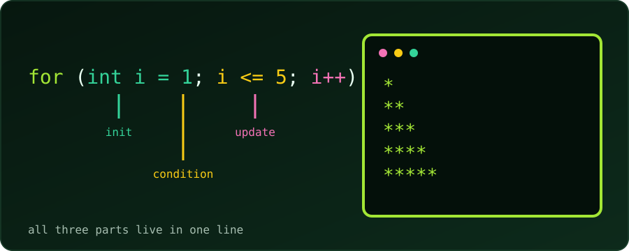

{fig-alt="The header for (int i = 1; i <= 5; i++) with init, condition and update labelled, beside a terminal printing a triangle of asterisks."}

Five problems, from beginner to intermediate, to build confidence with the `for` loop. Try each one on paper or in your editor first. If we get stuck, open **See hint** for the steps, and press **Reveal code** to compare with a tested solution.

Every solution was compiled with `gcc -Wall -Wextra` and run; the outputs shown are real. For a companion set, see [5 while loop practice problems](c-while-loop-practice-problems.qmd).

::: {.callout-note}
**Anatomy of a `for` loop.** `for (init; condition; update)` runs `init` once, tests `condition` before every pass, and runs `update` after every pass. It is the same recipe as a `while` loop, with all three parts gathered in one line.
:::

---

### Problem 1 (Easy): Multiplication Table

Write a program that asks for an integer and prints its multiplication table from 1 to 10 using a `for` loop.

Input: `5`

Expected output (first and last lines):
```
5 x 1 = 5
5 x 2 = 10
...
5 x 10 = 50
```

::: {.reveal-code}
::: {.hint}
- Read the number into `n`.
- Let the loop counter `i` run from 1 to 10 (`i <= 10`).
- Print `n`, `i` and `n * i` in one `printf`.
:::

```c
#include <stdio.h>

int main(void) {
    int n;
    printf("Enter an integer: ");
    scanf("%d", &n);

    for (int i = 1; i <= 10; i++) {
        printf("%d x %d = %d\n", n, i, n * i);
    }
    return 0;
}
```
:::

**Try next:** let the user also choose where the table stops (instead of always 10).

---

### Problem 2 (Easy): Factorial

Take a non-negative integer `N` and print its factorial, `N!`: the product of all positive integers up to `N` (for example, 5! = 5 × 4 × 3 × 2 × 1 = 120).

Input: `4`

Expected output:
```
Factorial of 4 is 24
```

::: {.reveal-code}
::: {.hint}
- Start an accumulator `fact` at **1**, not 0 (anything times 0 stays 0).
- Loop `i` from 2 to `N`.
- Multiply: `fact *= i`.
- Use `long long`: `int` overflows at 13!.
:::

```c
#include <stdio.h>

int main(void) {
    int n;
    printf("Enter a non-negative integer: ");
    scanf("%d", &n);

    long long fact = 1;             // 1 is the identity for multiplication (and 0! = 1)
    for (int i = 2; i <= n; i++) {
        fact *= i;
    }
    printf("Factorial of %d is %lld\n", n, fact);
    return 0;
}
```
:::

Tested: `4` gives 24, `0` gives 1 (the loop body never runs, so `fact` keeps its starting value), and `20` gives 2432902008176640000. Beyond 20, even `long long` overflows.

**Try next:** print the sum 1 + 2 + … + N instead, changing only the accumulator.

---

### Problem 3 (Easy-Medium): Count Digits

Write a program that reads an integer and counts how many digits it has, using a `for` loop.

Input: `45821`

Expected output:
```
Number of digits: 5
```

::: {.reveal-code}
::: {.hint}
- Copy the number into `temp`, so `n` stays untouched.
- Dividing an integer by 10 drops its last digit: 45821 → 4582 → 458 → 45 → 4 → 0.
- Put `temp /= 10` in the **update** part, and loop while `temp != 0`.
- Count one per pass.
- `0` has one digit, but the loop never runs for it, so handle it separately.
:::

```c
#include <stdio.h>

int main(void) {
    int n;
    printf("Enter an integer: ");
    scanf("%d", &n);

    int count = 0;
    for (int temp = n; temp != 0; temp /= 10) {
        count++;
    }
    if (n == 0) {
        count = 1;                  // 0 has one digit, but the loop body never runs for it
    }
    printf("Number of digits: %d\n", count);
    return 0;
}
```
:::

Here the loop variable is not a simple counter: the update step is `temp /= 10`. A `for` loop's update can be any expression. Negative numbers work too (`-987` gives 3), because dividing by 10 moves them toward 0 as well.

**Try next:** compute the sum of the digits (hint: `temp % 10` is the last digit).

---

### Problem 4 (Medium): Fibonacci Sequence

Read `N` and print the first `N` Fibonacci numbers. The sequence starts with 0 and 1, and each next number is the sum of the previous two: 0, 1, 1, 2, 3, 5, 8, …

Input: `6`

Expected output:
```
0 1 1 2 3 5
```

::: {.reveal-code}
::: {.hint}
- Keep two variables: `a = 0` (the current term) and `b = 1` (the next one).
- Each pass: print `a`.
- Then compute `next = a + b`, slide forward with `a = b`, and set `b = next`.
- Run the loop exactly `N` times: `i` from 0 while `i < N`.
:::

```c
#include <stdio.h>

int main(void) {
    int n;
    printf("How many terms? ");
    scanf("%d", &n);

    long long a = 0, b = 1;
    for (int i = 0; i < n; i++) {
        printf("%lld ", a);
        long long next = a + b;
        a = b;
        b = next;
    }
    printf("\n");
    return 0;
}
```
:::

Tested: `6` prints `0 1 1 2 3 5`, and `10` prints `0 1 1 2 3 5 8 13 21 34`. Here `i` is only a counter for "how many times"; the real work happens in `a` and `b`.

**Try next:** print only the even Fibonacci numbers among the first `N`.

---

### Problem 5 (Medium): Right-Angled Triangle of Stars

Read a height `H` and print a right-angled triangle of asterisks with `H` rows, using **nested** `for` loops.

Input: `4`

Expected output:
```
*
**
***
****
```

::: {.reveal-code}
::: {.hint}
- The **outer** loop counts rows: `row` from 1 to `H`.
- Row number `row` holds exactly `row` stars.
- So the **inner** loop counts columns: `col` from 1 to `row`, printing one `*` each time.
- After the inner loop finishes, print a newline to end the row.
:::

```c
#include <stdio.h>

int main(void) {
    int h;
    printf("Enter the height: ");
    scanf("%d", &h);

    for (int row = 1; row <= h; row++) {
        for (int col = 1; col <= row; col++) {
            printf("*");
        }
        printf("\n");
    }
    return 0;
}
```
:::

The inner loop's limit depends on the outer loop's variable (`col <= row`). That single detail is what turns a rectangle into a triangle.

**Try next:** print the triangle upside down, or right-aligned with leading spaces.

---

### What These Problems Practise

| Problem | Pattern |
| :--- | :--- |
| 1. Multiplication table | A counter used inside a calculation |
| 2. Factorial | An accumulator that multiplies |
| 3. Count digits | A custom update step (`temp /= 10`) |
| 4. Fibonacci | Updating several variables per pass |
| 5. Star triangle | Nested loops, inner limit tied to the outer variable |
