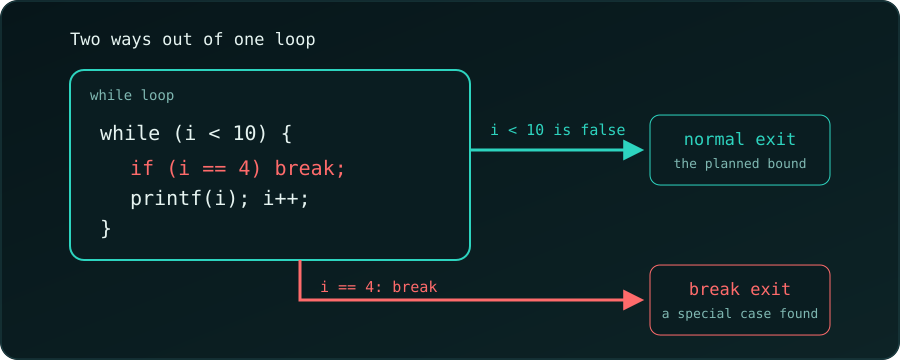

{fig-alt="A while loop box with the condition i < 10. A teal arrow on the right is the normal exit when the condition is false; a red arrow below is the break exit taken when i equals 4."}

A common question when we first meet `break`:

```c
int i = 0;
while (i < 10) {
    if (i == 4) break;
    printf("%d\n", i);
    i++;
}
```

```
0
1
2
3
```

The loop stops at 4, so **why did we write `i < 10`?**

## The Condition Is the Normal Exit, `break` Is the Special Exit

The two answer different questions:

- `i < 10` says "keep going while `i` is under 10": the *planned* range.
- `if (i == 4) break;` says "but if something special happens, stop **now**."

Think of driving. "Drive until we reach the destination" (`i < 10`) is the plan. "Stop at a red light" (`break`) is the exception. We don't delete the destination from the plan because a red light *might* appear.

In this toy example we could simply write `i < 4`. Real programs rarely know the stopping point in advance, as the next examples show.

::: {.callout-note}
**Rule.** `break` leaves the *innermost* loop at once and skips the rest of the body. The program continues after the loop.
:::

## Four Short Examples

(The snippets go inside `main`, with `#include <stdio.h>`. Each was compiled with `gcc -Wall -Wextra` and run.)

### 1. Search: Stop When We Find It

We don't know where 42 is, or whether it is there at all. We stop at the first match:

```c
int arr[] = {7, 19, 42, 5};
int found = -1;
for (int i = 0; i < 4; i++) {
    if (arr[i] == 42) {
        found = i;
        break;
    }
}
printf("%d\n", found);
```

```
2
```

Without `break` the loop would keep scanning for no reason. If 42 is missing, `found` stays -1.

### 2. Read Numbers Until 0

The condition means "keep reading while the input is valid". `break` means "the user typed 0":

```c
int x, sum = 0;
while (scanf("%d", &x) == 1) {
    if (x == 0) break;
    sum += x;
}
printf("%d\n", sum);
```

For the input `5 10 0 99`:

```
15
```

The 0 stops the loop, so 99 is never added.

### 3. Retry with a Limit

"At most 3 tries" is the plan; "stop as soon as it works" is the discovery. Here the second try pretends to succeed:

```c
int tries = 0;
while (tries < 3) {
    tries++;
    if (tries == 2) break;   // pretend it worked
}
printf("%d\n", tries);
```

```
2
```

Change the test to `tries == 5` and the loop ends by its condition, printing 3.

### 4. An Endless Loop with an Exit

When there is no natural condition (a menu, a game loop), `while (1)` runs until `break`:

```c
char cmd;
while (1) {
    scanf(" %c", &cmd);
    if (cmd == 'q') break;
    printf("%c\n", cmd);
}
```

For the input `a b q c`:

```
a
b
```

Here `break` *is* the exit condition. (A real program should also stop when `scanf` fails, such as at the end of the input.)

## Which Stop Goes Where?

| Kind of stop | Where it goes | Example |
| :--- | :--- | :--- |
| **Planned stop** (known up front) | loop condition | `i < 10`, `scanf(...) == 1` |
| **Discovered stop** (found mid-loop) | `break` | found the item, user typed 0 |
| **No natural condition** | `while (1)` + `break` | menu loop, game loop |

## Summary

A `while` condition says *when to keep going in the normal case*. A `break` says *stop immediately when a special case shows up*. The special case often can't be checked in the condition, because it is only known once we are inside the loop.

For more practice, see [while loop practice problems](c-while-loop-practice-problems.qmd).
