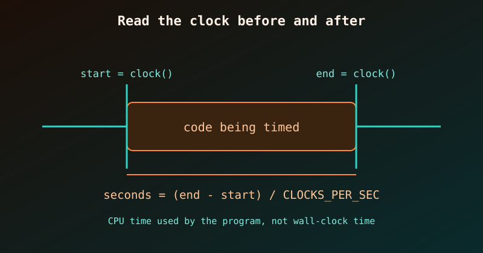

{fig-alt="Timeline with a start clock() reading, a block labelled code being timed, an end clock() reading, and the formula for seconds."}

`clock()` from `<time.h>` tells us how much **CPU time** the program has used so far. Call it before and after a piece of code, subtract, and we know how long that code took. We used it in [Inline Functions in C](c-inline-functions.qmd) to compare a function call with an inlined version, and this post explains how it works and where it can mislead us.

## The basics

- `clock()` returns a value of type `clock_t`: the processor time used by the program since it started, in *clock ticks*.
- `CLOCKS_PER_SEC` is the number of ticks per second. Dividing by it converts ticks to seconds.
- Cast to `double` before dividing, otherwise integer division throws away the fractions.

```c
#include <stdio.h>
#include <time.h>

int main(void) {
    clock_t start = clock();

    long sum = 0;
    for (long i = 1; i <= 200000000; i++) sum += i % 7;

    clock_t end = clock();
    double seconds = (double)(end - start) / CLOCKS_PER_SEC;

    printf("sum = %ld\n", sum);
    printf("CLOCKS_PER_SEC = %ld\n", (long)CLOCKS_PER_SEC);
    printf("time = %.3f s\n", seconds);
    return 0;
}
```

```
$ gcc -O2 timing.c -o timing && ./timing
sum = 599999998
CLOCKS_PER_SEC = 1000000
time = 0.265 s
```

On Linux `CLOCKS_PER_SEC` is 1,000,000 (the POSIX value), so one tick is a microsecond. Do not assume that on other systems; always divide by the constant. The exact times in this post come from one Linux machine with GCC 11.4 and will differ on yours.

## Pitfall 1: the optimiser may delete the code we are timing

In the program above we print `sum`, so the compiler must compute it. If we never use the result, an optimising compiler is allowed to remove the whole loop:

```c
long sum = 0;
for (long i = 1; i <= 200000000; i++) sum += i % 7;   // sum is never used
printf("time = %.3f s\n", (double)(clock() - start) / CLOCKS_PER_SEC);
```

```
$ gcc -O2 dead.c -o dead && ./dead
time = 0.000 s
```

A loop of 200 million iterations "ran" in zero seconds, because it did not run at all. Built with `-O0` the same program reports `0.529 s`. So:

::: {.callout-warning}
Always use the result of the code being timed (print it, return it, or store it in a `volatile` variable), so the compiler cannot discard it.
:::

## Pitfall 2: one run is noisy

The first run is often slower (cold caches, the CPU still speeding up), and other programs compete for the processor. Run the work several times and report the **minimum**, which is the run least disturbed by noise:

```c
#include <stdio.h>
#include <time.h>

#define RUNS 5

static long work(void) {
    long sum = 0;
    for (long i = 1; i <= 100000000; i++) sum += i % 7;
    return sum;
}

int main(void) {
    double best = 1e9;
    long result = 0;
    for (int r = 0; r < RUNS; r++) {
        clock_t start = clock();
        result = work();
        double t = (double)(clock() - start) / CLOCKS_PER_SEC;
        printf("run %d: %.3f s\n", r + 1, t);
        if (t < best) best = t;
    }
    printf("result = %ld, best of %d = %.3f s\n", result, RUNS, best);
    return 0;
}
```

```
run 1: 0.199 s
run 2: 0.133 s
run 3: 0.133 s
run 4: 0.134 s
run 5: 0.133 s
result = 299999997, best of 5 = 0.133 s
```

The first run was 50% slower than the rest. Printing `result` keeps the work from being optimised away (pitfall 1).

Also make the timed work last long enough, ideally at least a few hundredths of a second. A task that finishes in a few microseconds is dominated by the resolution of the clock and the cost of calling `clock()` itself; wrap it in a loop of many repetitions and divide.

## Pitfall 3: CPU time is not wall-clock time

`clock()` counts time the CPU spent running *our* program. Time spent waiting (sleeping, reading a file, waiting for the network) is not counted:

```c
#include <stdio.h>
#include <time.h>
#include <unistd.h>

int main(void) {
    clock_t c0 = clock();
    struct timespec w0, w1;
    clock_gettime(CLOCK_MONOTONIC, &w0);

    sleep(1);                                  // waiting, not computing

    clock_gettime(CLOCK_MONOTONIC, &w1);
    clock_t c1 = clock();

    printf("clock()         : %.3f s\n", (double)(c1 - c0) / CLOCKS_PER_SEC);
    printf("wall (monotonic): %.3f s\n",
           (w1.tv_sec - w0.tv_sec) + (w1.tv_nsec - w0.tv_nsec) / 1e9);
    return 0;
}
```

```
clock()         : 0.000 s
wall (monotonic): 1.000 s
```

Which one do we want?

| We want to know | Use |
|---|---|
| How much computation an algorithm needs | `clock()` |
| How long the user waits, including I/O and sleeping | `clock_gettime(CLOCK_MONOTONIC, ...)` (POSIX) |
| Time for a program using several threads | wall-clock time; `clock()` adds up the CPU time of all threads, so it can exceed the elapsed time |

## A reusable timing helper

Wrapping the pattern in a small function keeps benchmarks tidy:

```c
#include <time.h>

double seconds_since(clock_t start) {
    return (double)(clock() - start) / CLOCKS_PER_SEC;
}

// usage:
// clock_t t = clock();
// do_work();
// printf("%.3f s\n", seconds_since(t));
```

## Checklist

1. Compile with the optimisation level you care about (`-O2`), and compare variants at the same level.
2. Use the result of the timed code so it is not optimised away.
3. Repeat and take the minimum (or the median).
4. Pick CPU time (`clock()`) or wall time (`clock_gettime`) on purpose.
5. Time only the work, not `printf` or file reading, unless those are what we are measuring.

To compile and run these programs quickly, see [Compiling and Running C Programs on Linux](running-c-programs-on-linux.qmd).
