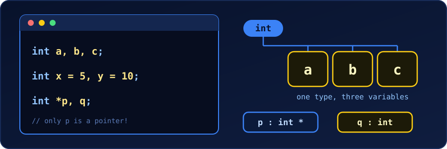

{fig-alt="A code editor shows int a, b, c; int x = 5, y = 10; and int *p, q;. Beside it, one int tag is connected to three boxes a, b and c. Below, p is shown as an int pointer and q as a plain int."}

In C we can declare several variables in one statement by separating their names with commas. The only rule is that they **share one type**. All the code below was compiled with `gcc -Wall -Wextra` and the outputs are real.

## 1. Declare without initialising

```c
int a, b, c;
```

This creates three `int` variables. Their values are **not defined yet**, so we assign them before we read them:

```c
#include <stdio.h>

int main(void) {
    int a, b, c;
    a = 1; b = 2; c = 3;
    printf("a=%d b=%d c=%d\n", a, b, c);
    return 0;
}
```

```
a=1 b=2 c=3
```

## 2. Declare and initialise each one

Every variable can get its own starting value, and a later one may use an earlier one in the same line:

```c
int x = 10, y = 20, z = x + y;
double price = 9.99, tax = 0.15, total = price * (1 + tax);
printf("x=%d y=%d z=%d\n", x, y, z);
printf("total=%.2f\n", total);
```

```
x=10 y=20 z=30
total=11.49
```

`z = x + y` works because `x` and `y` are already declared (and given values) by the time the compiler reaches `z`.

## 3. Give several variables the same value

Declare them first, then chain the assignment on the next line:

```c
int i, j, k;
i = j = k = 0;
printf("i=%d j=%d k=%d\n", i, j, k);
```

```
i=0 j=0 k=0
```

The assignment runs right to left: `k = 0`, then `j = k`, then `i = j`.

::: {.callout-warning}
Writing it all in the declaration, `int a = b = 5;`, does not work. When the compiler reads `b`, it has not been declared yet:

```
error: 'b' undeclared (first use in this function)
```

The valid forms are `int a = 5, b = 5;` or the two-line version above.
:::

## The traps

### Partial initialisation

```c
int a, b = 5;
```

Only `b` is set to 5. The `=` belongs to one variable, not to the whole line. `a` holds whatever was in that memory before, and the compiler warns when we read it:

```
warning: 'a' is used uninitialized [-Wuninitialized]
```

A common and harmless use is a loop counter, because the loop itself gives `i` its first value:

```c
int i, sum = 0;
for (i = 0; i < 10; i++) {
    sum += i;
}
printf("sum = %d\n", sum);
```

```
sum = 45
```

### The asterisk belongs to the variable

```c
int *r, s;
```

Here `r` is a pointer to `int`, but `s` is a plain `int`. We can see the difference in their sizes:

```c
int *r, s;
s = 4; r = &s;
printf("sizeof(r)=%zu sizeof(s)=%zu\n", sizeof(r), sizeof(s));
```

```
sizeof(r)=8 sizeof(s)=4
```

(8 bytes is a pointer on a 64-bit machine.) Writing `int* r, s;` looks as if both are pointers, but it means exactly the same thing: only `r` is. To make both pointers we repeat the asterisk:

```c
int *r, *s;
```

If we later write `p = q;` with `int *p, q;`, gcc complains: *assignment to 'int \*' from 'int' makes pointer from integer without a cast*. That message often means the asterisk trap.

Declarations can also mix a plain variable, an array and a pointer, since the extra symbols attach to each name:

```c
int n = 7, arr[3] = {1, 2, 3}, *ptr = &n;
printf("n=%d arr[1]=%d *ptr=%d\n", n, arr[1], *ptr);
```

```
n=7 arr[1]=2 *ptr=7
```

That compiles, but it is a good example of a line we would rather split.

### You cannot mix base types

```c
int a, float b;
```

```
error: expected identifier or '(' before 'float'
```

Each statement has one base type. Use two statements: `int a; float b;`.

## Should we do it?

Both styles are correct. Many programmers keep **one variable per line**:

```c
int count = 0;
int total = 0;
```

It is easier to comment each variable, simpler to read in a diff under version control, and it avoids the pointer and partial-initialisation traps. A single line is fine for closely related values of the same kind, such as `int row, col;` or `double x = 0, y = 0;`.

## A modern alternative: declare in the loop

Since C99, a loop counter can be declared inside the `for` itself. It then exists only inside the loop and cannot leak out:

```c
int sum = 0;
for (int i = 0; i < 10; i++) {
    sum += i;
}
```

## Quick summary

| We want | Write | Remember |
|---|---|---|
| Several variables, no values | `int a, b, c;` | Values are undefined until assigned |
| Different starting values | `int x = 1, y = 2;` | Each `=` applies to one variable |
| Same starting value | `int a = 0, b = 0;` or `int a, b; a = b = 0;` | `int a = b = 0;` is an error |
| Several pointers | `int *p, *q;` | The `*` belongs to each name |
| Different types | Separate statements | One base type per declaration |
