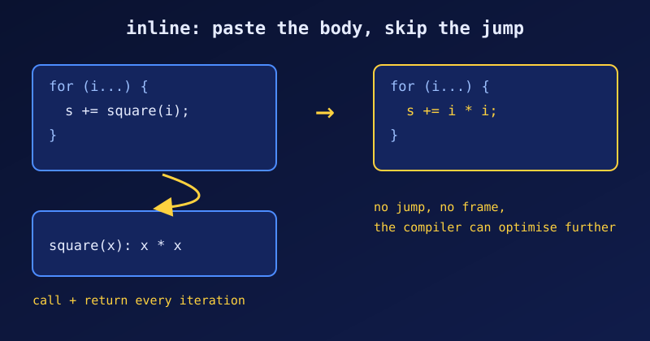

{fig-alt="Two boxes: a loop calling square(i) with an arrow to a separate function box, and the same loop with i * i written in place."}

An **inline function** asks the compiler to insert the function's body at each call site instead of emitting a jump to a separate piece of code. For tiny functions, the call itself (setting up arguments, jumping, returning) can cost more than the work done inside.

::: {.callout-note}
`inline` is a *hint*, not a command. The compiler may inline a function without the keyword, or ignore the keyword. The examples below were compiled with GCC 11.4 on Linux; timings will differ on other machines.
:::

## Five functions that suit `inline`

Each is small, called often, and has no loop or recursion of its own. We write them as `static inline` (the reason is in the last section).

```c
static inline int square(int x) { return x * x; }

static inline int max(int a, int b) { return (a > b) ? a : b; }

static inline int add(int a, int b) { return a + b; }

static inline void swap(int *m, int *n) {   // called thousands of times in a sort
    int tmp = *m;
    *m = *n;
    *n = tmp;
}

static inline int get_raw_value(const int *ptr) { return *ptr; }   // tiny accessor
```

## What goes wrong when we leave `inline` out

### 1. A tiny function in a hot loop

We call the same one-line function 100 million times, once through a normal call and once inlined. To make the comparison fair, `__attribute__((noinline))` (a GCC/Clang extension) stops the compiler from quietly inlining the first one for us. The timing uses `clock()`; see [Timing C Code with clock()](c-clock-benchmarking.qmd) for how it works and how to avoid misleading numbers.

```c
#include <stdio.h>
#include <time.h>   // clock() and CLOCKS_PER_SEC, explained in the clock() post

#define N 100000000

__attribute__((noinline)) int add_call(int a, int b) { return a + b; }
static inline int add_inline(int a, int b) { return a + b; }

int main(void) {
    clock_t t0 = clock();
    long s1 = 0;
    for (int i = 0; i < N; i++) s1 = add_call(s1, i);
    clock_t t1 = clock();
    long s2 = 0;
    for (int i = 0; i < N; i++) s2 = add_inline(s2, i);
    clock_t t2 = clock();
    printf("call   : sum=%ld  %.3f s\n", s1, (double)(t1 - t0) / CLOCKS_PER_SEC);
    printf("inline : sum=%ld  %.3f s\n", s2, (double)(t2 - t1) / CLOCKS_PER_SEC);
    return 0;
}
```

```
$ gcc -O2 inline_bench.c -o inline_bench && ./inline_bench
call   : sum=887459712  0.168 s
inline : sum=887459712  0.067 s
```

Same answer, about 2.5 times faster inlined. The loop body is so small that the call overhead dominates.

### 2. A function applied to an array

Inlining also lets the compiler optimise *across* the call, for example by processing several array elements at once. Here `sq_call` is kept as a real call and `sq_inline` is not:

```c
__attribute__((noinline)) int sq_call(int x) { return x * x + 1; }
static inline int sq_inline(int x) { return x * x + 1; }

// ... for each of 20 passes over 10 million ints:
//     b[i] = sq_call(a[i]);     versus     b[i] = sq_inline(a[i]);
```

```
call   : 0.368 s
inline : 0.174 s
```

The real call also blocks the compiler from combining the iterations, so it pays the call cost every time.

### 3. The function lives in another file

Without link-time optimisation, the compiler compiling `main.c` cannot see the body of a function defined in `add.c`. It has no choice but to emit a call, however small the function is. Putting a `static inline` version in the header fixes that.

```c
/* add.h */
int add(int a, int b);                      /* defined in add.c */
static inline int add_inl(int a, int b) { return a + b; }

/* main.c */
for (int i = 0; i < 1000; i++) s = add(s, i);       /* call into add.c */
for (int i = 0; i < 1000; i++) s = add_inl(s, i);   /* body inlined */
```

Compile with `gcc -O2 -S main.c -o -` and look at the assembly: there is one `call add@PLT` for the first loop and no call at all for `add_inl`.

### 4. Don't judge by an unoptimised build

At `-O0`, GCC ignores `inline`. The same benchmark as in example 1:

```
$ gcc -O0 inline_bench.c -o inline_bench && ./inline_bench
call   : sum=887459712  0.389 s
inline : sum=887459712  0.379 s
```

No difference. Always compare with `-O2`.

### The counter-case: not every function needs the keyword

Within one file, at `-O2`, GCC inlines a small function such as `add` on its own (the assembly for `printf("%d", add(2, 3))` contains no `call add`). The `inline` keyword matters most for functions in headers, and it should not be added to large functions, because every call site gets its own copy of the body and the executable grows.

## Why `static inline` in headers

In C99 and later, a plain `inline` function in a header does not provide an external definition. Unless one `.c` file also contains an `extern inline` declaration, the linker can fail when the compiler chooses not to inline:

```c
/* h2.h */
inline int twice(int x) { return 2 * x; }
```

```
$ gcc -O0 m2.c -o m2
/usr/bin/ld: in function `main': undefined reference to `twice'
```

(`gcc -O2 m2.c` happens to work, since the call is inlined, which is exactly why this bug hides until someone builds without optimisation.) Writing `static inline` gives each file its own private copy, so the header works at every optimisation level and never causes "multiple definition" errors.

## Rule of thumb

- `static inline` for tiny, hot functions, especially in headers.
- Leave it off big functions and anything called rarely.
- Measure with `-O2` before believing any speed claim, ours included.
