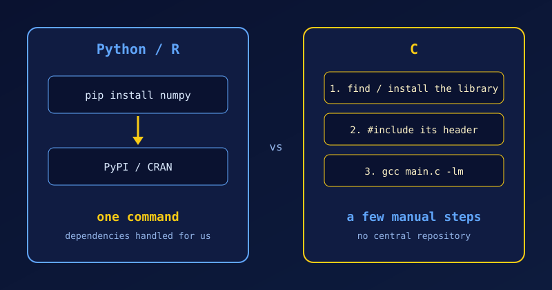

{fig-alt="Two panels: Python and R install a package with one command from PyPI or CRAN; C needs three manual steps: find the library, include its header, link it with a gcc flag."}

A library is a collection of ready-made code that we can reuse instead of writing it ourselves. It might compute square roots, sort data, read a file format, draw a window or talk to a database. We call its functions from our program, and the work is done by code that someone else has already written, tested and optimised.

In C, a library comes in two parts: a **header file** that declares what the library offers, and the **compiled code** that does the work. We have already used one without noticing: `printf()` and `scanf()` come from the standard C library, which the compiler links automatically.

Getting hold of other libraries is where C differs from Python and R. In Python, `pip install numpy` is all it takes. In R, it is `install.packages("ggplot2")`. Both fetch a ready-made package from a central repository (PyPI or CRAN). C has no such thing. There are thousands of specialised C libraries, but instead of downloading a package that "just works", we find the library, tell the compiler where its header is, and link it ourselves.

## How the Ecosystems Differ

| Feature | Python and R | C |
|---|---|---|
| Package manager | Built in and central (`pip`, `install.packages()`) | No official one. We use system managers (`apt`, `brew`) or newer tools such as vcpkg and Conan. |
| Typical focus | Data science, machine learning, web scripting, automation | Systems programming, embedded devices, operating-system kernels, graphics engines |
| Ease of integration | One command; dependencies resolved automatically | Compile from source or link binaries (`-l` flags) and set header paths |

## What Using a Library Looks Like in C

Using a library takes two steps: `#include` its header so the compiler knows the function declarations, and **link** the compiled code so it ends up in the final program. The standard library is linked for us, but some libraries, such as the maths library, are not. Let's try `pow()` from `<math.h>`:

```c
#include <stdio.h>
#include <math.h>

int main(void)
{
    double x;
    printf("Enter a number: ");
    scanf("%lf", &x);
    printf("pow(%.1f, 0.5) = %.4f\n", x, pow(x, 0.5));
    return 0;
}
```

If we compile without the library, the link step fails:

```default
$ gcc m.c -o m
/usr/bin/ld: /tmp/ccb1hHRk.o: in function `main':
m.c:(.text+0x60): undefined reference to `pow'
collect2: error: ld returned 1 exit status
```

Adding `-lm` (library *m*) fixes it:

```default
$ gcc m.c -o m -lm
$ ./m
Enter a number: 16
pow(16.0, 0.5) = 4.0000
```

Third-party libraries follow the same pattern, usually with `-I<dir>` for headers and `-L<dir> -l<name>` for the library. Many also support `pkg-config`, which prints the right flags for us, for example `gcc main.c $(pkg-config --cflags --libs sqlite3)`.

## The Irony: C Powers Python and R

C has no single repository of easy-to-use libraries, yet many of the most powerful Python and R libraries are written in C or C++. NumPy, Pandas and TensorFlow present a Python interface, but they run their performance-critical computations in optimised C/C++ backends. When we use them, we are using C indirectly.

## Popular C Libraries by Domain

When we do need a library in C, these are good places to start:

- **Maths and science:** GNU Scientific Library (GSL) for statistical algorithms; BLAS and LAPACK for high-performance linear algebra.
- **Data and utilities:** GLib provides data structures such as hash tables and linked lists, which the standard library lacks.
- **Graphics and games:** Raylib and SDL for rendering, windowing and games.
- **Databases:** SQLite for local data storage.

::: {.callout-note}
Before reaching for a third-party library, let's check what the standard library and POSIX already provide. See [POSIX Explained](POSIX-explained.qmd) for what a POSIX system guarantees.
:::

## References

1. [C Bootcamp: Libraries](https://gribblelab.org/teaching/CBootCamp/A1_Libraries.html)
2. [Python vs C language](https://www.aimoretechnologies.com/python-vs-c-language/)
3. [C vs Python: choosing the right programming language](https://medium.com/@kashanhaider3241/c-vs-python-choosing-the-right-programming-language-bd9fb6b4ee74)
4. [How NumPy's C library actually works](https://www.reddit.com/r/C_Programming/comments/1lxd529/how_numpys_c_library_actually_works/), r/C_Programming
