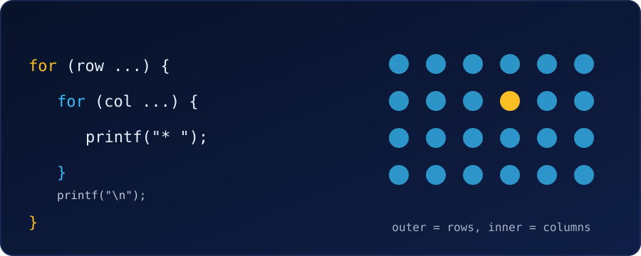

{fig-alt="An outer for loop over rows containing an inner for loop over columns, beside a grid of dots with one dot highlighted."}

Five problems on **nested loops** (a loop inside a loop), from easy to medium. Try each one on paper or in your editor first. If we get stuck, open **See hint** for the steps, and press **Reveal code** to compare with a tested solution.

Every solution was compiled with `gcc -Wall -Wextra` and run; the outputs shown are real. For single-loop practice first, see [5 for loop practice problems](c-5-for-loop-practice-problems-with-answers.qmd).

::: {.callout-note}
**The grid recipe.** For every pass of the **outer** loop, the **inner** loop runs from start to finish. So an outer loop over rows and an inner loop over columns visits every cell. Print the newline **after** the inner loop, once per row:

```c
for (int row = 1; row <= R; row++) {
    for (int col = 1; col <= C; col++) {
        // print one cell
    }
    printf("\n");
}
```
:::

---

### Problem 1 (Easy): Rectangle of Stars

Print a rectangle of stars with 3 rows and 5 columns, using nested `for` loops. Put a space after each star.

Expected output:
```
* * * * * 
* * * * * 
* * * * * 
```

::: {.reveal-code}
::: {.hint}
- The outer loop counts rows: 3 passes.
- The inner loop counts columns: 5 passes, each printing `"* "`.
- Print `"\n"` after the inner loop, not inside it, or every star lands on its own line.
:::

```c
#include <stdio.h>

int main(void) {
    for (int row = 1; row <= 3; row++) {        // 3 rows
        for (int col = 1; col <= 5; col++) {    // 5 stars per row
            printf("* ");
        }
        printf("\n");                           // end the row
    }
    return 0;
}
```
:::

**Try next:** let the user enter the number of rows and columns.

---

### Problem 2 (Easy): Multiplication Grid

Print a 5 × 5 multiplication grid: the cell in row `i`, column `j` holds `i * j`. Align the columns.

Expected output:
```
   1   2   3   4   5
   2   4   6   8  10
   3   6   9  12  15
   4   8  12  16  20
   5  10  15  20  25
```

::: {.reveal-code}
::: {.hint}
- Outer loop: `i` from 1 to 5. Inner loop: `j` from 1 to 5.
- Print `i * j` for each cell.
- Use `%4d` instead of `%d`, which pads every number to 4 characters so the columns line up.
- End each row with `"\n"` after the inner loop.
:::

```c
#include <stdio.h>

int main(void) {
    for (int i = 1; i <= 5; i++) {
        for (int j = 1; j <= 5; j++) {
            printf("%4d", i * j);
        }
        printf("\n");
    }
    return 0;
}
```
:::

**Try next:** make the grid 9 × 9 (what width do we need now?).

---

### Problem 3 (Easy-Medium): Number Triangle

Print a triangle of numbers where row `r` holds the numbers 1 to `r`, with 5 rows.

Expected output:
```
1 
1 2 
1 2 3 
1 2 3 4 
1 2 3 4 5 
```

::: {.reveal-code}
::: {.hint}
- Outer loop: `row` from 1 to 5.
- Row 1 has one number, row 2 has two, and so on, so the inner loop must stop at `row`: `col <= row`.
- Print `col` followed by a space.
:::

```c
#include <stdio.h>

int main(void) {
    for (int row = 1; row <= 5; row++) {
        for (int col = 1; col <= row; col++) {
            printf("%d ", col);
        }
        printf("\n");
    }
    return 0;
}
```
:::

The inner loop's limit depends on the outer loop's variable. That one detail turns a rectangle into a triangle. Print `row` instead of `col` and each line repeats its own row number (1, 22, 333, ...).

**Try next:** print the triangle upside down (5 numbers first, then 4, ...).

---

### Problem 4 (Medium): Centred Pyramid

Print a pyramid of stars with 5 rows, centred: row 1 has 1 star, row 2 has 3, row 3 has 5, and so on.

Expected output:
```
    *
   ***
  *****
 *******
*********
```

::: {.reveal-code}
::: {.hint}
- An outer loop can hold **two** inner loops, one after the other.
- First inner loop: print spaces. Row 1 needs 4, row 2 needs 3, ..., so `h - row` spaces.
- Second inner loop: print stars. Rows need 1, 3, 5, ..., so `2 * row - 1` stars.
- Then print `"\n"`.
:::

```c
#include <stdio.h>

int main(void) {
    int h = 5;
    for (int row = 1; row <= h; row++) {
        for (int s = 1; s <= h - row; s++) {        // leading spaces
            printf(" ");
        }
        for (int k = 1; k <= 2 * row - 1; k++) {    // stars: 1, 3, 5, ...
            printf("*");
        }
        printf("\n");
    }
    return 0;
}
```
:::

Change `h` to change the size; the formulas still work.

**Try next:** print a diamond (this pyramid followed by an upside-down one).

---

### Problem 5 (Medium): Checkerboard

Print a 6 × 6 checkerboard where `#` and `.` alternate in both directions, starting with `#` in the top-left corner.

Expected output:
```
# . # . # . 
. # . # . # 
# . # . # . 
. # . # . # 
# . # . # . 
. # . # . # 
```

::: {.reveal-code}
::: {.hint}
- Loop `row` and `col` from 0 to 5.
- Look at the corners: `#` appears where `row + col` is even, `.` where it is odd.
- Test it with `(row + col) % 2 == 0` and use `if`/`else` to choose what to print.
:::

```c
#include <stdio.h>

int main(void) {
    for (int row = 0; row < 6; row++) {
        for (int col = 0; col < 6; col++) {
            if ((row + col) % 2 == 0) {
                printf("# ");
            } else {
                printf(". ");
            }
        }
        printf("\n");
    }
    return 0;
}
```
:::

Whenever a pattern depends on a cell's position, the trick is to find a formula in `row` and `col`.

**Try next:** print a border: `#` on the edges of an 8 × 8 square and spaces inside.

---

::: {.callout-tip}
**Debugging tip.** If a pattern comes out wrong, check three things in order: (1) is the `\n` in the right loop, (2) is each inner loop's limit what we intended (`5`, `row`, `h - row`), and (3) do the loops start at the value (0 or 1) our formula assumes?
:::

### What These Problems Practise

| Problem | Pattern |
| :--- | :--- |
| 1. Rectangle | Outer = rows, inner = columns, newline after the inner loop |
| 2. Multiplication grid | Using both loop variables in a calculation |
| 3. Number triangle | Inner limit depends on the outer variable |
| 4. Pyramid | Two inner loops in one outer loop |
| 5. Checkerboard | A formula in `row` and `col` plus an `if` |
