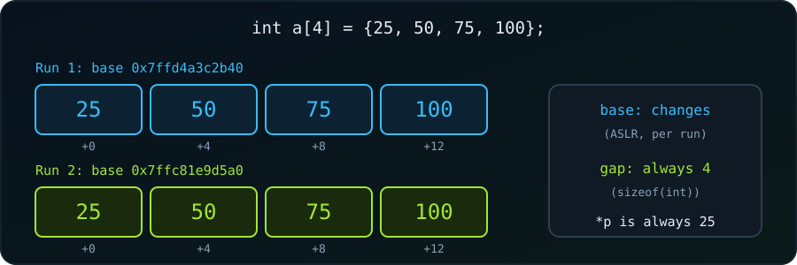

{fig-alt="Two runs of the same program place an int array of four elements at different base addresses, but neighbouring elements are 4 bytes apart in both."}

Take this loop, which prints the address of every element of an array:

```c
int myNumbers[4] = {25, 50, 75, 100};
int i;

for (i = 0; i < 4; i++) {
  printf("%p\n", &myNumbers[i]);
}
```

Will it always print the same output? Can the addresses change with the operating system or the device? And if they do change, how can pointers be reliable at all? Let's answer both questions.

## Short answer

**The spacing between the addresses is always the same. The actual numbers almost always change.**

Within one run, we see something like:

```
0x7ffd4a3c2b40
0x7ffd4a3c2b44
0x7ffd4a3c2b48
0x7ffd4a3c2b4c
```

Each address is exactly **4 bytes** after the previous one, because `sizeof(int)` is 4 here. C guarantees that array elements are contiguous. The *starting* address, however, will differ almost every time we run the program.

## What is guaranteed and what changes

| Property | Guaranteed? | Why |
|---|---|---|
| `&myNumbers[i+1] - &myNumbers[i] == 1` | ✅ Always | Pointer arithmetic on `int *` counts elements |
| Neighbours are `sizeof(int)` bytes apart | ✅ Always | Arrays are contiguous in memory |
| The **absolute** value such as `0x7ffd...` | ❌ Almost never | Depends on the OS, ASLR and the stack state |
| Same address across runs | ❌ No | ASLR randomizes the stack each run |
| Same address on a different device | ❌ No | Different OS, architecture and stack layout |

## Why the starting address changes

**ASLR (Address Space Layout Randomization)** is a security feature of modern operating systems. Each time a program starts, the OS places the stack at a random base address, so a local array such as `myNumbers` lands in a different spot. Running the same binary three times can give:

```
Run 1: 0x7ffd4a3c2b40
Run 2: 0x7ffc81e9d5a0
Run 3: 0x7ffd9f27c3e0
```

This makes it harder for attackers to predict where things live. The offset pattern (`+0, +4, +8, +12`) never changes; only the base moves.

Other things can shift the address too:

- **OS and compiler:** stack alignment, the `main` prologue and variable ordering differ.
- **Architecture:** a 32-bit build prints 8 hex digits, a 64-bit build prints up to 12 or more.
- **Compiler flags:** `-O0` and `-O2` may reorder local variables.
- **Other variables:** adding another local variable shifts the neighbours.

## See it yourself

```c
#include <stdio.h>

int main(void) {
    int a[4] = {25, 50, 75, 100};
    int *p = a;                              // p holds the CURRENT address

    for (int i = 0; i < 4; i++)
        printf("%p\n", (void *)&a[i]);

    printf("gap    : %td bytes\n", (char *)&a[1] - (char *)&a[0]);
    printf("value  : %d\n", *p);
    printf("value  : %d\n", *(p + 2));

    int *q = &a[3];
    printf("offset : %td\n", q - p);
    return 0;
}
```

One run on Linux gave:

```
0x7ffd710965e0
0x7ffd710965e4
0x7ffd710965e8
0x7ffd710965ec
gap    : 4 bytes
value  : 25
value  : 75
offset : 3
```

Run it a few times: the four addresses change, while `gap`, `value` and `offset` stay identical.

To switch ASLR off for one run on Linux:

```
setarch $(uname -m) -R ./a.out
```

Now the same address prints every time, which shows the shifting was ASLR and not our code.

::: {.callout-note}
`%p` expects a `void *`, so the strictly correct call is `printf("%p\n", (void *)&a[i]);`. Most compilers accept the version without the cast, but the cast is proper C. Likewise, print `sizeof` values with `%zu`.
:::

## So how can pointers be reliable?

A pointer stores the address **as it is right now**, not a fixed number. The address of an object is decided when the program runs, and then it does not change for the lifetime of that object:

- ASLR picks the base address at startup.
- `&a[0]` evaluates to whatever that base turned out to be.
- The pointer stores that value.
- `*p` reads from that exact address, which is where the array really is.

The pointer and the object always agree, because the pointer was computed from the object at runtime. Reliability comes not from the number being constant, but from the pointer and the object sharing the same current address.

> **Analogy:** we don't need to know a friend's address in advance. We ask "where do you live?" and get the current one. Hardcoding an old address and hoping nobody moved is what fails.

| Question | Answer |
|---|---|
| Does `&a[0]` change while the program runs? | ❌ No, an object's address is fixed for its lifetime |
| Does `p = &a[0]; *p` read the right value? | ✅ Always, within that run |
| Is `&a[3] - &a[0]` always 3? | ✅ Always, offsets are stable even if the base moves |
| Does the number `0x7ffd...` survive to the next run? | ❌ No, ASLR changes it |

## What really makes pointers unreliable

ASLR is not the danger. These are:

1. **Hardcoding addresses:** `int *p = (int *)0x7ffd4a3c2b40;` breaks on the next run.
2. **Dangling pointers:** using a pointer after the object is freed, or after the function that owned a local variable returned.
3. **Saving pointers to disk or sending them to another process:** the address means nothing there.
4. **Out-of-bounds arithmetic:** `a[10]` on a four-element array points somewhere valid-looking but wrong.
5. **Comparing addresses across runs:** the numbers differ, so `==` fails.

None of these involves ASLR itself. They all use a pointer outside the object's valid lifetime, or treat an address as portable when it is not.

## Why pointers are still the right tool

- **Computed, not memorized.** `&x` asks the system where `x` is, and the answer is always current.
- **Type-aware.** `int *p` tells the compiler to read 4 bytes as an `int`, whatever the numeric address.
- **Relative math is stable.** `p + 1` means the next `int`, that is `address + sizeof(int)`, independent of the base.

## Conclusion

Array addresses change between runs, devices and builds, because ASLR and the platform choose where the stack goes. What never changes is the *layout*: elements are contiguous and `sizeof(T)` apart, and a pointer always holds the actual current address of its object. So:

> **Never rely on a specific address value; rely on the relationships.** Take the address with `&`, use it while the object is alive, and it is always correct. The address only looks unpredictable *between* runs, which is exactly when we should not be reusing the old number.
