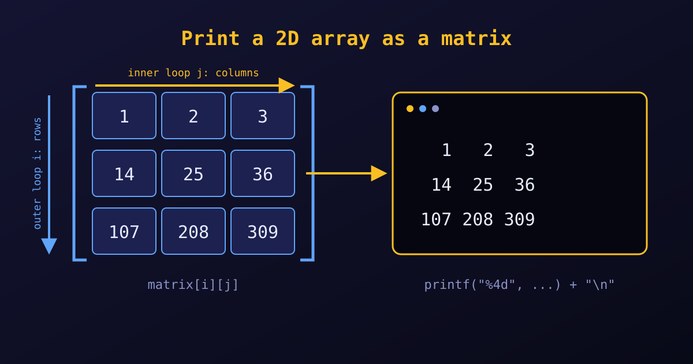

{fig-alt="A 3 by 3 grid holding 1, 2, 3, 14, 25, 36 and 107, 208, 309. An arrow across the top marks the inner loop over columns, an arrow down the side marks the outer loop over rows, and a terminal on the right shows the same numbers in aligned rows."}

To print a 2D array as a matrix, we use **nested `for` loops**. The outer loop moves from row to row. The inner loop prints every element of the current row. Right after the inner loop finishes, we print a newline (`\n`) so the next row starts on a new line.

## A complete example

```c
#include <stdio.h>

int main() {
    int rows = 3;
    int cols = 3;

    // 1. Initialise a 2D array
    int matrix[3][3] = {
        {1, 2, 3},
        {14, 25, 36},
        {107, 208, 309}
    };

    printf("The matrix is:\n");

    // 2. Nested loops: rows outside, columns inside
    for (int i = 0; i < rows; i++) {
        for (int j = 0; j < cols; j++) {
            printf("%4d", matrix[i][j]);   // width 4 keeps the columns aligned
        }
        printf("\n");                      // end the row
    }

    return 0;
}
```

Output:

```text
The matrix is:
   1   2   3
  14  25  36
 107 208 309
```

## Key formatting tricks

- **Put `printf("\n")` after the inner loop but inside the outer loop.** If it is missing, the whole matrix prints as one long line of numbers. If it is inside the inner loop, every number lands on its own line.
- **Use a width specifier such as `%4d`.** It reserves at least four characters for each integer, so numbers with one, two or three digits still line up in vertical columns. Choose a width one larger than the longest number, so there is always a gap between columns.
- **A tab is the alternative.** Instead of `%4d`, we can print `printf("%d\t", matrix[i][j]);`. This gives:

  ```text
  1	2	3
  14	25	36
  107	208	309
  ```

  Tabs are quick, but how wide they look depends on the terminal, and they can drift out of line when the numbers have different lengths. A width specifier gives the same result everywhere.

::: {.callout-tip}
Use `%-4d` to left-align each number inside its column, or `%6.2f` for floating-point matrices (width 6, two decimals).
:::

## Summary

| Task | How |
|:--|:--|
| Visit every element | outer loop over `i` (rows), inner loop over `j` (columns) |
| Start a new row | `printf("\n");` after the inner loop |
| Align the columns | a width in the format, such as `%4d` |
