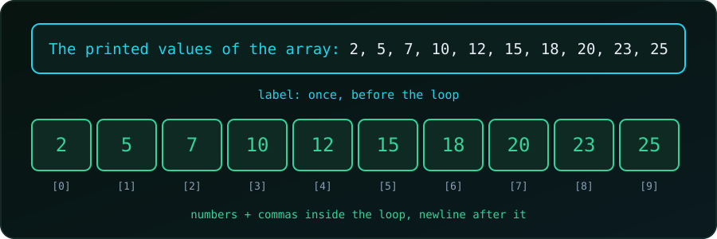

{fig-alt="A printf label printed once, above ten array cells holding 2, 5, 7, 10, 12, 15, 18, 20, 23 and 25 separated by commas."}

We have an array and want one tidy line of output:

```
The printed values of the array: 2, 5, 7, 10, 12, 15, 18, 20, 23, 25
```

Our first attempt puts the whole message inside the loop:

```c
#include <stdio.h>

int main(void) {
    int FixedArr[10] = {2, 5, 7, 10, 12, 15, 18, 20, 23, 25};

    for (int val = 0; val < 10; val++) {
        printf("The printed values of the array: %d, ", FixedArr[val]);
    }
    return 0;
}
```

Output:

```
The printed values of the array: 2, The printed values of the array: 5, The printed values of the array: 7, ...
```

(Every program in this post was compiled with `gcc -Wall -Wextra` and run; the outputs are real.)

## Why the label repeats

The body of a loop runs once per element, and `printf` prints its whole format string every time. The label is part of that string, so it is printed ten times. We want it **once**.

> **Anything that should appear once goes outside the loop.** The loop body should print only what repeats for each element.

So the label goes **before** the loop, the numbers and separators go **inside**, and the final newline goes **after**.

## Fix 1: Label before the loop

```c
printf("The printed values of the array: ");
for (int val = 0; val < 10; val++) {
    printf("%d, ", FixedArr[val]);
}
printf("\n");
```

```
The printed values of the array: 2, 5, 7, 10, 12, 15, 18, 20, 23, 25,
```

This is the label problem solved, but the line still ends with a **trailing comma and space**. For quick debugging that is fine. For output people read or programs parse, we want the comma only **between** numbers.

## Removing the trailing comma

The idea is the same in each fix: print the separator *before* every element except the first, or *after* every element except the last.

### Fix 2: A `first` flag

```c
printf("The printed values of the array: ");
int first = 1;
for (int val = 0; val < 10; val++) {
    if (!first) printf(", ");
    printf("%d", FixedArr[val]);
    first = 0;
}
printf("\n");
```

```
The printed values of the array: 2, 5, 7, 10, 12, 15, 18, 20, 23, 25
```

The flag is `1` only for the first element, so the first number gets no comma before it. It makes no assumption about the array size or about which values are printed, which makes it the most robust choice.

### Fix 3: Choose the separator with `?:`

```c
printf("The printed values of the array: ");
for (int val = 0; val < 10; val++) {
    printf("%d%s", FixedArr[val], val < 9 ? ", " : "");
}
printf("\n");
```

Same output, no extra variable. `%s` prints `", "` after every element except the last one (index 9), where it prints an empty string. The catch is that the number `9` is hard-coded, so we must change it whenever the size changes. Better to use a size variable:

```c
int n = 10;
for (int val = 0; val < n; val++) {
    printf("%d%s", FixedArr[val], val < n - 1 ? ", " : "");
}
```

### Fix 4: A leading separator

```c
printf("The printed values of the array:");
for (int val = 0; val < n; val++) {
    printf("%s%d", val ? ", " : " ", FixedArr[val]);
}
printf("\n");
```

Here the label has no trailing space. For the first element (`val` is `0`, which counts as false) `?:` prints a single space; for every other element it prints `", "`. This is the shortest clean form, but it is also the hardest to read at a glance.

### Fix 5: An `if` after the number

```c
printf("The printed values of the array: ");
for (int val = 0; val < n; val++) {
    printf("%d", FixedArr[val]);
    if (val < n - 1) printf(", ");
}
printf("\n");
```

Same output again, and probably the easiest version to read: print the number, then add a comma unless it was the last one.

All of Fixes 2 to 5 print exactly:

```
The printed values of the array: 2, 5, 7, 10, 12, 15, 18, 20, 23, 25
```

## Use the array size, not `10`

In the examples above we wrote `val < 10` to match the array. If the array later grows, every `10` must be found and changed. Let C compute the count:

```c
int n = sizeof FixedArr / sizeof FixedArr[0];   // 10
```

`sizeof FixedArr` is the array's size in bytes and `sizeof FixedArr[0]` is the size of one `int`, so the division gives the number of elements. This works only where `FixedArr` is a real array. Inside a function that receives the array as a parameter, it is a pointer and this trick gives the wrong answer, so pass the length as a separate argument.

::: {.callout-warning}
**Do not loop past the end.** An array of 10 elements has valid indices 0 to 9. With `val <= 10` the last iteration reads `FixedArr[10]`, which does not exist. If the array is only partly filled, loop up to the number of elements we actually set, as explained in [Why an Uninitialized C Array Prints Garbage](c-uninitialized-array.qmd).
:::

## Which one to use

| Situation | Use |
| :--- | :--- |
| Quick debug output, trailing comma is fine | Fix 1 |
| Clean output, easiest to read | Fix 5 |
| Clean output, any size or skipped items | Fix 2 (`first` flag) |
| Short one-liner, size known | Fix 3 or 4 |

## Summary

- A loop body runs once per element, so a label inside it is printed once per element.
- Print the label before the loop, the elements inside it, and the newline after it.
- To avoid a trailing comma, print the separator between elements: with a `first` flag, a `?:`, or an `if` on the last index.
- Compute the element count with `sizeof arr / sizeof arr[0]` instead of hard-coding it.

For the same idea with numbers produced by a loop, and with rows in nested loops, see [Printing a Comma-Separated List in C](c-print-comma-separated-list.qmd). To fill an array from a loop first, see [How to Save Loop Results in an Array in C](c-save-loop-in-array.qmd).
