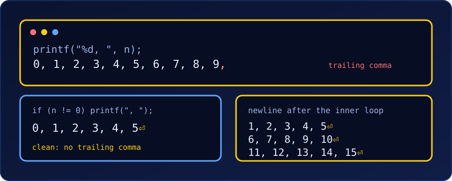

{fig-alt="Terminal output showing a list that ends with a stray comma, a clean list without it, and a three-row grid of numbers with a newline after each row."}

A common beginner question: this loop prints the numbers 0 to 19 except 10, but all stuck together. How do we get `0, 1, 2, ...`?

```c
#include <stdio.h>

int main(void) {
    for (int numb = 0; numb < 20; numb++) {
        if (numb == 10) continue;
        printf("%d", numb);
    }
    printf("\n");
    return 0;
}
```

Output:

```
0123456789111213141516171819
```

`printf("%d", numb)` prints only the digits; nothing tells C to add a space. Whatever we want between the numbers, we must print ourselves. (Every program below was compiled with `gcc -Wall -Wextra` and run; the outputs are real.)

## Step 1: Put the Comma and Space in the Format String

```c
printf("%d, ", numb);
```

Output:

```
0, 1, 2, 3, 4, 5, 6, 7, 8, 9, 11, 12, 13, 14, 15, 16, 17, 18, 19, 
```

It works, but the line ends with a **trailing comma and space**. For quick debugging that is harmless. For output a person will read or a program will parse, we want the separator **between** items only.

## Step 2: Remove the Trailing Comma

The idea in all three fixes is the same: print the separator *before* each item, except the first (or *after* each item, except the last).

### Option 1: separator before every number except the first

```c
for (int numb = 0; numb < 20; numb++) {
    if (numb == 10) continue;
    if (numb != 0) printf(", ");
    printf("%d", numb);
}
printf("\n");
```

```
0, 1, 2, 3, 4, 5, 6, 7, 8, 9, 11, 12, 13, 14, 15, 16, 17, 18, 19
```

This works only because `0` happens to be the first value printed. If we started at 1, or skipped 0, the test `numb != 0` would be wrong.

### Option 2: a `first` flag (always correct)

```c
int first = 1;
for (int numb = 0; numb < 20; numb++) {
    if (numb == 10) continue;
    if (!first) printf(", ");
    printf("%d", numb);
    first = 0;
}
printf("\n");
```

Same output, and it is right whatever the first printed value is or which values we skip.

### Option 3: choose the separator with `?:`

```c
for (int numb = 0; numb < 20; numb++) {
    if (numb == 10) continue;
    printf("%d%s", numb, numb < 19 ? ", " : "\n");
}
```

The `%s` prints `", "` after every number except the last, where it prints the newline instead. It is the shortest, but it needs to know which value is last. If we skipped 19 with `continue`, the previous number would be the last printed and would still get a trailing `", "`. Use Option 2 when the last item can change.

::: {.callout-note}
**Which one?** Option 3 when the last item is known and fixed (a plain `0..n-1` loop), Option 2 when items are skipped or the range can change, and Step 1 when the trailing comma doesn't matter.
:::

## Line Breaks with `\n` in Nested Loops

`\n` is the "new line" character. In a single loop we print it once, after the loop. With **nested loops** (one loop inside another, as in the [nested for loop practice problems](c-nested-for-loop-practice-problems.qmd)), the question becomes *which loop* prints it. The rule:

> The inner loop prints one **row**; the `\n` goes **after** the inner loop, so it runs once per row.

### Example 1: a grid of comma-separated numbers

```c
for (int row = 1; row <= 3; row++) {
    for (int col = 1; col <= 5; col++) {
        if (col > 1) printf(", ");          // separator before every item but the first
        printf("%d", (row - 1) * 5 + col);
    }
    printf("\n");                           // once per row, after the inner loop
}
```

```
1, 2, 3, 4, 5
6, 7, 8, 9, 10
11, 12, 13, 14, 15
```

The comma test (`col > 1`) restarts for every row, because `col` starts again at 1. No row ends with a comma.

### Example 2: the classic mistake, `\n` inside the inner loop

```c
for (int row = 1; row <= 3; row++) {
    for (int col = 1; col <= 5; col++) {
        printf("%d, ", (row - 1) * 5 + col);
        printf("\n");                       // wrong place
    }
}
```

```
1, 
2, 
3, 
4, 
5, 
6, 
...
```

Now every number lands on its own line (15 lines instead of 3), because the newline runs once per **cell**, not once per row. Move it out of the inner loop.

### Example 3: Option 3 inside a triangle

The last item of each row is the one where `col == row`, so the `?:` trick can print the comma or the newline:

```c
for (int row = 1; row <= 5; row++) {
    for (int col = 1; col <= row; col++) {
        printf("%d%s", col, col < row ? ", " : "\n");
    }
}
```

```
1
1, 2
1, 2, 3
1, 2, 3, 4
1, 2, 3, 4, 5
```

There is no separate `printf("\n")` here: the separator choice does both jobs, comma inside a row and newline at its end.

### Example 4: aligned columns

For a table, pad each number to a fixed width with `%2d` (the same idea as `%4d` in the multiplication grid problem):

```c
for (int i = 1; i <= 4; i++) {
    for (int j = 1; j <= 4; j++) {
        printf("%2d%s", i * j, j < 4 ? ", " : "\n");
    }
}
```

```
 1,  2,  3,  4
 2,  4,  6,  8
 3,  6,  9, 12
 4,  8, 12, 16
```

::: {.callout-tip}
**Checklist when the layout looks wrong.** (1) Which loop prints the `\n`? It belongs after the inner loop. (2) Is the separator printed between items, not after the last? (3) Does the test for "first item" or "last item" use a variable that restarts with each row?
:::

## Summary

| Goal | Code |
| :--- | :--- |
| Numbers with separators | `printf("%d, ", x);` |
| No trailing comma, first item known | `if (i != first) printf(", ");` |
| No trailing comma, always correct | a `first` flag |
| Separator or newline in one call | `printf("%d%s", x, last ? "\n" : ", ");` |
| One row per line in nested loops | `printf("\n");` after the inner loop |
