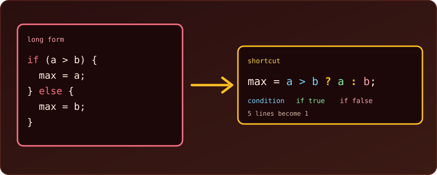

{fig-alt="A five-line if-else block assigning the larger of a and b to max, with an arrow to the one-line version max = a > b ? a : b, with the condition, the true value and the false value labelled."}

A short `if` takes three lines, and an `if`-`else` that only chooses **a value** takes five. C has a few shortcuts for these small decisions. Every program below was compiled with `gcc -Wall -Wextra` and run; the outputs are real. For the long form, see [if-else examples in C](10-c-if-else-examples.qmd).

## 1. Start Simple: Drop the Braces

Here is a very common piece of code, inside a loop that should skip the number 4. The long form:

```c
if (i == 4) {
    continue;
}
```

The braces `{ }` are needed only to group **several** statements. When the body is a single statement, we can leave them out, and the whole `if` fits on one line:

```c
if (i == 4) continue;
```

Same meaning, two lines shorter. In a complete program:

```c
for (int i = 1; i <= 6; i++) {
    if (i == 4) continue;
    printf("%d ", i);
}
printf("\n");
```

```
1 2 3 5 6 
```

The number 4 is skipped. (Section 5 shows the one trap of this shortcut.)

## 2. The Ternary Operator `? :`

An `if`-`else` that only chooses **a value** can shrink too. The pattern is `condition ? value_if_true : value_if_false`. It is an **expression**: it produces a value we can assign, return or print. First, the long form:

```c
int a = 7, b = 12;
int max;
if (a > b) {
    max = a;
} else {
    max = b;
}
```

The shortcut:

```c
int max = a > b ? a : b;
```

Both give `12`. Read the shortcut aloud as "is `a` greater than `b`? then `a`, otherwise `b`". Together in a runnable program:

```c
#include <stdio.h>

int main(void) {
    int a = 7, b = 12;
    int max = a > b ? a : b;
    printf("%d\n", max);
    return 0;
}
```

```
12
```

### Example: choose a word inside `printf`

Because it is an expression, it fits inside a function call, which is where it is most useful:

```c
for (int n = 3; n <= 4; n++) {
    printf("%d is %s\n", n, n % 2 == 0 ? "even" : "odd");
}
int items = 1;
printf("%d item%s\n", items, items == 1 ? "" : "s");
items = 3;
printf("%d item%s\n", items, items == 1 ? "" : "s");
```

```
3 is odd
4 is even
1 item
3 items
```

The second pattern, adding an `s` only when the count is not 1, is a classic.

### Example: absolute value and clamping

```c
int n = -5, low = 0, high = 10, x = 15;
int abs_n = n < 0 ? -n : n;
int clamped = x < low ? low : (x > high ? high : x);
printf("abs = %d, clamped = %d\n", abs_n, clamped);
```

```
abs = 5, clamped = 10
```

The second line **nests** a ternary inside another: below `low` gives `low`, above `high` gives `high`, otherwise `x`. One level of nesting is fine; beyond that, write a normal `if`.

::: {.callout-warning}
**Keep it readable.** A chain such as `score >= 80 ? 'A' : score >= 60 ? 'B' : 'C'` works (it printed `A` for 85), but three or more levels are harder to read than the `if`/`else if` they replace. The ternary is a shortcut for a *simple* choice between two values. It is not a replacement for `if` when the branches *do* things (several statements, loops, `return`).
:::

## 3. Test a Value Directly

In C, **zero is false and any other value is true**. So we don't need to compare with 0:

```c
int count = 3, done = 0;
if (count)  printf("count is non-zero\n");   // same as count != 0
if (!done)  printf("not done yet\n");        // same as done == 0
```

```
count is non-zero
not done yet
```

`if (x)` means "x is not zero"; `if (!x)` means "x is zero". Use it for flags and counts; for a number where zero is a meaningful value (a score, a temperature), the explicit `!= 0` is clearer.

## 4. A Comparison Is a Number

A comparison gives `1` when true and `0` when false, so it can be stored or added:

```c
int year = 2100;
int leap = (year % 4 == 0 && year % 100 != 0) || year % 400 == 0;
printf("%d leap? %d\n", year, leap);

int a = 5, b = 3;
printf("a > b gives %d, a < b gives %d\n", a > b, a < b);

// counting with a condition: no if needed
int nums[] = {4, 9, 2, 7, 10, 3}, big = 0;
for (int i = 0; i < 6; i++) {
    big += nums[i] > 5;
}
printf("numbers above 5: %d\n", big);
```

```
2100 leap? 0
a > b gives 1, a < b gives 0
numbers above 5: 3
```

`big += nums[i] > 5;` adds 1 for every element above 5 and 0 otherwise, replacing `if (nums[i] > 5) big++;`. (2100 is not a leap year: divisible by 100 but not by 400.)

## 5. The Trap of Braces-Free `if`

The shortcut in section 1 works because the body is a **single statement**. The trap is adding a second one later. Only the first statement after the `if` belongs to it, whatever the indentation says:

```c
int n = -1;
if (n > 0)
    printf("one\n");
    printf("two (always printed!)\n");
```

```
two (always printed!)
```

`n` is not positive, yet the second `printf` runs, because it is not part of the `if`. With `-Wall`, gcc even warns: `this 'if' clause does not guard... [-Wmisleading-indentation]`. The fix is to keep the braces whenever the body might grow:

```c
if (n > 0) {
    printf("one\n");
    printf("two\n");
}
```

## 6. Lookup Instead of `if`/`else if`

When a number picks one of several fixed texts, an array beats a chain of `if`s:

```c
int month = 3;
const char *name[] = {"Jan", "Feb", "Mar", "Apr"};
printf("%s\n", name[month - 1]);
```

```
Mar
```

## Precedence and Type Pitfalls

```c
int x = 4;
int r = x % 2 == 0 ? 10 : 20;
int p = 1 + x > 3 ? 100 : 200;   // 1 + x is computed, then > 3, then ?:
printf("%d %d\n", r, p);
printf("%.1f\n", 5 > 3 ? 1.5 : 2);
```

```
10 100
1.5
```

- `?:` has **low precedence**: the whole condition is evaluated first. When in doubt, add parentheses around the condition, and around a ternary used inside a bigger expression.
- If the two values have different types (`1.5` and `2`), the result takes the common type (`double`). Use the matching format (`%.1f`, not `%d`).

## Summary

| Shortcut | Replaces | Use when |
| :--- | :--- | :--- |
| `x = c ? a : b;` | `if (c) x = a; else x = b;` | choosing one of two values |
| `printf("%s", c ? "yes" : "no");` | an `if` around two `printf`s | picking text inside output |
| `if (x)` / `if (!x)` | `x != 0` / `x == 0` | flags and counts |
| `count += cond;` | `if (cond) count++;` | counting matches |
| `if (c) stmt;` | `if (c) { stmt; }` | one short statement, no later additions |
| `name[i]` | a chain of `else if` | an index selects a fixed value |
