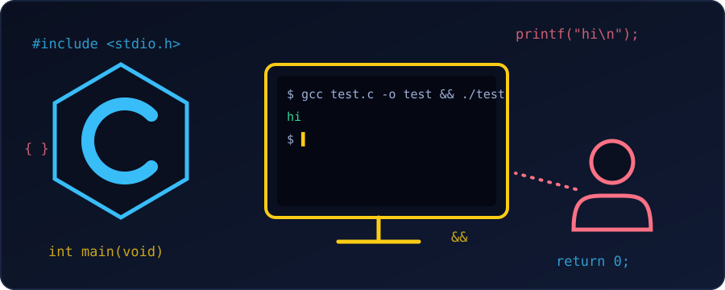

{fig-alt="A sketch of a person at a computer whose terminal runs gcc test.c and prints hi, beside a hexagonal C logo with scraps of C code floating around."}

Sometimes we only want to know whether a few lines of C work. Opening a full IDE for that is slow. Here are four quick ways, from no setup at all to a faster loop on our own machine.

### 1. Online compiler (no setup)

To check an algorithm or a syntax idea, an online sandbox is enough. We don't need to install anything.

- [OnlineGDB](https://www.onlinegdb.com/online_c_compiler): has a debugger with breakpoints.
- [Compiler Explorer (Godbolt)](https://godbolt.org/): shows the assembly that GCC or Clang generate from our code.
- [Replit](https://replit.com/): good for saving and sharing snippets.

### 2. One command in the terminal

If GCC or Clang is installed, we save the snippet as `test.c` and build and run it in one line:

```bash
gcc -Wall -Wextra test.c -o test && ./test
```

- `&&` runs `./test` **only if** the compilation succeeded.
- `-Wall -Wextra` turn on common warnings, so mistakes show up immediately. For example, `int x; return x;` gives `warning: 'x' is used uninitialized`.

We can even skip the file. `gcc -x c -` reads C code from standard input:

```bash
printf '#include <stdio.h>\nint main(void){printf("hi\\n");return 0;}\n' | gcc -x c - -o t && ./t
```

```
hi
```

### 3. Editor shortcuts

If we prefer an editor, a plugin can compile and run for us:

- **VS Code:** install the *Code Runner* extension, then press `Ctrl + Alt + N` (`Cmd + Option + N` on Mac) with the `.c` file open.
- **Sublime Text:** with a C build system, press `Ctrl + B` (`Cmd + B` on Mac).

### 4. Feed input from a file

If the program uses `scanf`, retyping the values on every run gets tedious. We put them in a file instead. Take this program:

```c
#include <stdio.h>

int main(void) {
    int a, b;
    scanf("%d %d", &a, &b);
    printf("%d + %d = %d\n", a, b, a + b);
    return 0;
}
```

Create `input.txt` containing `3 4`, then redirect it into the program with `<`:

```bash
./test < input.txt
```

```
3 + 4 = 7
```

::: {.callout-tip}
## Catch memory bugs too
Adding `-fsanitize=address,undefined -g` to the `gcc` command makes the program report out-of-bounds access and undefined behaviour while it runs. It is handy for short tests.
:::

### Summary

- Quick idea, no compiler: use an online sandbox.
- Compiler installed: `gcc -Wall -Wextra test.c -o test && ./test`.
- Repeated `scanf` input: `./test < input.txt`.

### References

- [Stack Overflow: how to test a C or C++ snippet quickly](https://stackoverflow.com/questions/6815383/how-to-test-c-or-c-snippet-quickly)
- [Quora: testing a C or C++ program without entering inputs manually](https://www.quora.com/How-can-I-test-a-C-or-C++-program-without-having-to-manually-enter-inputs-every-time)
