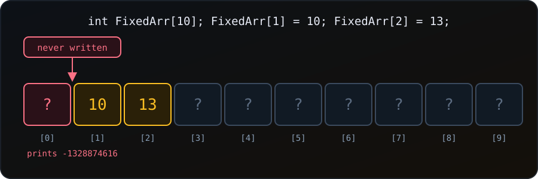

{fig-alt="An array of ten int slots. Slot 0 is never written and holds leftover garbage, slots 1 and 2 hold 10 and 13, and slots 3 to 9 are unset."}

We declare an array of 10 integers, set only elements 1 and 2, and print the first three:

```c
#include <stdio.h>

int main(void) {
    int FixedArr[10];   // an integer array of size 10
    FixedArr[1] = 10;   // we skip the first element, index 0
    FixedArr[2] = 13;

    for (int k = 0; k < 3; k++) {
        printf("%d\n", FixedArr[k]);
    }
    return 0;
}
```

The loop prints `10` and `13` as expected, but the first line is a strange number such as `-1328874616`. Where does it come from, and how do we stop it?

### Why it happens

`int FixedArr[10];` only **reserves** 40 bytes (10 ints of 4 bytes) for the array. It does not write anything into them. Those bytes still hold whatever the program, or the code that ran before it, last left in that part of the stack. We call such a value **indeterminate**.

When the loop reads `FixedArr[0]`, `printf` takes those leftover bits and shows them as an `int`. The number means nothing; it is just old data.

Two things follow from this:

- **The value is not stable.** It can change with the compiler, the optimisation level, the machine, or even a change somewhere else in the program. Compiled with `gcc 11.4 -Wall -Wextra`, our program printed `2` for slot 0 on every run. Compiled with `-O2` it printed `-1149427712`. You may see yet another number.
- **The C standard does not allow relying on it.** Reading an uninitialised local variable gives an unspecified value at best, and the behaviour can be undefined. A program that reads one may work today and fail tomorrow.

::: {.callout-warning}
**No warning, no error.** gcc with `-Wall -Wextra` compiled this program without a single message, even at `-O2`. The compiler cannot always tell that a loop will read a slot we never wrote. This is why the bug is easy to miss.
:::

Skipping index 0 is not special. Any slot we do not write holds garbage, and so do slots 3 to 9 in the program above. They only look harmless because the loop never reads them.

### Fix 1: Initialise the whole array with `{0}`

Give the array an initialiser. Every element not listed is set to zero:

```c
int FixedArr[10] = {0};   // all ten slots are 0
FixedArr[1] = 10;
FixedArr[2] = 13;
```

Output:

```
0
10
13
```

Now the slot we skipped is a clean `0`, and so are slots 3 to 9. This is the simplest habit: **initialise an array when we declare it**.

### Fix 2: Partial and designated initialisers

The initialiser does not have to be all zeros. Elements we leave out are always zero:

```c
int b[5] = {7, 8};          // 7 8 0 0 0
int c[5] = { [3] = 9 };     // 0 0 0 9 0  (designated initialiser)
```

Output:

```
partial: 7 8 0 0 0
designated: 0 0 0 9 0
```

The `[3] = 9` form sets one chosen slot and zeroes the rest.

### Fix 3: Fill it with a loop or `memset`

A loop works for any starting value:

```c
for (int i = 0; i < 10; i++) {
    FixedArr[i] = -1;       // for example, -1 can mean "not set"
}
```

For zero, `memset` from `<string.h>` does the same in one line:

```c
#include <string.h>

int a[5];
memset(a, 0, sizeof a);     // sets every byte to 0
```

`memset` sets **bytes**, so it is safe for `0` (and `-1`) but not for other values: `memset(a, 1, sizeof a)` would make each int `16843009`.

### Fix 4: Use `calloc` for dynamic arrays

`malloc` gives uninitialised memory, exactly like the array above. `calloc` gives zeroed memory:

```c
#include <stdlib.h>

int *d = calloc(5, sizeof *d);   // five ints, all 0
printf("%d %d\n", d[0], d[4]);   // 0 0
free(d);
```

### Fix 5: Static and global arrays start at zero

An array declared with `static`, or outside any function, is zero-initialised automatically:

```c
static int e[5];                 // all zeros
printf("%d %d\n", e[0], e[4]);   // 0 0
```

This is a rule only for static storage. An ordinary local array, like `FixedArr` above, gets no such treatment.

### Fix 6: Only read what we wrote

Sometimes the array is **deliberately** only partly filled, for instance when we do not know in advance how many values will arrive. Then the cleanest fix is not to zero everything but to keep a counter of used slots, and loop up to the counter:

```c
int f[5];
int used = 0;                 // how many slots hold real data

f[used++] = 10;
f[used++] = 13;

for (int k = 0; k < used; k++) {   // not k < 5
    printf("%d\n", f[k]);
}
```

Output:

```
10
13
```

The loop never touches an unset slot, so there is nothing to go wrong. Notice that in our original program the bug was the loop limit `k < 3`: we wrote two values but read three.

### Which fix to use

| Situation | Use |
| :--- | :--- |
| Array we will fill later, any reads possible | `= {0}` at declaration |
| A few known starting values | partial or designated initialiser |
| Reset an existing array to 0 | `memset(a, 0, sizeof a)` |
| Dynamic array that must start at 0 | `calloc` |
| Array that is intentionally partly filled | a counter such as `used` |

Whichever we pick, the rule is the same: **never read a slot we have not written**. Tools such as Valgrind and compiler sanitizers can also catch reads of uninitialised memory while a program runs, which helps when the code is too big to check by eye.

### Summary

- `int a[10];` reserves memory but does not set it, so unset slots hold leftover (indeterminate) values.
- Printing one gives a number like `-1328874616` that can change between compilers, flags and machines. The compiler may not warn about it.
- Initialise at the declaration with `= {0}`, or fill the array before reading it.
- `static` and global arrays, and `calloc` memory, start at zero; ordinary local arrays and `malloc` memory do not.
- If the array is only partly used, keep a counter and loop up to it.

Every program above was compiled with `gcc 11.4 -Wall -Wextra` and run; the outputs shown are real, except that the garbage value in the first program depends on the machine. For more on arrays, see [How to Save Loop Results in an Array in C](c-save-loop-in-array.qmd).
