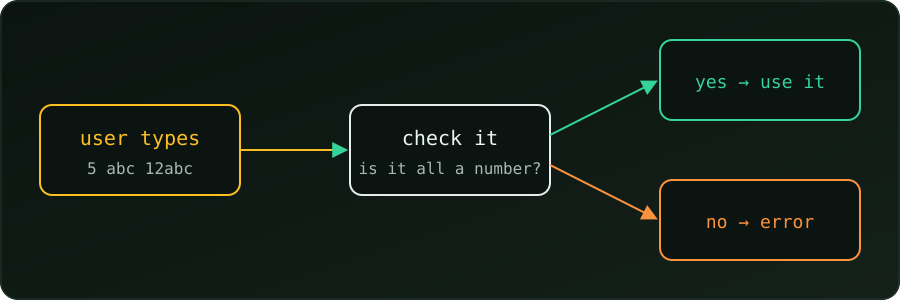

{fig-alt="A box 'user types 5, abc, 12abc' leads to a box 'check it: is it all a number?'. Yes leads to 'use it'; no leads to 'error'."}

A program that asks for a number must not assume the user types one. They may type `abc`, `-3` or nothing. C does not stop this, so we check the input ourselves.

### Check `scanf`'s return value

`scanf` returns how many items it converted. For one `%d`, success means `1`:

```c
#include <stdio.h>

int main(void) {
    int num;
    printf("Enter a number: ");
    if (scanf("%d", &num) != 1 || num < 0) {
        printf("Please enter a non-negative integer.\n");
        return 1;
    }

    long long factorial = 1;
    for (int i = 2; i <= num; i++)
        factorial *= i;
    printf("%d! = %lld\n", num, factorial);
    return 0;
}
```

- `scanf(...) != 1` catches the wrong type (`abc` gives `0`).
- `num < 0` catches a number that makes no sense for a factorial.

```
Enter a number: 5
5! = 120
Enter a number: abc
Please enter a non-negative integer.
```

### The catch: partial input

`scanf("%d")` reads the digits it finds and stops, so it accepts bad input:

```
Enter a number: 12abc
12! = 479001600
Enter a number: 3.7
3! = 6
```

### Stricter: `fgets` + `strtol`

We read the whole line as text, then convert it. `strtol` sets `end` to the first character it could not use, so `*end` must be the end of the line:

```c
#include <stdio.h>
#include <stdlib.h>

int main(void) {
    char line[64];
    printf("Enter a number: ");
    if (fgets(line, sizeof line, stdin) == NULL)
        return 1;

    char *end;
    long num = strtol(line, &end, 10);

    if (end == line || (*end != '\n' && *end != '\0') || num < 0 || num > 20) {
        printf("Please enter a whole number from 0 to 20.\n");
        return 1;
    }

    long long factorial = 1;
    for (long i = 2; i <= num; i++)
        factorial *= i;
    printf("%ld! = %lld\n", num, factorial);
    return 0;
}
```

- `end == line`: no digits were found (`abc`).
- `*end` is not the end of the line: extra characters followed the number (`12abc`, `3.7`).
- `num > 20`: `21!` does not fit in a `long long`, so we reject it.

Now the earlier bad inputs are rejected:

```
Enter a number: 12abc
Please enter a whole number from 0 to 20.
Enter a number: 3.7
Please enter a whole number from 0 to 20.
Enter a number: 20
20! = 2432902008176640000
```

### Summary

- Always check what `scanf` returns.
- `scanf` accepts `12abc` as `12`; for strict checks use `fgets` + `strtol` and test `*end`.
- Check the type first, then whether the value makes sense.
