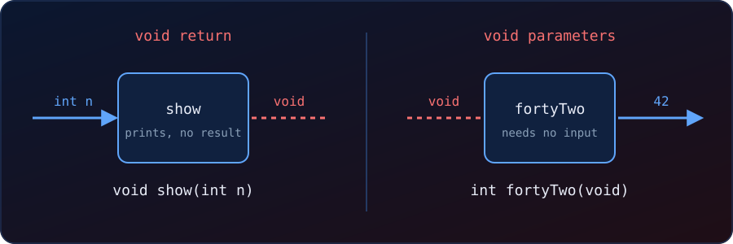

{fig-alt="Two function boxes. void show(int n) takes an int but has a dashed empty output. int fortyTwo(void) has a dashed empty input and returns 42."}

Consider this function:

```c
int myFunction(int x) {
  return 5 + x;
}
```

It **takes an argument** and **returns a value**, so replacing either part with `void` would break it. `void` is for the other kinds of functions, and it means something different depending on where we write it.

## The four combinations

```c
int  myFunction(int x)   // takes an int, returns an int
int  myFunction(void)    // takes nothing, returns an int
void myFunction(int x)   // takes an int, returns nothing
void myFunction(void)    // takes nothing, returns nothing
```

## Case 1: `void` as the return type

The function has no result. Its whole job is a side effect, such as printing, writing to a file, or changing an array in place.

```c
void greet(int times) {
    for (int i = 0; i < times; i++)
        printf("Hello\n");
}
```

We call it as a statement. Nothing comes back, so there is nothing to pass to `printf`:

```c
greet(3);                 // correct
printf("%d", greet(3));   // error: invalid use of void expression
```

A sorting function is a typical example:

```c
void bubbleSort(int a[], int n);   // sorts a[] in place, returns nothing
```

The array is changed through the pointer, so no return value is needed. Writing `void` documents that, and the compiler stops us from using a result that does not exist.

## Case 2: `void` as the parameter list

```c
int fortyTwo(void) {
    return 42;
}
```

Why not simply write `int fortyTwo()`? In C (before C23), empty parentheses mean *unspecified arguments*, which is the old pre-prototype style. The compiler does not check calls against it. The test below compiles without a single error:

```c
int f();                       // unspecified parameters
int main(void) { return f(1, 2, 3); }   // accepted
```

With `(void)` the compiler enforces zero arguments:

```c
int f(void) { return 7; }
int main(void) { return f(1); }
```

```
error: too many arguments to function ‘f’
```

So `int f(void)` gives us type checking, which is the main reason to write it in C. In C++, and from C23 onward, `f()` and `f(void)` mean the same thing, but writing `(void)` is still correct and works with older compilers.

## What `void` does to `myFunction`

| Change | Effect |
|---|---|
| `void myFunction(int x)` | `printf("%d", myFunction(3))` no longer compiles. Call it as `myFunction(3);` instead. |
| `int myFunction(void)` | `myFunction(3)` is an error, since it now takes no arguments. |
| `void myFunction(void)` | Both the call and the `printf` break. |

Our function needs an input and produces an output, so `void` is the wrong tool for it.

## All together

```c
#include <stdio.h>

int  add(int a, int b)  { return a + b; }          // returns a value
void show(int n)        { printf("%d\n", n); }     // side effect only
int  fortyTwo(void)     { return 42; }             // takes nothing

int main(void) {
    printf("%d\n", add(2, 3));   // value used
    show(add(2, 3));             // value passed to a void function
    printf("%d\n", fortyTwo());  // called with no arguments
    return 0;
}
```

```
5
5
42
```

`show` "just prints", `fortyTwo` "takes nothing", and `main(void)` "takes no command-line arguments".

::: {.callout-tip}
**The rule.** A `void` return means "call me for what I do, not for a value". A `void` parameter list means "I take no arguments, and the compiler should enforce that". If a function needs to take or give a value, use neither.
:::
