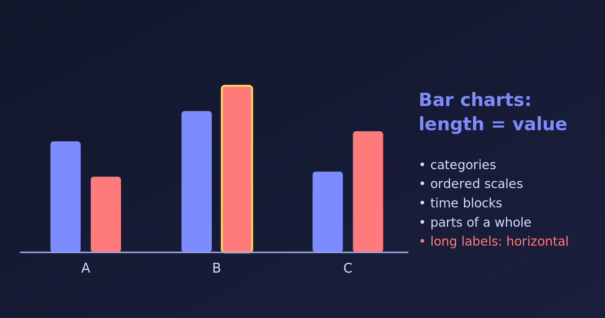

{.bk-adapt fig-alt="A grouped bar chart with three groups of two bars of different heights, one group highlighted, on a dark background."}

A **bar chart** maps each value to the length of a bar. Our eyes compare lengths very accurately, which is why bar charts are the safest choice whenever we compare quantities across **distinct categories**. Here are six situations where they work well, each drawn in R. The data are made up for illustration.

```{r}
library(tidyverse)
library(patchwork)
```

## 1. Comparing Categories (Nominal Data)

When categories have no natural order, we sort the bars by size so that the ranking is obvious. Typical uses are sales by product line or web traffic by referral source.

```{r}
#| fig-width: 6.5
#| fig-height: 3.6
traffic <- tibble(
  source = c("Organic search", "Direct", "Social media", "Email", "Referral"),
  visits = c(5200, 3100, 2400, 1300, 900)
)

ggplot(traffic, aes(x = reorder(source, visits), y = visits)) +
  geom_col(fill = "steelblue") +
  coord_flip() +
  labs(title = "Website visits by source", x = NULL, y = "Visits")
```

### Pareto chart

A **Pareto chart** sorts the bars in descending order and adds a line with the cumulative percentage. It shows the "vital few" categories that cause most of an outcome, such as the common reasons for customer complaints.

```{r}
#| fig-width: 7
#| fig-height: 4
complaints <- tibble(
  reason = c("Late delivery", "Damaged item", "Wrong item", "Billing error", "Rude staff", "Other"),
  n = c(120, 75, 40, 25, 15, 10)
) %>%
  arrange(desc(n)) %>%
  mutate(reason = fct_inorder(reason), cum_pct = cumsum(n) / sum(n) * 100)

total <- sum(complaints$n)

ggplot(complaints, aes(reason)) +
  geom_col(aes(y = n), fill = "steelblue") +
  geom_line(aes(y = cum_pct * total / 100, group = 1), colour = "tomato", linewidth = 1) +
  geom_point(aes(y = cum_pct * total / 100), colour = "tomato", size = 2) +
  scale_y_continuous(name = "Complaints",
                     sec.axis = sec_axis(~ . / total * 100, name = "Cumulative %")) +
  labs(title = "Reasons for complaints (Pareto chart)", x = NULL) +
  theme(axis.text.x = element_text(angle = 25, hjust = 1))
```

The first two reasons already account for over half of all complaints (`r round(complaints$cum_pct[2])`%), so that is where to act first.

## 2. Ordered Categories (Ordinal Data)

When categories follow a natural order, the bars keep that order. Likert survey answers are the classic case. We must keep the order of the scale, not sort by size.

```{r}
#| fig-width: 6.5
#| fig-height: 3.6
likert <- tibble(
  answer = factor(c("Strongly disagree", "Disagree", "Neutral", "Agree", "Strongly agree"),
                  levels = c("Strongly disagree", "Disagree", "Neutral", "Agree", "Strongly agree")),
  n = c(12, 25, 38, 80, 45)
)

ggplot(likert, aes(answer, n)) +
  geom_col(fill = "steelblue") +
  labs(title = "Responses to a survey statement", x = NULL, y = "Respondents")
```

Income brackets (low, medium, high) or performance tiers work the same way.

## 3. Discrete Time Blocks

Line graphs suit measurements that flow continuously. When each value is a **total for a block of time**, such as monthly rainfall, quarterly earnings or daily steps, a bar chart is more honest: each bar is one block, and nothing is implied between them.

```{r}
#| fig-width: 7
#| fig-height: 3.8
rain <- tibble(month = factor(month.abb, levels = month.abb),
               mm = c(8, 12, 30, 80, 190, 330, 360, 330, 250, 130, 20, 5))

ggplot(rain, aes(month, mm)) +
  geom_col(fill = "steelblue") +
  labs(title = "Monthly rainfall (made-up data)", x = NULL, y = "Rainfall (mm)")
```

Bars also suit a **few** time points, such as an indicator over 5 years, where a line over so few points looks sparse.

## 4. Parts of a Whole: Stacked Bars

To see the total and its parts, we can segment each bar. A stacked bar shows the totals. A 100% stacked bar shows the shares, whatever the totals.

```{r}
#| fig-width: 9
#| fig-height: 3.8
energy <- expand_grid(country = c("A", "B", "C"), fuel = c("Coal", "Gas", "Solar")) %>%
  mutate(twh = c(60, 30, 10, 20, 50, 30, 10, 20, 70))

stacked <- ggplot(energy, aes(country, twh, fill = fuel)) +
  geom_col() +
  labs(title = "Stacked: totals and parts", x = "Country", y = "Energy (TWh)", fill = NULL)

filled <- ggplot(energy, aes(country, twh, fill = fuel)) +
  geom_col(position = "fill") +
  scale_y_continuous(labels = scales::percent) +
  labs(title = "100% stacked: shares", x = "Country", y = "Share", fill = NULL)

stacked | filled
```

A **diverging stacked bar** is a variant for survey scales. It centres the bars on the neutral answer, with negative answers to the left and positive ones to the right, so the net sentiment is visible at once.

## 5. Two Categorical Variables: Clustered Bars

To compare groups across a second variable, we put the bars side by side.

```{r}
#| fig-width: 6.5
#| fig-height: 3.8
salary <- expand_grid(department = c("Sales", "IT", "HR"), status = c("Full-time", "Part-time")) %>%
  mutate(avg = c(52, 30, 61, 38, 48, 29))

ggplot(salary, aes(department, avg, fill = status)) +
  geom_col(position = "dodge") +
  labs(title = "Average salary by department and status",
       x = NULL, y = "Average salary (thousands)", fill = NULL)
```

## 6. Horizontal Bars

Rotating the chart by 90 degrees helps in two situations.

**Long labels.** Vertical bars force the labels to tilt, while horizontal bars keep them readable.

```{r}
#| fig-width: 7
#| fig-height: 3.6
depts <- tibble(
  department = c("Department of Environmental Protection", "Department of Public Transport",
                 "Department of Health Services", "Department of Parks"),
  budget = c(42, 65, 90, 18)
)

ggplot(depts, aes(x = reorder(department, budget), y = budget)) +
  geom_col(fill = "steelblue") +
  coord_flip() +
  labs(title = "Budget by department", x = NULL, y = "Budget (millions)")
```

**Population pyramids.** Two horizontal bar charts share a vertical age axis, with one group to the left and the other to the right.

```{r}
#| fig-width: 6.5
#| fig-height: 4
pyramid <- expand_grid(age = c("0-14", "15-29", "30-44", "45-59", "60+"), sex = c("Male", "Female")) %>%
  mutate(pop = c(26, 24, 28, 27, 25, 25, 19, 20, 12, 15),
         pop = ifelse(sex == "Male", -pop, pop),
         age = factor(age, levels = c("0-14", "15-29", "30-44", "45-59", "60+")))

ggplot(pyramid, aes(age, pop, fill = sex)) +
  geom_col() +
  coord_flip() +
  scale_y_continuous(labels = abs) +
  labs(title = "Population pyramid (made-up data)", x = "Age group", y = "Population (millions)", fill = NULL)
```

## When to Choose a Bar Chart, and When Not To

| Choose a bar chart if... | Avoid a bar chart if... |
|---|---|
| The horizontal axis holds distinct groups, brackets or blocks of time | The axis is a continuous scale (exact age, temperature, seconds): use a line plot or histogram |
| The goal is comparing exact differences in magnitude | There are dozens of categories that clog the axis: use a sorted horizontal bar chart or a table |
| We want a chart that non-technical readers understand at once | We want to show a distribution (spread, quartiles, outliers): use a box plot |

::: {.callout-tip}
Always start the value axis of a bar chart at zero. The bar's length is the message, so a truncated axis exaggerates differences.
:::

For a comparison with pie charts, see [pie chart vs bar chart](pie-vs-bar-chart.html), and for choosing a chart by data type see [choosing a chart by data type](choice-of-charts-by-data-type-categorical-quantitative.html).
