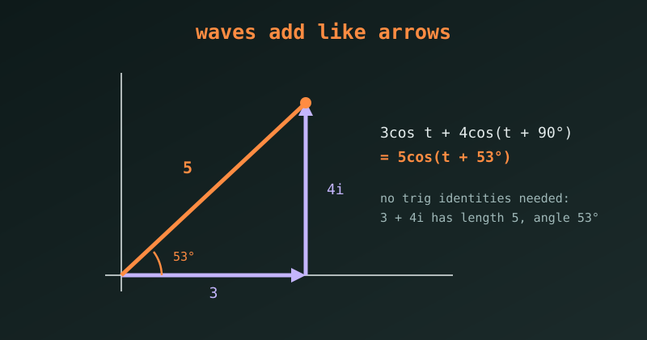

{fig-alt="A diagram with a horizontal arrow of length 3 and a vertical arrow of length 4 adding up to a diagonal arrow of length 5 at 53 degrees, representing the combined wave 5cos(t + 53 degrees)."}

Complex numbers are the more natural choice whenever a problem involves **rotations, oscillations, waves or roots of equations**. Forcing a solution through real numbers alone needs messy trigonometry and heavy calculus, while complex numbers reduce the work to addition and multiplication. (If the basics are new, see [Complex Numbers: Why They Are as Real as Real Numbers](complex-numbers.html).)

Let's go through six cases. In each we set the real-number approach beside the complex one.

## 1. Combining waves and oscillations

**Real numbers:** adding sound waves, light waves or alternating currents that start at different times (phases) needs trigonometric identities such as the one for $\sin(A + B)$.

**Complex numbers:** write each wave as a complex number. Its **length** is the wave's strength (amplitude) and its **angle** is the timing (phase). Adding waves is then just adding numbers.

**Example:** add $3\cos t$ and $4\cos(t + 90^\circ)$. Represent them as $3$ and $4i$ (a quarter turn ahead):

$$
3 + 4i \quad\Rightarrow\quad \text{length } \sqrt{3^2 + 4^2} = 5, \quad \text{angle } \tan^{-1}(4/3) \approx 53^\circ
$$

So the combined wave is $5\cos(t + 53^\circ)$, with no identities needed.

## 2. 2D rotations and geometry

**Real numbers:** rotating a point $(x, y)$ needs a $2 \times 2$ matrix of sines and cosines.

**Complex numbers:** a point is one number, $x + yi$, and rotating it is one multiplication. This makes complex numbers a natural choice for 2D physics engines and robotics.

**Example:** rotate $(1, 1)$ by 90 degrees. Multiply $1 + i$ by $i$:

$$
i(1 + i) = i + i^2 = -1 + i
$$

so $(1, 1)$ moves to $(-1, 1)$.

## 3. Differential equations

**Real numbers:** equations for vibrating springs, shock absorbers and RLC circuits often have solutions that oscillate while dying away. With real numbers we must guess combinations of sines, cosines and exponentials.

**Complex numbers:** growth, decay and oscillation are all one exponential, $e^{rt}$, with a complex $r$. We just solve a quadratic.

**Example:** solve $y'' + 2y' + 5y = 0$. Try $y = e^{rt}$:

$$
r^2 + 2r + 5 = 0 \quad\Rightarrow\quad r = \frac{-2 \pm \sqrt{4 - 20}}{2} = -1 \pm 2i
$$

The real part $-1$ gives the decay ($e^{-t}$) and the imaginary part $2$ gives the oscillation, so the solutions are $e^{-t}\cos 2t$ and $e^{-t}\sin 2t$. No guessing was needed.

## 4. Roots of polynomials

**Real numbers:** $x^2 + 1 = 0$ has no solution, while $x^2 - 1 = 0$ has two. The degree alone does not tell us how many roots to expect.

**Complex numbers:** they are *algebraically closed*: every polynomial of degree $n$ has exactly $n$ roots (counting repeats). This makes stability analysis in control theory predictable.

**Example:** $x^3 - 1 = 0$ has a single real root, but three complex ones:

$$
x = 1, \qquad x = -\tfrac{1}{2} + \tfrac{\sqrt{3}}{2}\,i, \qquad x = -\tfrac{1}{2} - \tfrac{\sqrt{3}}{2}\,i
$$

and $x^2 + 1 = 0$ has the two roots $\pm i$.

## 5. 2D fluid flow and electromagnetism

**Real numbers:** describing air flow around a wing, or an electric field around a wire, needs coupled partial differential equations in $x$ and $y$.

**Complex numbers:** complex functions preserve angles (*conformal mapping*). For ideal, frictionless flow, we can solve the easy case of flow around a circle, then use one complex function to bend the circle into another shape. The classic map $w = z + 1/z$ turns a slightly off-centre circle into a wing-like profile, and the flow around the circle is carried along with it.

## 6. Hard real integrals

**Real numbers:** many integrals, especially in physics and statistics, have no elementary antiderivative, so ordinary calculus gets stuck.

**Complex numbers:** step into the complex plane and use the *residue theorem*. The answer is still a real number.

**Example:**

$$
\int_{-\infty}^{\infty} \frac{\cos x}{1 + x^2}\,dx = \frac{\pi}{e} \approx 1.156
$$

The trick is to replace $\cos x$ by $e^{iz}$ and to look at the function $e^{iz}/(1 + z^2)$, which has a single trouble spot (a pole) at $z = i$ in the upper half-plane. The residue theorem gives $2\pi i \times \dfrac{e^{-1}}{2i} = \dfrac{\pi}{e}$, and the real part of that is the integral we wanted.

## Summary

| Problem | Real-number approach | Complex approach |
|:--------|:---------------------|:-----------------|
| Adding waves | Trig identities | Add two numbers |
| 2D rotation | $2 \times 2$ matrix | Multiply by $e^{i\theta}$ |
| Oscillating, decaying solutions | Guess sines, cosines, exponentials | Solve a quadratic, read off $r$ |
| Counting roots | Depends on the equation | Always exactly $n$ |
| Flow around shapes | Coupled PDEs | Map a simple shape with one function |
| Hard integrals | No elementary antiderivative | Residues |

## Key takeaway

- Whenever the problem involves a **cycle**, a **rotation** or a **wave**, complex numbers describe it directly.
- They do not replace real numbers: the final answers (amplitudes, positions, integrals) are still real. Complex numbers are the shortcut we take to reach them.
