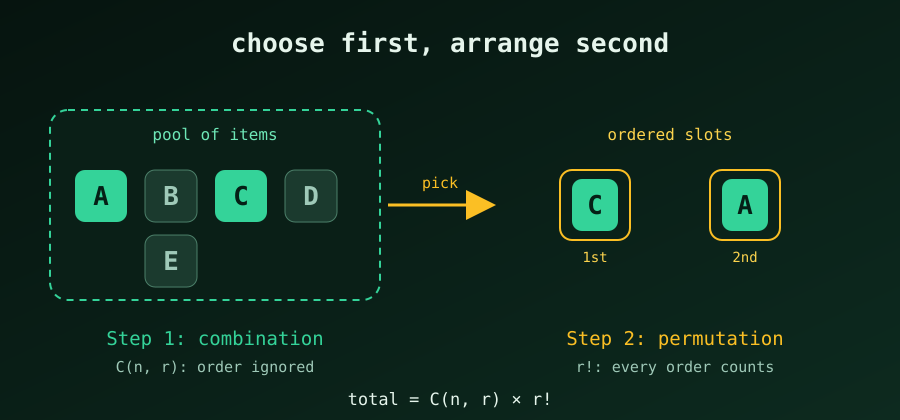

{fig-alt="A pool of five lettered tiles, two of which are picked and placed into two ordered slots, labelled combination and permutation."}

Permutations and combinations often appear in the same problem (if the two ideas are new, start with [Understanding Permutations and Combinations with Examples](understanding-permutation-combination-with-examples.html)). Whenever we must first **select** a group of items (a combination) and then **arrange** the chosen items in order (a permutation), we need both. This "choose first, arrange second" approach is the standard way to count when the items come from different categories.

::: {.callout-note}
## The pattern

$$
\text{total} = \underbrace{\binom{n}{r}}_{\text{choose the group}} \times \underbrace{r!}_{\text{order it}}
$$

When there are several categories, Step 1 is a *product* of combinations, one per category, and $r$ is the size of the whole chosen group.
:::

## 1. Passwords with a fixed mix of characters

Suppose we want a 4-character password made of 2 distinct letters (from 26) and 2 distinct digits (from 10). A single permutation formula cannot guarantee the exact mix, so we fix the mix first.

- **Step 1 (combination):** choose the 2 letters and the 2 digits: $\binom{26}{2} \times \binom{10}{2} = 325 \times 45 = 14{,}625$ groups.
- **Step 2 (permutation):** arrange the 4 chosen characters: $4! = 24$ ways.
- **Total:** $14{,}625 \times 24 = \mathbf{351{,}000}$ passwords.

## 2. Code words from separate pools

We have 6 consonants and 4 vowels, and we want a 5-letter code word with exactly 3 consonants and 2 vowels (no letter repeated).

- **Step 1 (combination):** $\binom{6}{3} \times \binom{4}{2} = 20 \times 6 = 120$ ways to pick the letters.
- **Step 2 (permutation):** arrange the 5 letters: $5! = 120$ orders.
- **Total:** $120 \times 120 = \mathbf{14{,}400}$ words.

## 3. A batting order

A cricket squad has 15 players: 8 batsmen and 7 bowlers. The coach picks a starting 11 with 6 batsmen and 5 bowlers, then sets the batting order.

- **Step 1 (combination):** $\binom{8}{6} \times \binom{7}{5} = 28 \times 21 = 588$ possible teams.
- **Step 2 (permutation):** put the 11 players in order from #1 to #11: $11! = 39{,}916{,}800$ lineups.
- **Total:** $588 \times 39{,}916{,}800 = 23{,}471{,}078{,}400 \approx \mathbf{2.35 \times 10^{10}}$ batting orders.

## 4. Seating guests on a stage

Twelve executives attend a conference, and 4 of them are chosen to sit in 4 labelled chairs on stage (Chair 1 to Chair 4).

- **Step 1 (combination):** choose the 4 executives: $\binom{12}{4} = 495$ groups.
- **Step 2 (permutation):** assign the 4 chosen executives to the chairs: $4! = 24$ ways.
- **Total:** $495 \times 24 = \mathbf{11{,}880}$ ways.

::: {.callout-tip}
## A shortcut when there are no categories

Here nothing restricts who may sit where, so the two steps collapse into one:

$$
\binom{n}{r} \times r! = {}^{n}P_{r} = \frac{n!}{(n-r)!}
$$

Indeed, $^{12}P_4 = 12 \times 11 \times 10 \times 9 = 11{,}880$. The two-step method is needed when categories force a particular mix, as in the first three examples.
:::

## How to recognise these problems

| The question asks for... | Use |
|:--|:--|
| a group, order irrelevant | combination only |
| an ordered arrangement of everything or of $r$ items from $n$ | permutation only |
| a group with a required mix, *and* then an order | combination(s) first, then $r!$ |

If the problem says "exactly $k$ of this kind and $m$ of that kind" and then asks for an arrangement, we are in the "choose first, arrange second" case.
