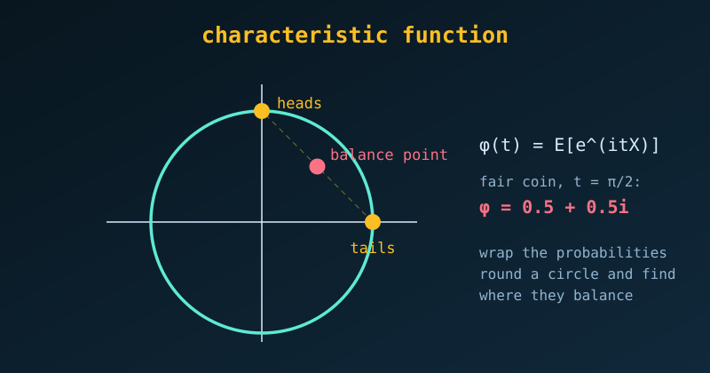

{fig-alt="A circle with tails at the right, heads at the top, and a balance point halfway between them."}

A **characteristic function** is a "fingerprint" of a probability distribution. Two distributions with the same fingerprint are the same distribution, and every distribution has one. This post builds it from scratch with a fair coin, using nothing but a circle.

## The recipe in three steps

Suppose a random outcome $X$ can take some values, each with a probability.

1. **Pick a speed $t$.** This is just a number we choose.
2. **Wrap the outcomes round a circle.** Each outcome $x$ is placed on a circle of radius 1, at the angle $t \times x$. Think of it as turning by that angle from the starting point on the right. (Angles are in radians: a half turn is $\pi$.)
3. **Find the balance point.** Average the positions of the points on the circle, giving each outcome a weight equal to its probability.

That balance point is the value of the characteristic function at $t$. We repeat for every speed $t$, and the collection of balance points is the fingerprint.

## Example: a fair coin

Let tails be the number 0 and heads the number 1, each with probability 0.5.

- **Tails** is at angle $t \times 0 = 0$, so it always sits at the starting point on the right.
- **Heads** is at angle $t \times 1 = t$, so it moves round the circle as we change $t$.

Let's look at three speeds.

```{r}
#| echo: false
#| fig-alt: "Three panels of the unit circle. For t = 0, heads and tails sit together at the right and the balance point is there too. For t = pi over 2, heads is at the top and the balance point is halfway between heads and tails. For t = pi, heads is on the left opposite tails and the balance point is at the centre."
library(ggplot2)

circle <- do.call(rbind, lapply(c("t = 0", "t = π/2", "t = π"), function(l)
  data.frame(panel = l, a = seq(0, 2 * pi, length.out = 200))))
ts <- c(0, pi / 2, pi)
labs3 <- c("t = 0", "t = π/2", "t = π")
pts <- do.call(rbind, lapply(1:3, function(i) data.frame(
  panel = labs3[i], x = c(1, cos(ts[i])), y = c(0, sin(ts[i])), who = c("tails", "heads"))))
bal <- data.frame(panel = labs3, x = 0.5 + 0.5 * cos(ts), y = 0.5 * sin(ts))
for (d in c("circle", "pts", "bal")) {
  tmp <- get(d); tmp$panel <- factor(tmp$panel, levels = labs3); assign(d, tmp)
}

ggplot() +
  geom_hline(yintercept = 0) + geom_vline(xintercept = 0) +
  geom_path(data = circle, aes(cos(a), sin(a)), colour = "steelblue") +
  geom_point(data = pts, aes(x, y), colour = "steelblue", size = 4) +
  geom_point(data = bal, aes(x, y), colour = "tomato", size = 3) +
  facet_wrap(~ panel) +
  coord_fixed(xlim = c(-1.3, 1.3), ylim = c(-1.3, 1.3)) +
  labs(x = "Real axis", y = "Imaginary axis")
```

Blue points are the two outcomes, and the red point is their balance point:

| Speed $t$ | Where heads sits | Balance point (red) |
|:---------:|:-----------------|:--------------------|
| $0$ | right, on top of tails | $1$ (both at the same spot) |
| $\pi/2$ (quarter turn) | top | halfway between: $0.5 + 0.5i$ |
| $\pi$ (half turn) | left, opposite tails | $0$ (the centre) |

(The vertical axis is called "imaginary" only for historical reasons. It is just the up-down direction of the circle. See the [complex numbers post](complex-numbers.html) if curious.)

As $t$ grows, heads keeps going round the circle and the balance point traces out a path. That path, over all $t$, is the coin's fingerprint.

## In symbols

The point at angle $\theta$ on the circle is written $e^{i\theta}$. So heads is at $e^{it}$ and tails at $e^{0} = 1$, and the balance point is

$$
\varphi(t) = 0.5\cdot 1 + 0.5\cdot e^{it}
$$

For any random variable $X$, the same recipe is written

$$
\varphi_X(t) = E\left[e^{itX}\right]
$$

where $E[\ ]$ means "the probability-weighted average". That is all a characteristic function is.

## Why anyone bothers: sums become products

Say we flip two fair coins and count the heads. Finding that distribution normally means working out all the ways to reach each total. With fingerprints it is a multiplication. For independent variables, the fingerprint of the sum is the product of the fingerprints:

$$
\varphi_{X+Y}(t) = \varphi_X(t)\,\varphi_Y(t)
$$

For our two coins:

$$
(0.5 + 0.5\,e^{it})^2 = 0.25 + 0.5\,e^{it} + 0.25\,e^{2it}
$$

The numbers in front tell us the answer: 0 heads has probability 0.25, 1 head has 0.5, and 2 heads has 0.25. We got the distribution of the sum just by multiplying.

## Two facts worth remembering

- **It always exists.** Every point on the circle stays at distance 1 from the centre, so the average can never blow up. Other summaries of a distribution, such as the mean, can fail to exist for strange distributions.
- **It identifies the distribution.** No two different distributions have the same characteristic function.

## Where it is used

The main use is proving theorems about sums and averages. For example, the standard proof of the [central limit theorem](charishma-of-clt.html) shows that the fingerprint of a standardised average approaches the fingerprint of the normal distribution. See also [complex numbers in statistics](complex-numbers-in-statistics.html).

## Key takeaway

- Wrap outcomes round a circle at speed $t$ and find the balance point: that is $\varphi(t)$.
- The balance points for all $t$ form a fingerprint that identifies the distribution.
- Adding independent variables corresponds to multiplying their fingerprints.
