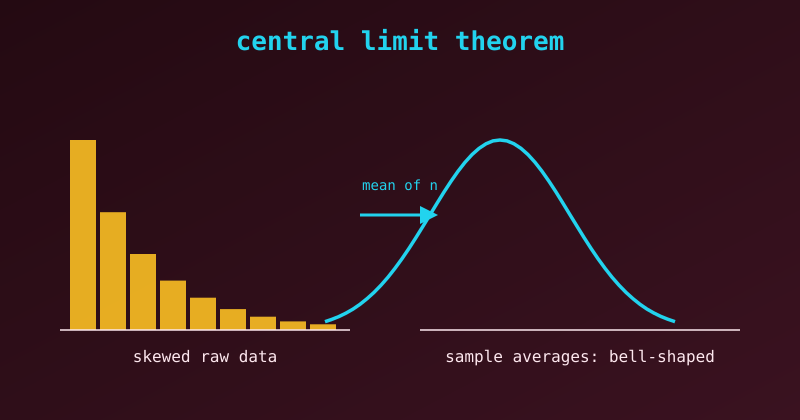

{fig-alt="A skewed histogram of raw data on the left, an arrow labelled mean of n, and a bell curve of sample averages on the right."}

The **central limit theorem** (CLT) says that the average of a large enough random sample is approximately normally distributed, even when the original data is heavily skewed, uniform or U-shaped. That lets us use the normal bell curve to calculate probabilities for sample averages.

## Why the CLT is so useful

- **We need not know the population shape.** In practice we rarely know the true distribution of what we study. The CLT tells us the sample average behaves predictably anyway.
- **It powers statistical inference.** Confidence intervals, t-tests, z-tests and A/B tests all rely on it to measure the margin of error.
- **It makes sampling practical.** Instead of surveying millions of people, we can sample 1,000 and estimate the national average with a known margin of error.

## Seeing it in R

Let's draw from a strongly right-skewed population (exponential, mean 1) and look at the distribution of sample means for growing $n$.

```{r}
#| fig-alt: "Four histograms of sample means from a skewed exponential population, for n = 1, 5, 30 and 100: strongly skewed at n = 1, then increasingly bell-shaped and narrower."
library(ggplot2)

set.seed(7)
sizes <- c(1, 5, 30, 100)
means <- do.call(rbind, lapply(sizes, function(n) {
  data.frame(n = factor(paste("n =", n), levels = paste("n =", sizes)),
             mean = replicate(5000, mean(rexp(n))))
}))

ggplot(means, aes(mean)) +
  geom_histogram(bins = 40, fill = "steelblue", colour = "white") +
  facet_wrap(~ n, scales = "free") +
  labs(x = "Sample mean", y = "Count")
```

The raw data ($n = 1$) is far from normal, yet the sample means become symmetric and bell-shaped as $n$ grows. They also get narrower, with spread $\sigma / \sqrt{n}$:

```{r}
data.frame(n = sizes,
           sd_of_means = round(as.numeric(tapply(means$mean, means$n, sd)), 3),
           theory = round(1 / sqrt(sizes), 3))
```

## When the CLT works

For the classical CLT, the sampling process should meet four conditions:

1. **Independence:** each observation does not influence the next.
2. **Identical distribution:** all observations come from the same population or process.
3. **Large enough $n$:** a common rule of thumb is $n \ge 30$ for moderately skewed data. Symmetric data may need only about 10, and heavily skewed data $n \ge 100$ or more.
4. **Finite mean and variance:** $\mu$ must exist and $\sigma^2 < \infty$.

## When the CLT fails

- **Infinite variance (heavy tails).** The Cauchy distribution and some Pareto distributions (financial crashes, earthquake magnitudes) have tails so heavy that larger samples never smooth out the average, since one huge outlier can wreck the mean at any time.
- **Dependent data.** In time series such as daily stock prices or hourly temperatures, today depends on yesterday. Standard CLT formulas then badly underestimate the margin of error.
- **Sample too small for extreme skew.** If 99.9% of users pay \$0 and 0.1% pay \$500, a sample of 30 is almost always all zeros. The sample averages stay skewed until $n$ is in the thousands.
- **Looking at individual points, not averages.** The CLT is about sums and averages. A larger sample never makes the raw heights, incomes or waiting times look like a bell curve.

| Scenario | Does the CLT work? | Reason |
|:---------|:------------------:|:-------|
| Average of $n = 50$ dice rolls | Yes | Independent, finite variance, $n \ge 30$ |
| Average of $n = 100$ skewed incomes | Yes | Finite variance and a large sample |
| Average of Cauchy random variables | No | Infinite variance: the average never stabilises |
| Average of daily stock prices | No | Observations are correlated over time |
| Individual customer wait times ($n = 10{,}000$) | No | The CLT governs averages, not raw values |

## Worked example: delivery times

Suppose an online store wants the true average delivery time over all 500,000 orders this year. Delivery times are right-skewed: most parcels arrive in 2 or 3 days, a few take two weeks. We sample $n = 100$ orders and get:

| Quantity | Symbol | Value |
|:---------|:------:|------:|
| Sample size | $n$ | 100 orders |
| Sample mean | $\bar{x}$ | 3.4 days |
| Sample standard deviation | $s$ | 1.5 days |

### Step 1: the standard error

Since $n = 100$ is well above 30, the CLT says the sample mean is approximately normal. Its spread is the **standard error**:

$$
SE = \frac{s}{\sqrt{n}} = \frac{1.5}{\sqrt{100}} = \frac{1.5}{10} = 0.15 \text{ days}
$$

### Step 2a: a 95% confidence interval

On a normal curve, 95% of sample means fall within 1.96 standard errors of the true mean (the same idea as the 68-95-99.7 [Empirical Rule](visualizing-empirical-rule.html), with 1.96 as the exact multiplier for 95%):

$$
\text{Margin of error} = 1.96 \times 0.15 = 0.294 \text{ days}
$$

$$
\text{CI} = 3.4 \pm 0.294 = [3.11,\ 3.69] \text{ days}
$$

Although the raw delivery data is skewed and we checked only 100 of 500,000 orders, we can be 95% confident that the true average delivery time lies between 3.11 and 3.69 days.

### Step 2b: testing a claim

Marketing wants to advertise "Average delivery in 3 days!" Is our 3.4 just sampling noise, or evidence that the true mean is worse than 3? We count how many standard errors 3.4 is above 3.0:

$$
Z = \frac{\bar{x} - \mu_0}{SE} = \frac{3.4 - 3.0}{0.15} = \frac{0.4}{0.15} \approx 2.67
$$

The one-sided probability of landing 2.67 or more standard errors above the mean by chance is about 0.0038. That is far below the usual 5% cutoff, so we reject the 3-day claim: the true average delivery time is very likely longer than 3 days.

::: {.callout-note}
With $s$ estimated from the data, the exact reference distribution is the t-distribution. For $n = 100$ it is almost identical to the normal, so the result is the same here.
:::

| Inference tool | Formula | Question answered |
|:---------------|:-------:|:------------------|
| Standard error | $\dfrac{s}{\sqrt{n}}$ | How much does the sample average bounce around due to luck? |
| Confidence interval | $\bar{x} \pm 1.96 \cdot SE$ | What is a realistic range for the true average? |
| Hypothesis test ($Z$) | $\dfrac{\bar{x} - \mu_0}{SE}$ | Is the difference real, or random noise? |

## Can we use it on non-normal data?

Yes. This is the main superpower of the CLT. It helps to separate two levels of data:

- **The raw data stays non-normal.** If most customers spend \$0 and a few spend \$500, plotting 10,000 individual customers will always look skewed.
- **The sample averages become normal.** Take 100 customers at a time, compute the average spend, and repeat: those averages cluster around the true mean in a symmetric bell curve, because high and low values inside each sample cancel out.

How large $n$ must be depends on the skew:

- **Mildly skewed or uniform data:** about $n = 30$.
- **Heavily skewed data** (incomes, website clicks): perhaps $n = 100$ to $500$.
- **Infinite variance** (Cauchy): never, however large $n$ gets.

| Goal | Normal / CLT math OK? | Why |
|:-----|:---------------------:|:----|
| Estimate the population mean (confidence interval) | Yes | The sample mean is approximately normal for large $n$ |
| Compare two group means (A/B test, t-test) | Yes | Both group means become approximately normal |
| Predict one individual's value (prediction interval) | No | Individual values keep the original non-normal shape |

## Hypothesis testing on non-normal data

Standard t-tests and z-tests do not need the raw data to be bell-shaped. They need only the sample mean (or the difference of two means) to be approximately normal, which the CLT provides when the sample is large enough.

- **Large sample** ($n \ge 30$ for mild skew, $n \ge 100$ for heavy skew): run the standard t-test or z-test directly.
- **Small sample** ($n < 30$) with non-normal data: the CLT has not kicked in, so p-values from a t-test can mislead. Use a non-parametric test (Mann-Whitney U, Wilcoxon signed-rank) or bootstrapping.

Even with a large sample, avoid CLT-based tests in these situations:

- **We care about the median, not the mean.** For skewed data such as income or house prices, the mean is pulled far from the typical value, and a test on the median is more meaningful.
- **Extreme outliers or infinite variance.** The sample mean never stabilises, and t-tests lose power.
- **One tiny group in an A/B test.** Both groups need enough observations. With $n_A = 500$ but $n_B = 8$, the CLT assumption still breaks down for group B.

| Data shape | Sample size | Best test |
|:-----------|:-----------:|:----------|
| Normal | Any (even $n = 10$) | Standard t-test |
| Skewed, uniform or U-shaped | Large ($n \ge 30$ to 100+) | Standard t-test (powered by the CLT) |
| Skewed, uniform or U-shaped | Small ($n < 30$) | Mann-Whitney U or Wilcoxon test |
| Heavy outliers (testing medians) | Any | Mann-Whitney U or bootstrap test |

## Key takeaway

- The CLT is about **averages**, not individual values.
- It lets us do inference without knowing the population's shape, provided the sample is large, the observations are independent and the variance is finite.
- The more skewed the data, the larger the sample we need.
