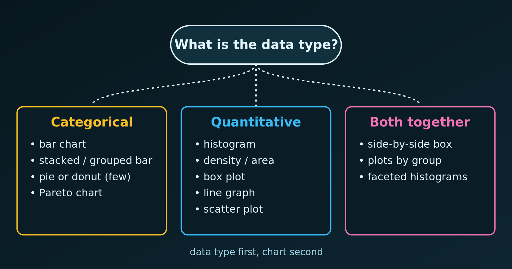

{.bk-adapt fig-alt="A decision diagram. Categorical data leads to bar chart, stacked or grouped bar, pie or donut and Pareto chart. Quantitative data leads to histogram, density, box plot, line graph and scatter plot. Both together lead to side-by-side box plots and faceted histograms."}

The right chart depends on the **type of data** in our variables. A wrong choice can distort a relationship, or show data in a way that makes no statistical sense, such as a line graph joining unrelated categories. Let's go through the three cases and draw an example of each in R.

## 1. Categorical Data

Categorical (qualitative) data are labels or groups: gender, country, car model, satisfaction level. The usual goal is to compare **counts or percentages** across groups.

| Chart | Best for | Example |
|---|---|---|
| Bar chart | Comparing counts or percentages between separate groups | Patients by blood type ($A$, $B$, $AB$, $O$) |
| Stacked or grouped bar | A main category split by a second one | Agree / disagree answers by age group |
| Pie or donut chart | Parts of a whole, with at most about five categories | Market share of a few firms |
| Pareto chart | Finding the few most frequent categories to prioritise | Frequency of manufacturing defects |

## 2. Quantitative Data

Quantitative (numerical) data are measurable quantities for which arithmetic makes sense. They are either **discrete** (countable, like shoe sizes or the number of children) or **continuous** (any value in a range, like height, time or weight).

| Chart | Best for | Example |
|---|---|---|
| Histogram | The distribution, spread and skewness of one continuous variable | Household incomes in a city |
| Density or area chart | A smooth distribution, or tail regions | A normal curve and its critical region |
| Box plot | Five-number summary and outliers | Exam scores in one school |
| Line graph | A change or trend over time | Global temperature from 1880 to today |
| Scatter plot | The relationship between two quantitative variables | Hours studied and exam score |

## 3. Mixed Data: Categorical and Quantitative

To see how a number behaves across groups, we use charts that combine both types:

- **Side-by-side box plots** are the standard way to compare a quantitative variable across categories, for example salary across job titles.
- **Faceted histograms** show a small histogram for each category, so that we can compare shape, centre and spread.

## One Example of Each in R

We use the `mpg` data set that ships with `ggplot2` (fuel economy of 234 cars). Each panel matches a row of the tables above. The plots use the default grey panel.

```{r}
#| fig-width: 9
#| fig-height: 7
library(ggplot2)
library(patchwork)

bar <- ggplot(mpg, aes(x = reorder(class, class, length))) +
  geom_bar(fill = "steelblue") +
  coord_flip() +
  labs(title = "Categorical: bar chart", x = NULL, y = "Number of cars")

hist <- ggplot(mpg, aes(hwy)) +
  geom_histogram(binwidth = 2, fill = "steelblue", colour = "white") +
  labs(title = "Quantitative: histogram", x = "Highway mpg", y = "Number of cars")

scatter <- ggplot(mpg, aes(displ, hwy)) +
  geom_point(colour = "steelblue", alpha = 0.7) +
  labs(title = "Two numbers: scatter", x = "Engine size (litres)", y = "Highway mpg")

line <- ggplot(economics, aes(date, unemploy / 1000)) +
  geom_line(colour = "steelblue") +
  labs(title = "Over time: line graph", x = NULL, y = "Unemployed (millions)")

box <- ggplot(mpg, aes(x = reorder(drv, hwy, median), y = hwy)) +
  geom_boxplot(fill = "lightblue") +
  labs(title = "Mixed: box plot by group", x = "Drive type", y = "Highway mpg")

facet <- ggplot(mpg, aes(hwy)) +
  geom_histogram(binwidth = 3, fill = "steelblue", colour = "white") +
  facet_wrap(~ drv, ncol = 1) +
  labs(title = "Mixed: faceted histograms", x = "Highway mpg", y = "Cars")

(bar | hist | scatter) / (line | box | facet)
```

Notice what each chart answers. The bar chart ranks the categories, the histogram shows the shape of one variable, and the scatter plot shows how two variables move together. The line graph follows a change over time, while the box plot and the faceted histograms compare a number across groups.

## Common Mistakes

- **A line graph for unordered categories.** A line suggests a trend between points, so use bars for categories.
- **A pie chart with many slices.** See [pie chart vs bar chart](pie-vs-bar-chart.html) and [pie charts with many categories](pie-chart-in-r-with-many-categories.html).
- **A histogram for categories, or a bar chart for a continuous variable.** A histogram's bars touch because the intervals are continuous, while the bars of a bar chart are separate.

::: {.callout-tip}
Ask two questions first: what type is each variable, and what do we want to show (compare, see a distribution, follow a trend, or relate two variables)? The answers almost always point to one chart from the tables above.
:::

## Summary

| We have | We want | Use |
|---|---|---|
| One categorical variable | Compare counts | Bar chart |
| One categorical variable | Parts of a whole | Pie or donut (few categories) |
| One quantitative variable | See its distribution | Histogram or box plot |
| Two quantitative variables | See a relationship | Scatter plot |
| A quantitative variable over time | See a trend | Line graph |
| Quantitative by categorical | Compare groups | Side-by-side box plots or faceted histograms |
