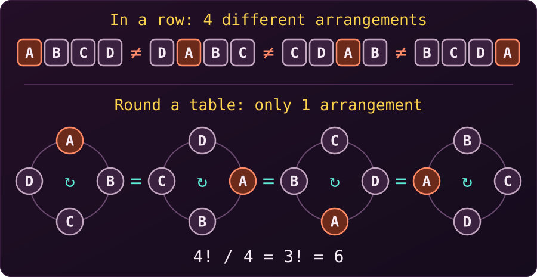
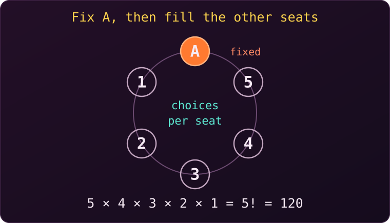
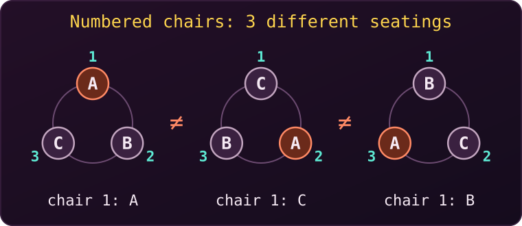
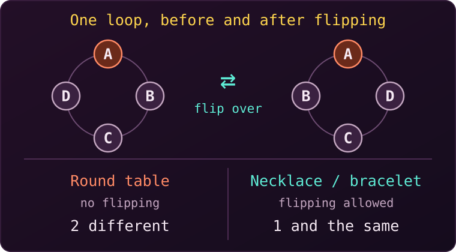
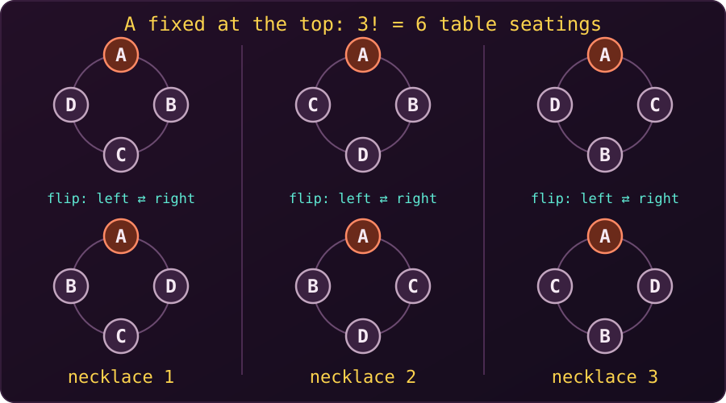
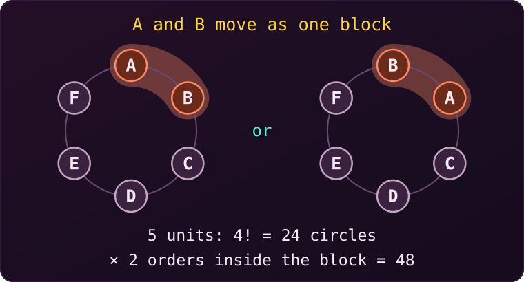
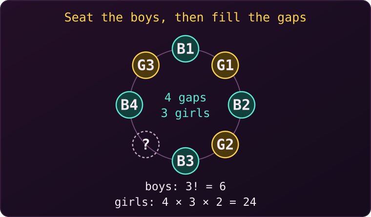
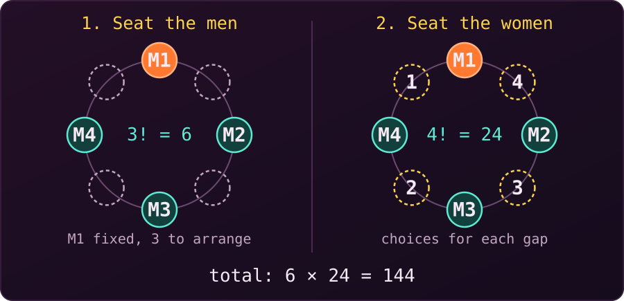
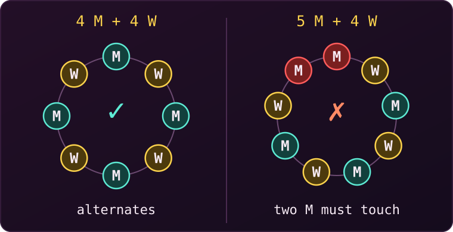
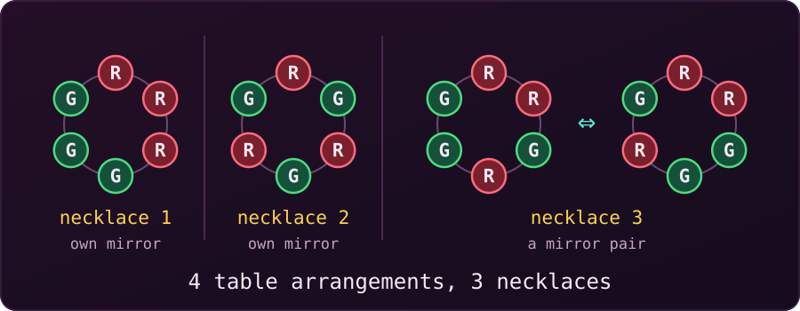

{fig-alt="The orders ABCD, DABC, CDAB and BCDA shown twice. As rows they are marked unequal, four different arrangements. Round a table they are marked equal, one arrangement, so 4 factorial divided by 4 gives 6."}

In how many ways can people sit around a round table? The answer differs from that for a row, and one idea explains why. We start with it and then add restrictions one at a time. New to arrangements in a row? See [permutations and combinations with examples](understanding-permutation-combination-with-examples.html).

## The core idea

In a **row**, the positions are different from one another (first, second, third, ...), so $n$ distinct objects can be arranged in $n!$ ways.

In a **circle**, there is no first position. If everyone moves one seat in the same direction, each person keeps the same neighbours on the same sides, so we count it as the same arrangement. Each circular arrangement therefore appears $n$ times among the $n!$ row arrangements, as in the picture above:

$$
\frac{n!}{n} = (n-1)!
$$

### Fix one person

Another way to see it: only the positions **relative to each other** matter. So we seat one person anywhere and keep them there. This person now marks a starting point, and the remaining $n-1$ seats are filled as in a row.

{fig-alt="Six seats round a table. The top one is a solid orange dot for the fixed person A, and the other five show 5, 4, 3, 2 and 1 choices, giving 120 ways."}

**Example.** 8 people can sit around a round table in $7! = 5040$ ways.

## Numbered chairs

If the chairs are numbered, it matters **which chair** each person gets. Moving everyone one seat gives a new seating, so we do not divide by $n$. We count as in a row: $n!$.

{fig-alt="Three round tables with chairs numbered 1, 2 and 3. Chair 1 holds A, then C, then B, so these are three different seatings."}

| 3 people | Number of seatings |
|:--|:--|
| Chairs not numbered | $2! = 2$ |
| Chairs numbered | $3! = 6$ |

## Necklaces and bracelets

A necklace or bracelet differs from a table in one way: we can **flip it over**. Flipping swaps left and right, so an arrangement and its mirror image are the **same** object. Necklaces, bracelets and garlands are all counted this way.

{fig-alt="The loops A B C D and A D C B are mirror images of each other. Round a table, with no flipping, they are two different arrangements. As a necklace or bracelet, with flipping allowed, they are one."}

| | Round table | Necklace or bracelet |
|:--|:--|:--|
| Turn it round | same | same |
| Flip it over | not possible | same |
| $n$ distinct objects | $(n-1)!$ | $(n-1)!/2$ |

The necklace formula needs $n \ge 3$ (with 1 or 2 objects there is only 1 arrangement). With 4 distinct beads, the 6 table arrangements pair up into 3 necklaces:

{fig-alt="Six round arrangements of A, B, C and D with A at the top, shown in three columns. In each column the lower one is the left to right mirror image of the upper one, so there are three necklaces."}

**Example.** 6 different beads make $\dfrac{5!}{2} = 60$ necklaces.

::: {.callout-note}
Some advanced combinatorics books separate the two words: there a "necklace" can only be turned round, while a "bracelet" can also be flipped. Unless a question says so, we flip both.
:::

## Sitting together

To keep two people together, we **glue them into one block**. We then have $n-1$ units around the table, which gives $(n-2)!$ arrangements. Inside the block the two can swap places, so we multiply by $2!$:

$$
2!\,(n-2)!
$$

{fig-alt="Two round tables of six seats with A and B shaded as one block. The order is A then B on one and B then A on the other. Five units give 24 circles, times 2 gives 48."}

**Example.** 6 people with A and B together: $2 \times 4! = 48$.

The same method works for $k$ particular people (with $k < n$). The block and the other $n-k$ people make $n-k+1$ units, and the block can be ordered in $k!$ ways:

$$
k!\,(n-k)!
$$

**Example.** 7 people with A, B and C together: $3! \times 4! = 144$.

## Sitting apart

For two people who must **not** be neighbours, it is easiest to subtract the "together" cases from the total:

$$
(n-1)! - 2\,(n-2)!
$$

**Example.** 6 people with A and B apart: $5! - 48 = 120 - 48 = 72$.

## No two of a group adjacent: the gap method

Suppose 4 boys and 3 girls sit around a table and no two girls may be neighbours.

{fig-alt="A round table where four boys alternate with four gaps. Three gaps hold girls and one is empty. The boys can be seated in 6 ways and the girls in 24."}

1. Seat the boys first: $3! = 6$ ways.
2. They create 4 gaps, one between each pair of neighbouring boys.
3. The girls take 3 of the 4 gaps, in order: ${}^4P_3 = 4 \times 3 \times 2 = 24$ ways.

Total: $6 \times 24 = 144$.

In general, with $m$ boys and $g$ girls ($g \le m$):

$$
(m-1)! \times {}^mP_g
$$

## Alternating seats

For men and women to alternate **all the way round**, there must be the same number of each. Take 4 men and 4 women, and seat them in two steps.

{fig-alt="Two steps. First, four men take alternate seats with M1 fixed, giving 6 ways. Second, the four gaps offer 4, 3, 2 and 1 choices to the women, giving 24 ways. The total is 144."}

1. **Men:** the table is empty, so rotations look alike. We fix one man and arrange the other three: $3! = 6$ ways.
2. **Women:** the seated men now mark the places. The gap between M1 and M2 differs from the gap between M2 and M3, so the 4 women fill 4 different places: $4! = 24$ ways.

$$
3! \times 4! = 144
$$

### Why not $4! \times 4!$?

We remove the effect of rotation **once**, because there is only one table to rotate, and seating the men already does that. Using $4!$ for the men as well treats their four seats as different from each other. Then $4! \times 4! = 576$ counts each seating 4 times, since moving everyone 0, 2, 4 or 6 seats keeps the same neighbours.

$$
\frac{4! \times 4!}{4} = 144
$$

With $m$ men and $m$ women, the answer is $(m-1)!\; m!$.

With 5 men and 4 women, strict alternation is **impossible**: going round the table, two men must end up side by side.

{fig-alt="On the left, four men and four women alternate around a table. On the right, five men and four women leave two men sitting next to each other."}

If the question only asks that **no two women** sit together, the gap method applies: $4! \times {}^5P_4 = 24 \times 120 = 2880$.

::: {.callout-note}
In a **row**, 5 men and 4 women can alternate (M W M W M W M W M), because the two ends do not touch. This gives $5!\,4! = 2880$ ways.
:::

## Identical objects

Now suppose some objects are alike: $p$ of one kind, $q$ of another, and so on, with $n$ in total.

### The shortcut and its condition

If $p, q, \ldots$ have **no common factor greater than 1**, the number of table arrangements is

$$
\frac{(n-1)!}{p!\,q!\cdots}
$$

**Example.** 3 red and 2 blue beads: $\dfrac{4!}{3!\,2!} = 2$. The blue beads are either together or apart.

Flipping either pattern over gives the same pattern again, so there are also **2** necklaces. Dividing by 2 would wrongly give 1.

### When the shortcut fails

With 3 red and 3 green beads, the formula gives $\dfrac{5!}{3!\,3!} = \dfrac{10}{3}$, which cannot be a count. The reason is that some patterns repeat before a full turn: `RGRGRG` looks the same after turning two places.

So we count directly. There are $\dfrac{6!}{3!\,3!} = 20$ row arrangements:

- 2 of them come from the repeating pattern `RGRGRG`, giving 1 circular arrangement.
- The other 18 fall into groups of 6 rotations, giving 3 circular arrangements.

That makes **4** table arrangements. Now we allow flipping and see which of them become the same:

{fig-alt="Four circular patterns of three red and three green beads. The first two are their own mirror images. The last two are mirror images of each other, so there are three necklaces."}

So the count is:

- 2 patterns that look the same after flipping: **2** necklaces;
- 2 patterns that turn into each other: **1** necklace.

That is **3** necklaces from 4 table arrangements. In short, if $T$ is the number of table arrangements and $S$ is the number of them unchanged by flipping,

$$
\text{Necklaces} = \frac{T + S}{2} = \frac{4+2}{2} = 3
$$

When all beads are distinct and $n \ge 3$, no pattern is unchanged by flipping ($S = 0$), and we are back to $\dfrac{(n-1)!}{2}$. For larger problems, **Burnside's lemma** does this kind of counting systematically.

## One more example: two conditions

Six people A, B, C, D, E and F sit around a table. A and B must be together, while C and D must be apart.

1. **A and B together:** $2 \times 4! = 48$.
2. **A and B together, C and D also together:** two blocks and two people make 4 units, so $3! \times 2! \times 2! = 24$.
3. **Subtract:** $48 - 24 = 24$.

## Quick reference

| Condition | Number of ways |
|:--|:--|
| $n$ distinct, round table | $(n-1)!$ |
| $n$ distinct, necklace or bracelet ($n \ge 3$) | $(n-1)!/2$ |
| Numbered chairs | $n!$ |
| $k$ particular people together ($k < n$) | $k!\,(n-k)!$ |
| 2 particular people apart | $(n-1)! - 2(n-2)!$ |
| $m$ boys, $g$ girls, no two girls adjacent | $(m-1)!\;{}^mP_g$ |
| $m$ men and $m$ women alternating | $(m-1)!\,m!$ |
| Identical objects, counts with no common factor | $(n-1)!/(p!\,q!\cdots)$ |
| Necklace with identical objects | $(T+S)/2$ |

## Common mistakes

- **Using $n!$ for a round table** with unnumbered chairs.
- **Forgetting to divide by 2** for necklaces and bracelets of distinct objects.
- **Dividing by 2 blindly** when some objects are identical.
- **Adding instead of multiplying** the $k!$ orders inside a block. See [when to add and when to multiply](counting-rule-and-addition-rule-when-to-add-and-multiply.html).
- **Using subtraction for "no two adjacent"** with three or more people: subtracting "all together" still leaves cases where two of them sit side by side. Use the gap method.
