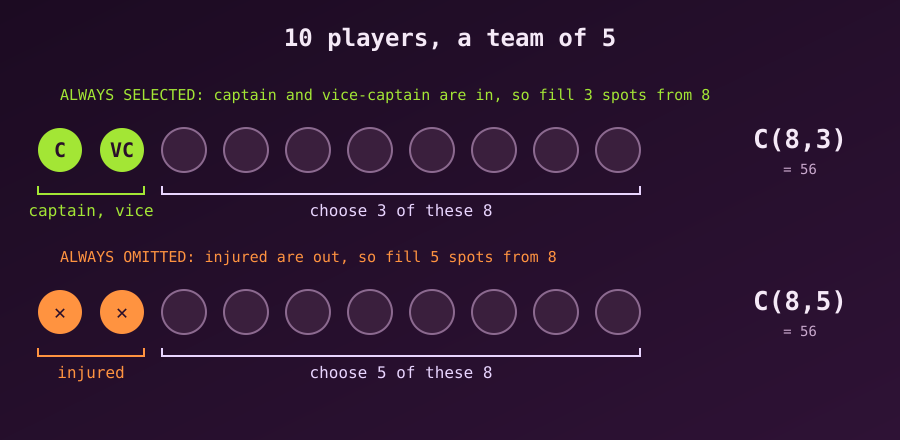

{fig-alt="Two rows of ten circles. In the first, a captain and a vice-captain (marked C and VC) are set aside and 3 players are chosen from the remaining 8. In the second, two crossed-out injured players are set aside and 5 players are chosen from the remaining 8."}

Choosing $r$ items from $n$ (see [Understanding Permutations and Combinations with Examples](understanding-permutation-combination-with-examples.html) for the basics) normally gives $\binom{n}{r}$ ways. But what if $p$ particular items **must** be included, or **must not** be? We start with a concrete team and let the logic show us the formula.

## The situation

A coach must pick a team of $r = 5$ players from a squad of $n = 10$. Without any condition there are $\binom{10}{5} = 252$ teams. Now we add a condition, in two different versions.

## Case 1: some items are always selected

The captain and the vice-captain ($p = 2$) must both be on the team.

1. The captain and vice-captain already hold 2 of the 5 spots, and their places are settled. They no longer take part in the choosing.
2. The spots still open: $5 - 2 = 3$.
3. The players still available: $10 - 2 = 8$ (everyone except the captain and vice-captain).
4. So the only real decision is which 3 of the other 8 join them:

$$
\binom{8}{3} = \frac{8 \times 7 \times 6}{3 \times 2 \times 1} = \mathbf{56} \text{ ways.}
$$

## Case 2: some items are always omitted

Instead, 2 players ($p = 2$) are injured and must stay out.

1. Injured players can never be picked, so we simply remove them from the squad: $10 - 2 = 8$ players remain.
2. Nothing has been filled, so all 5 spots are still open.
3. The decision is which 5 of the healthy 8 play:

$$
\binom{8}{5} = \frac{8 \times 7 \times 6}{3 \times 2 \times 1} = \mathbf{56} \text{ ways.}
$$

::: {.callout-note}
The two answers are equal here only by coincidence of the numbers: $\binom{8}{3} = \binom{8}{5}$ because choosing 3 players to include is the same as choosing 5 to leave out. The two cases are different problems in general.
:::

## Deriving the general formulas

Replace the numbers by letters: $n$ items, $r$ to select, $p$ special items.

**Always selected.** The $p$ special items are placed, so we remove them from both the pool and the spots:

$$
\text{pool} = n - p, \qquad \text{spots} = r - p \quad\Longrightarrow\quad \boxed{\binom{n-p}{\,r-p\,}}
$$

This needs $p \le r \le n$: we cannot force in more items than there are spots.

**Always omitted.** The $p$ special items leave the pool, but the spots are untouched:

$$
\text{pool} = n - p, \qquad \text{spots} = r \quad\Longrightarrow\quad \boxed{\binom{n-p}{\,r\,}}
$$

This needs $r \le n - p$: enough items must remain to fill every spot.

## Summary

| Condition | Pool left | Spots left | Ways |
|:--|:--:|:--:|:--:|
| $p$ items always selected | $n-p$ | $r-p$ | $\binom{n-p}{r-p}$ |
| $p$ items always omitted | $n-p$ | $r$ | $\binom{n-p}{r}$ |

In both cases the pool shrinks by $p$. What differs is whether the spots shrink too: yes if the items are forced in, no if they are kept out.

::: {.callout-note}
## Notation

Many textbooks write combinations as $^{n}C_{r}$ or $nCr$ instead of $\binom{n}{r}$. All three mean the same thing, so the results above read equally well as $^{n-p}C_{r-p}$ and $^{n-p}C_{r}$.
:::
