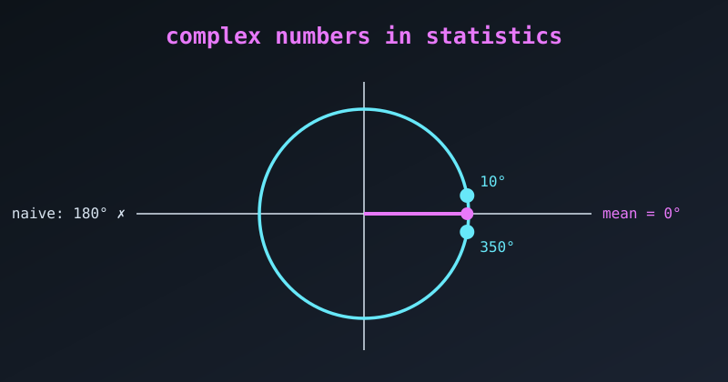

{fig-alt="A unit circle on the complex plane with two points at 10 and 350 degrees. The complex average points to 0 degrees, while the naive average of 180 degrees is marked as wrong."}

Complex numbers act as a mathematical shortcut in statistics: they turn messy calculus and probability problems into simple algebra. If complex numbers are new to us, [the earlier post on complex numbers](complex-numbers.html) covers the basics. Here we only need one fact: $e^{i\theta} = \cos\theta + i\sin\theta$ is a point on the unit circle.

## 1. Characteristic functions

Every probability distribution has a "fingerprint" called its **characteristic function**:

$$
\varphi_X(t) = E\left[e^{itX}\right]
$$

Unlike the moment-generating function, it exists for **every** distribution, because $e^{itX}$ always stays on a circle of radius 1 and never explodes. That includes chaotic ones such as the Cauchy distribution, where the mean and variance do not exist.

### Example: adding independent variables

For a coin flip $X$ (1 with probability $p$, otherwise 0):

$$
\varphi_X(t) = (1 - p) + p\,e^{it}
$$

The total of two independent flips would normally need a convolution (a sum or integral over all ways to get each total). With characteristic functions, adding independent variables just **multiplies** them:

$$
\varphi_{X_1 + X_2}(t) = \left[(1 - p) + p\,e^{it}\right]^2
$$

This is exactly the characteristic function of a Binomial(2, $p$), which is the right answer. Calculus has become multiplication.

### Example: why the Cauchy average never settles

The standard Cauchy distribution has $\varphi(t) = e^{-|t|}$. For the average of $n$ independent Cauchy values, we multiply $n$ copies and rescale $t$ by $1/n$:

$$
\varphi_{\bar{X}}(t) = \left[e^{-|t|/n}\right]^n = e^{-|t|}
$$

The average has the **same** distribution as a single observation. Collecting more data never helps, which is why the [law of large numbers](what-is-law-of-large-numbers-what-it-is-not.html) fails for the Cauchy. The same machinery is the standard proof route for the [central limit theorem](charishma-of-clt.html): the characteristic function of a standardised average approaches $e^{-t^2/2}$, that of the normal distribution.

## 2. Circular statistics: averaging angles

Real numbers struggle with angles. The directions $350^\circ$ and $10^\circ$ are only 20 degrees apart, yet their ordinary average is

$$
\frac{350 + 10}{2} = 180^\circ
$$

which points the opposite way. On the complex unit circle, each angle $\theta$ becomes the point $e^{i\theta}$. We average the points, then read off the angle:

$$
\frac{e^{i\,350^\circ} + e^{i\,10^\circ}}{2} = \frac{(\cos 350^\circ + \cos 10^\circ) + i(\sin 350^\circ + \sin 10^\circ)}{2} = \cos 10^\circ \approx 0.985
$$

The sines cancel ($\sin 350^\circ = -\sin 10^\circ$), leaving a point on the positive real axis. Its angle is $0^\circ$, the sensible answer. The length of the average, 0.985, is also useful: it is close to 1 when the angles are tightly clustered and close to 0 when they are spread all around.

```{r}
#| echo: false
#| fig-alt: "The unit circle in the complex plane with Real and Imaginary axes. Two blue points sit at 10 and 350 degrees; their average, a red point inside the circle on the positive real axis, lies at angle 0."
library(ggplot2)

ang <- c(10, 350) * pi / 180
pts <- data.frame(x = cos(ang), y = sin(ang))
mean_pt <- data.frame(x = mean(cos(ang)), y = mean(sin(ang)))
circle <- data.frame(t = seq(0, 2 * pi, length.out = 200))

ggplot() +
  geom_hline(yintercept = 0) + geom_vline(xintercept = 0) +
  geom_path(data = circle, aes(cos(t), sin(t)), colour = "steelblue") +
  geom_segment(data = mean_pt, aes(x = 0, y = 0, xend = x, yend = y),
               arrow = arrow(length = unit(0.2, "cm")), colour = "tomato", linewidth = 1) +
  geom_point(data = pts, aes(x, y), colour = "steelblue", size = 3) +
  geom_point(data = mean_pt, aes(x, y), colour = "tomato", size = 3) +
  annotate("text", x = 0.97, y = 0.28, label = "10°", hjust = 0) +
  annotate("text", x = 0.97, y = -0.28, label = "350°", hjust = 0) +
  annotate("text", x = mean_pt$x - 0.05, y = 0.12, label = "average", colour = "tomato", hjust = 1) +
  coord_fixed(xlim = c(-1.3, 1.5), ylim = c(-1.3, 1.3)) +
  labs(x = "Real axis", y = "Imaginary axis")
```

This is how statisticians average wind directions, bird migration paths, times of day and circadian rhythms.

## 3. Time series and spectral analysis

When data fluctuates over time (ocean tides, brain waves, monthly sales), the **Fourier transform** maps it into complex numbers whose sizes show which cycles are present. A series with a yearly rhythm in monthly data shows a peak at a period of 12 months. Spectral analysis is a standard way to find hidden cycles and periodic trends.

## 4. Complex normal data

In radar, wireless communication and MRI, each measurement arrives as an amplitude and a phase, that is, a pair of numbers. Writing the pair as one complex number $z = x + iy$ keeps the geometry intact (size and angle) instead of splitting it into two separate real values, and gives a compact way to model signal plus noise.

## Why this is useful

| Idea | Without complex numbers | With complex numbers |
|:-----|:------------------------|:---------------------|
| Sum of independent variables | Convolution (an integral) | Multiply characteristic functions |
| Existence of a transform | Moment-generating function may not exist | Characteristic function always exists |
| Averaging angles | $350^\circ$ and $10^\circ$ give $180^\circ$ | Gives $0^\circ$, as it should |
| Two-part measurements | Two separate real values | One complex value |

## Key takeaway

- Complex numbers are not a curiosity in statistics: they make sums of random variables, proofs and angle averages simpler.
- The unit-circle point $e^{i\theta}$ is the key object, since it stays bounded and encodes angles naturally.
