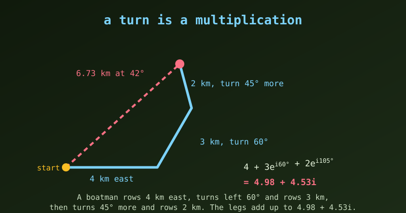

{fig-alt="A path of three legs: 4 km east, 3 km after a 60 degree left turn, and 2 km after a further 45 degree turn. A dashed arrow from the start to the finish shows the total, 6.73 km at 42 degrees."}

A boatman who keeps changing direction, and waves that start at different times, are the same kind of problem, and both are clumsy with trigonometry. (In [an earlier post](cases-when-complex-numbers-are-more-natural-than-so-called-real-ones.html) we saw that complex numbers handle them easily.) Let's work through examples **both ways**, starting with the boatman.

## The idea

A **boat leg**, a distance $d$ in a heading $\theta$, is the arrow $d\,e^{i\theta}$: length $d$, angle $\theta$. A **wave** $A\cos(t + \phi)$ with strength $A$ and timing $\phi$ works the same way, as the arrow $A\,e^{i\phi}$. In both cases:

- **Adding waves (or legs) is adding arrows.**
- **Turning by an angle $\alpha$ is multiplying by $e^{i\alpha}$.**

## Example 1: a boatman who turns

A boatman rows **4 km east**, turns **left by 60°**, and rows **3 km**. How far is he from the start, and in which direction?

### The trigonometry way

The two legs and the straight line back to the start form a triangle. The angle inside the triangle at the turn is $180^\circ - 60^\circ = 120^\circ$ (an easy place to slip).

1. **Law of cosines** for the distance:

   $$d^2 = 4^2 + 3^2 - 2(4)(3)\cos 120^\circ = 25 + 12 = 37, \qquad d \approx 6.08 \text{ km}$$

2. **Law of sines** for the direction at the start:

   $$\sin\alpha = \frac{3\sin 120^\circ}{6.08} \approx 0.427 \quad\Rightarrow\quad \alpha \approx 25.3^\circ$$

   (The sine rule can give two possible angles, so we must check that the acute one is right.)

### The complex way

East is the direction $e^{i0^\circ} = 1$. After a 60° left turn he faces $e^{i60^\circ}$:

$$
4 + 3e^{i60^\circ} = 4 + 3(0.5 + 0.866i) = 5.5 + 2.598i
$$

Distance: $\sqrt{5.5^2 + 2.598^2} = \sqrt{37} \approx 6.08$ km. Direction: $\tan^{-1}(2.598/5.5) \approx 25.3^\circ$ north of east. The same result with no triangle drawing and no ambiguity.

## Example 2: he turns again

After the second leg, the boatman turns left by another **45°** and rows **2 km** more. His heading is now $60^\circ + 45^\circ = 105^\circ$.

### The trigonometry way

We must start a new triangle with the *result so far* (6.08 km at 25.3°) and the new leg (2 km at 105°):

1. Angle between them: $105^\circ - 25.3^\circ = 79.7^\circ$, so the angle inside the triangle is $180^\circ - 79.7^\circ = 100.3^\circ$.
2. Law of cosines: $d^2 = 6.08^2 + 2^2 - 2(6.08)(2)\cos 100.3^\circ \approx 37 + 4 + 4.37 = 45.4$, so $d \approx 6.73$ km.
3. Law of sines: $\sin\beta = \dfrac{2\sin 100.3^\circ}{6.73} \approx 0.292$, so $\beta \approx 17.0^\circ$.
4. Direction: $25.3^\circ + 17.0^\circ = 42.3^\circ$.

Every extra leg needs a new triangle, a new interior angle to track, and the earlier rounding errors carry along.

### The complex way

The third leg is just another arrow, $2e^{i105^\circ} = -0.518 + 1.932i$. Add it to what we have:

$$
4 + 3e^{i60^\circ} + 2e^{i105^\circ} = 5.5 + 2.598i + (-0.518 + 1.932i) = 4.982 + 4.530i
$$

Distance: $\sqrt{4.982^2 + 4.530^2} \approx 6.73$ km. Direction: $\tan^{-1}(4.530/4.982) \approx 42.3^\circ$. A fourth leg would be one more term.

## Example 3: two waves

Add $3\cos t$ and $4\cos(t + 30^\circ)$.

### The trigonometry way

1. Expand the second wave with $\cos(A + B) = \cos A\cos B - \sin A\sin B$:

   $$4\cos(t + 30^\circ) = 4\cos t\,\cos 30^\circ - 4\sin t\,\sin 30^\circ = 3.464\cos t - 2\sin t$$

2. Add the first wave:

   $$3\cos t + 3.464\cos t - 2\sin t = 6.464\cos t - 2\sin t$$

3. This is not yet one wave. We want $R\cos(t + \varphi) = R\cos\varphi\cos t - R\sin\varphi\sin t$, so we match coefficients:

   $$R\cos\varphi = 6.464, \qquad R\sin\varphi = 2$$

4. Square and add to get the strength: $R = \sqrt{6.464^2 + 2^2} = \sqrt{45.78} \approx 6.77$.

5. Divide to get the timing: $\tan\varphi = 2/6.464$, so $\varphi \approx 17.2^\circ$.

**Result:** $6.77\cos(t + 17.2^\circ)$, after five steps and an identity we had to remember.

### The complex way

$$
3 + 4e^{i30^\circ} = 3 + 4(\cos 30^\circ + i\sin 30^\circ) = 6.464 + 2i
$$

The length is $\sqrt{6.464^2 + 2^2} \approx 6.77$ and the angle is $\tan^{-1}(2/6.464) \approx 17.2^\circ$. The same answer, but there was no identity to recall and no matching step. The length and angle come straight off the number.

```{r}
#| echo: false
#| fig-alt: "Three wave curves over one cycle, 0 to 360 degrees: 3cos t, 4cos(t + 30 degrees) and their sum, a larger wave of height about 6.77 shifted by about 17 degrees."
library(ggplot2)

t <- seq(0, 360, length.out = 400)
rad <- t * pi / 180
d <- rbind(
  data.frame(t, y = 3 * cos(rad), wave = "3cos t"),
  data.frame(t, y = 4 * cos(rad + 30 * pi / 180), wave = "4cos(t + 30°)"),
  data.frame(t, y = 6.766 * cos(rad + 17.19 * pi / 180), wave = "sum: 6.77cos(t + 17.2°)")
)

ggplot(d, aes(t, y, colour = wave)) +
  geom_line(linewidth = 1) +
  scale_x_continuous(breaks = seq(0, 360, 90)) +
  labs(x = "t (degrees)", y = "Value", colour = NULL) +
  theme(legend.position = "bottom")
```

## Example 4: three waves

Now add a third wave, $2\cos(t + 120^\circ)$, to the first two.

### The trigonometry way

We must expand **every** shifted wave, then collect the cosine and sine terms:

$$
\begin{aligned}
4\cos(t + 30^\circ) &= 3.464\cos t - 2\sin t \\
2\cos(t + 120^\circ) &= -1\cos t - 1.732\sin t
\end{aligned}
$$

Total: $(3 + 3.464 - 1)\cos t + (-2 - 1.732)\sin t = 5.464\cos t - 3.732\sin t$.

Then match to $R\cos(t + \varphi)$ again: $R = \sqrt{5.464^2 + 3.732^2} \approx 6.62$ and $\tan\varphi = 3.732/5.464$, giving $\varphi \approx 34.3^\circ$.

Each extra wave costs another identity expansion.

### The complex way

Just add another arrow:

$$
3 + 4e^{i30^\circ} + 2e^{i120^\circ} = (6.464 + 2i) + (-1 + 1.732i) = 5.464 + 3.732i
$$

Its length is $\sqrt{5.464^2 + 3.732^2} \approx 6.62$ and its angle is $\tan^{-1}(3.732/5.464) \approx 34.3^\circ$. A fourth or fifth wave is one more term in the sum.

## Why trigonometry is clumsy here

| Task | Trigonometry | Complex numbers |
|:-----|:-------------|:----------------|
| Keep track of a turn | Interior angles and $180^\circ - \theta$ | Multiply by $e^{i\alpha}$ |
| Direction | Law of sines (two possible angles) | $\tan^{-1}$ of the sum |
| Add one more leg or wave | New triangle or new expansion | One more term |
| Add a shifted wave | Expand with an identity, then match $R\cos(t + \varphi)$ | Add one arrow |

::: {.callout-note}
The final arithmetic is the same: both methods end up with the same cosines and sines of angles. What complex numbers remove is the **bookkeeping**: identities to recall, triangles to draw, and angles to track. That is why engineers use them for AC circuits, where dozens of waves with different phases have to be added.
:::

## Key takeaway

- A wave with a phase, or a boat leg with a heading, is an arrow $A\,e^{i\theta}$.
- Adding is adding arrows, and turning is multiplying by $e^{i\alpha}$.
- Trigonometry does the same job, but each extra wave or leg means another identity or another triangle.
