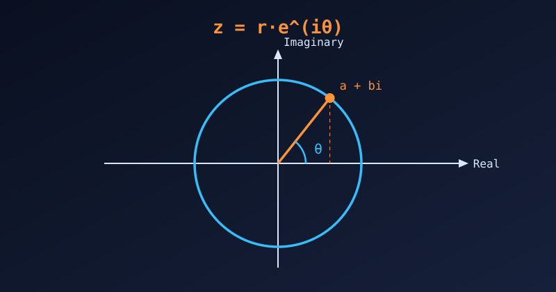

{fig-alt="A complex plane with a horizontal real axis and a vertical imaginary axis, a circle around the origin, and an arrow from the origin to a point on the circle at angle theta."}

Complex numbers are just as "real" as real numbers: both are abstract models that people created to describe the physical world. The labels "real" and "imaginary" are historical accidents, and complex numbers are essential for modelling waves, rotations and oscillations.

## Why they are equally "real"

- **Both are human abstractions.** We cannot hold $-5$ or $\pi$ in our hands any more than we can hold $i = \sqrt{-1}$. Each is a set of rules that reliably predicts how nature behaves.
- **An unfortunate name.** In the 17th century René Descartes called these numbers "imaginary", as a mild insult, because square roots of negative numbers troubled him. The name stuck, although the numbers are completely consistent.
- **Two-dimensional numbers.** A real number sits on a line. A complex number $z = a + bi$ sits on a plane, with a real part $a$ and an imaginary part $b$. Multiplying by $i$ is a 90-degree rotation, which is as physical as moving forward or backward.

## The complex plane

We draw the real part on the horizontal axis and the imaginary part on the vertical axis. So $z = 3 + 2i$ is the point 3 to the right and 2 up.

```{r}
#| echo: false
#| fig-alt: "The complex plane with a horizontal Real axis and a vertical Imaginary axis. An arrow runs from the origin to the point 3 + 2i, with dashed lines to the axes and an arc marking its angle of about 34 degrees."
library(ggplot2)

z <- 3 + 2i
arc <- data.frame(t = seq(0, Arg(z), length.out = 50))

ggplot() +
  geom_hline(yintercept = 0) + geom_vline(xintercept = 0) +
  geom_segment(aes(x = 0, y = 0, xend = Re(z), yend = Im(z)),
               arrow = arrow(length = unit(0.25, "cm")), colour = "tomato", linewidth = 1) +
  geom_segment(aes(x = Re(z), y = 0, xend = Re(z), yend = Im(z)), linetype = "dashed") +
  geom_segment(aes(x = 0, y = Im(z), xend = Re(z), yend = Im(z)), linetype = "dashed") +
  geom_path(data = arc, aes(0.8 * cos(t), 0.8 * sin(t)), colour = "steelblue") +
  annotate("point", x = Re(z), y = Im(z), size = 3, colour = "tomato") +
  annotate("text", x = Re(z) + 0.1, y = Im(z) + 0.25, label = "3 + 2i", hjust = 0) +
  annotate("text", x = 1.1, y = 0.35, label = "theta", parse = TRUE) +
  coord_fixed(xlim = c(-1, 4.5), ylim = c(-1, 3)) +
  labs(x = "Real axis", y = "Imaginary axis")
```

The same point can be described by its length and direction, the **polar form**:

$$
z = r\,e^{i\theta} = r(\cos\theta + i\sin\theta), \qquad r = \sqrt{a^2 + b^2}
$$

Here $r = \sqrt{3^2 + 2^2} = \sqrt{13} \approx 3.61$ and $\theta \approx 33.7^\circ$.

## Multiplying by $i$ rotates by 90 degrees

Complex arithmetic follows the usual rules together with $i^2 = -1$. For example:

$$
(1 + 2i)(3 - i) = 3 - i + 6i - 2i^2 = 5 + 5i
$$

Multiplying our point by $i$ turns it a quarter turn counter-clockwise, and four turns bring it back:

$$
3 + 2i \;\to\; -2 + 3i \;\to\; -3 - 2i \;\to\; 2 - 3i \;\to\; 3 + 2i
$$

More generally, **multiplying complex numbers multiplies their lengths and adds their angles.** This one fact is behind most of the shortcuts below.

## How complex numbers ease real-world calculations

Complex numbers replace messy trigonometry with simple arithmetic. Here are small examples that we can do by hand.

### 1. AC circuits

In alternating current, voltage and current oscillate like waves and drift out of step. Engineers give each component a complex **impedance** $Z$: a resistor is $R$, an inductor is $jX_L$ (engineers write $j$ for $i$). Series impedances simply add, and Ohm's law $I = V/Z$ still holds.

Take a resistor of 3 $\Omega$ in series with an inductor of 4 $\Omega$ (reactance), driven by 10 V:

$$
Z = 3 + 4j, \qquad |Z| = \sqrt{3^2 + 4^2} = 5\ \Omega
$$

$$
I = \frac{10}{3 + 4j} = \frac{10(3 - 4j)}{(3 + 4j)(3 - 4j)} = \frac{30 - 40j}{25} = 1.2 - 1.6j
$$

The size of the current is $|I| = 10/5 = 2$ A, and its angle is $\tan^{-1}(-1.6/1.2) \approx -53^\circ$, so the current **lags the voltage by 53 degrees**. One short calculation gives both the amount and the timing. With sines and cosines we would be solving a differential equation or juggling phase-shift identities.

### 2. Rotating points in 2D graphics

Rotating a point $(x, y)$ by an angle $\theta$ normally needs the matrix

$$
\begin{pmatrix} x' \\ y' \end{pmatrix} =
\begin{pmatrix} \cos\theta & -\sin\theta \\ \sin\theta & \cos\theta \end{pmatrix}
\begin{pmatrix} x \\ y \end{pmatrix}
$$

With complex numbers it is a single multiplication, $z' = z\,e^{i\theta}$. To rotate the point $(1, 1)$ by 45 degrees, multiply by $e^{i\pi/4} = (1 + i)/\sqrt{2}$ (since $\pi/4$ radians is exactly 45 degrees):

$$
(1 + i)\cdot\frac{1 + i}{\sqrt{2}} = \frac{1 + 2i + i^2}{\sqrt{2}} = \frac{2i}{\sqrt{2}} = \sqrt{2}\,i
$$

So $(1, 1)$ moves to $(0, \sqrt{2})$, straight up the imaginary axis, exactly as a 45-degree turn should. Chaining two rotations just multiplies the factors.

### 3. Signals and Wi-Fi

A wave needs both a cosine and a sine to describe its size and timing. The single complex number $e^{i\omega t} = \cos\omega t + i\sin\omega t$ carries both at once. This is why the Fast Fourier Transform (FFT), which splits a messy signal into clean frequencies, is written with complex numbers. The same idea powers Wi-Fi, streaming video and phone calls.

### 4. Other places

- **Quantum mechanics.** Schrödinger's equation, which governs atoms, lasers and semiconductors, contains $i$ explicitly.
- **Control systems and aviation.** Engineers place a system's behaviour on the complex plane to see whether an aircraft will settle after turbulence or spiral out of control.

## Drawing a circle with complex numbers in R

The equation of a circle with centre $(h, k)$ and radius $r$ is usually written as an implicit equation:

$$
(x - h)^2 + (y - k)^2 = r^2
$$

It describes the circle but does not tell us how to plot it: `plot()` needs points, so we must solve for $y$ twice (upper and lower halves). In the complex plane the same circle is one compact formula, with the centre $c = h + ki$:

$$
|z - c| = r \quad\Longleftrightarrow\quad z = c + r\,e^{i t}, \quad 0 \le t < 2\pi
$$

As $t$ runs around, $e^{it}$ walks once round the unit circle, so we get the points directly:

```{r}
#| fig-alt: "A circle of radius 3 centred at 2 + 1i drawn in the complex plane, with its centre marked and the Real and Imaginary axes labelled."
c0 <- 2 + 1i      # centre
r  <- 3           # radius
t  <- seq(0, 2 * pi, length.out = 200)

z  <- c0 + r * exp(1i * t)

ggplot(data.frame(re = Re(z), im = Im(z)), aes(re, im)) +
  geom_hline(yintercept = 0) + geom_vline(xintercept = 0) +
  geom_path(colour = "steelblue", linewidth = 1) +
  annotate("point", x = Re(c0), y = Im(c0), colour = "tomato", size = 3) +
  coord_fixed() +
  labs(x = "Real axis", y = "Imaginary axis")
```

::: {.callout-note}
With real numbers we would write `x <- h + r * cos(t)` and `y <- k + r * sin(t)` separately. Complex numbers pack both coordinates into one value, so shifting (adding $c$), scaling (multiplying by $r$) and rotating (multiplying by $e^{i\alpha}$) are single operations on `z`.
:::

## Key takeaway

- A complex number is a point (or arrow) on a plane: real part along one axis, imaginary part along the other.
- Multiplication scales lengths and adds angles, so rotation becomes multiplication.
- That makes AC circuit analysis, rotations, frequency analysis and curve drawing shorter and cleaner.
