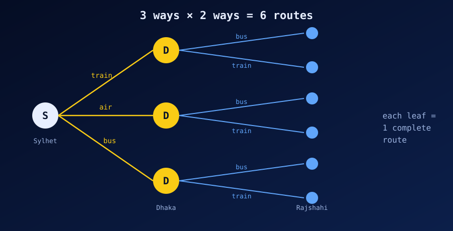

{fig-alt="A tree diagram. Sylhet branches into three ways to reach Dhaka (train, air, bus). Each Dhaka node branches into two ways to reach Rajshahi (bus, train), ending in six leaves."}

Counting problems usually come down to one question: do we **add** the numbers of ways, or **multiply** them? We answer it with two examples, then see why the common slogan is not quite right.

## Multiplying: the counting rule

There are 3 ways to go from Sylhet to Dhaka, and 2 ways to go from Dhaka to Rajshahi. How many ways are there to get from Sylhet to Rajshahi?

We can list every route with a tree:

- Sylhet to Dhaka by train, then Dhaka to Rajshahi by bus or train: **2** routes.
- Sylhet to Dhaka by air, then bus or train: **2** routes.
- Sylhet to Dhaka by bus, then bus or train: **2** routes.

The tree diagram above shows the same count.

$$
\text{Total} = 2 + 2 + 2 = 6
$$

Adding the same number three times is just multiplication, so we could have written

$$
3 \times 2 = 6
$$

directly. This is the **fundamental counting principle** (the counting rule):

::: {.callout-note}
If one stage can be done in $m$ ways and, whichever way it was done, a second stage can be done in $n$ ways, then the two stages together can be done in $m \times n$ ways.
:::

It is the building block behind permutations and combinations: see [Understanding Permutations and Combinations with Examples](understanding-permutation-combination-with-examples.html) for it in action.

## Adding: the addition rule

To travel from Dhaka to Chattogram we can take one of 5 flights **or** one of 3 trains. We will take only one of them, so there is no second stage to carry out:

$$
5 + 3 = 8 \text{ ways.}
$$

The addition rule applies when the options are **alternatives that cannot happen together** (and none is counted twice).

## A better way to decide

The words "and" and "or" help only sometimes. A more reliable test is to ask whether the choice is **finished** after one pick.

| Situation | Is the choice complete? | Operation |
|:--|:--|:--|
| Sylhet to Rajshahi: we have reached Dhaka but not Rajshahi | Incomplete: another stage is needed | **Multiply** ($3 \times 2$) |
| Dhaka to Chattogram: one flight or one train | Complete: the trip is done | **Add** ($5 + 3$) |

- **Incomplete choices:** keep multiplying until the whole task is complete.
- **Complete alternatives:** add them.

## Why "AND means multiply, OR means add" can mislead

In permutations, combinations and probability we often hear that AND leads to multiplication and OR leads to addition. That is a useful shortcut, but it has conditions.

- **Multiplication** is valid when the number of ways (or the probability) at the second stage is the one that applies *after* the first stage. For counting, the second stage must have the same number of options whichever first option we took. For probabilities, we multiply by the conditional probability, which equals the plain probability only when the events are **independent**.
- **Addition** is valid when the alternatives are **mutually exclusive**. If they can overlap, we must subtract the overlap.

In probability notation:

$$
P(A \cup B) = P(A) + P(B) - P(A \cap B)
$$

$$
P(A \cap B) = P(A)\,P(B \mid A)
$$

The first reduces to simple addition when $P(A \cap B) = 0$ (mutually exclusive events). The second reduces to $P(A)\,P(B)$ when $A$ and $B$ are independent.

## Using both in one problem

A bag has 6 red and 4 green balls. We draw 2 balls **with replacement**. What is the probability that both have the same colour?

Each way of getting "same colour" is a sequence of two draws, so each way is an *incomplete* choice until both draws are made (multiply). The two ways, red-red and green-green, are *complete* and cannot happen together (add):

$$
\begin{aligned}
P(\text{same}) &= P(R_1 R_2) + P(G_1 G_2) \\
&= P(R_1)\,P(R_2) + P(G_1)\,P(G_2) \\
&= \frac{6}{10}\cdot\frac{6}{10} + \frac{4}{10}\cdot\frac{4}{10} \\
&= 0.36 + 0.16 = \mathbf{0.52}
\end{aligned}
$$

::: {.callout-tip}
## Without replacement

If the first ball is not put back, the second draw depends on the first, so we multiply by conditional probabilities instead:

$$
\begin{aligned}
P(\text{same}) &= \frac{6}{10}\cdot\frac{5}{9} + \frac{4}{10}\cdot\frac{3}{9} \\
&= \frac{30 + 12}{90} = \frac{7}{15} \approx 0.467
\end{aligned}
$$

We still multiply along each sequence and add the two exclusive outcomes.
:::

## Summary

- **Multiply** stages that are carried out one after another until the task is complete.
- **Add** complete, mutually exclusive alternatives.
- Check the conditions (dependence and overlap) before applying the slogan.
