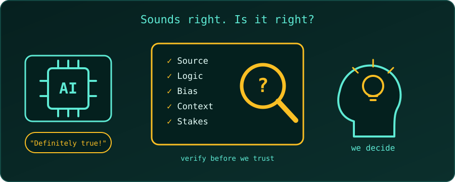

{fig-alt="An AI chip claims a confident answer, a magnifying glass and checklist examine it, and a human head with a lightbulb decides."}

In the AI age, critical thinking has moved from a "nice-to-have" soft skill to a **survival necessity**.

AI is very good at generating text, analysing data and solving problems quickly. But it is also a black box: it can be confidently wrong, it can be biased, and it lacks human context. Here is why critical thinking is the most important skill to build right now.

## 1. Catching the "Confident Liar" (Hallucinations)

Generative AI doesn't *know* facts; it predicts the most likely next word (or pixel) from patterns in its training data. The result can be articulate, well-formatted nonsense, often called a **hallucination**.

**The role of critical thinking:** evaluate the logic of an argument, verify the sources, and ask, *"Does this actually make sense, or does it just sound good?"* Without that habit, we are easily fooled by false information that looks professional.

## 2. Spotting Algorithmic Bias

AI models are trained on human data, so they absorb human prejudices, stereotypes and systemic biases.

**The role of critical thinking:** look at an output and ask, *"Who is missing from this data? What assumptions is the algorithm making? Is this fair?"* People have to be the ethical check, so that AI does not quietly repeat discrimination at scale.

## 3. Asking the Right Questions (GIGO)

"Garbage in, garbage out" is the old rule of computing, and it still holds: the quality of an AI's answer depends on the quality of the question and the depth of the problem behind it.

**The role of critical thinking:** AI cannot tell us *what* problem to solve or *why* it matters. We have to define the problem, break it into logical steps, and ask the questions that lead to a useful answer.

## 4. Filtering Information Overload and Deepfakes

AI has made fake news, deepfake videos and automated spam cheap and easy to produce. We are entering an era where seeing is no longer believing.

**The role of critical thinking:** judge the credibility of the source, cross-check with other sources, and ask who made the content and why. Critical thinking is a personal firewall against manipulation.

## 5. Resisting Automation Bias

**Automation bias** is the human tendency to over-trust machines: if a computer said it, it must be right.

**The role of critical thinking:** stay sceptical. Challenge the AI, double-check its arithmetic, and recognise when human intuition, empathy or real-world context should override the machine's recommendation.

## 6. Making High-Stakes Decisions

AI can list the options, but it cannot take responsibility for the consequences. In a medical diagnosis, a legal strategy or a business merger, AI can assist, but it should not decide.

**The role of critical thinking:** weigh the ethical, emotional and long-term implications of a decision, which an AI does not truly understand.

## A Quick Checklist for Using AI Answers

Before trusting an AI answer, it helps to ask:

1. **Source:** can I verify this claim somewhere reliable?
2. **Logic:** does each step follow from the previous one?
3. **Bias:** whose viewpoint or data might be missing?
4. **Context:** does this fit my real situation, or only the general case?
5. **Stakes:** what happens if this is wrong, and who bears the cost?

## Summary: The New Division of Labour

| AI is excellent at **processing** | Humans are essential for **evaluating** |
| :--- | :--- |
| speed and scale | truth |
| pattern recognition | ethics |
| generating drafts and options | context and wisdom |

Using AI without critical thinking turns us into passive consumers of whatever the algorithm feeds us. With it, we become the **director** of a powerful tool, using it to strengthen our own intellect rather than replace it.
