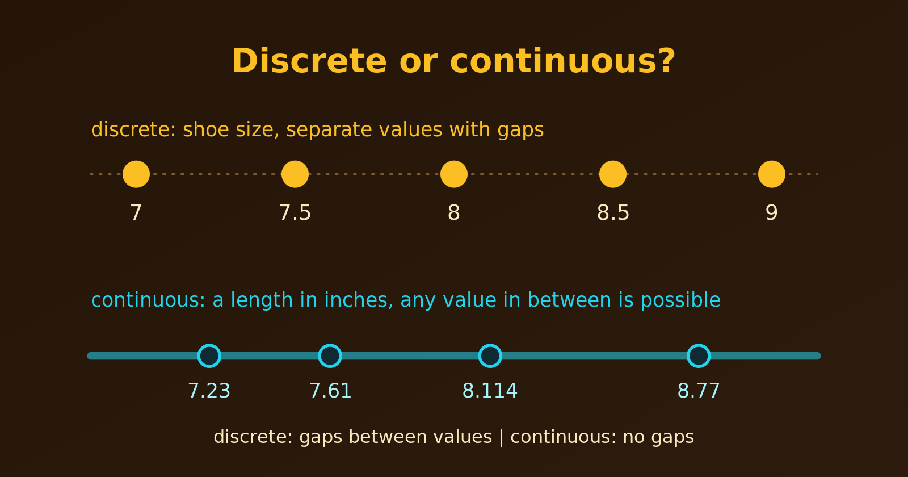

{.bk-adapt fig-alt="Two number lines. The top one shows shoe sizes 7, 7.5, 8, 8.5 and 9 as separate dots. The bottom one shows a continuous length as a solid line with markers at 7.23, 7.61, 8.114 and 8.77, any value being possible."}

Many people think that a discrete variable must be a whole number, like the number of children. That is not the definition. A variable is **discrete** if it takes **distinct, isolated values that can be counted**, so that there is a gap between any two neighbouring allowed values. Those values may well be fractions or decimals.

What matters is not whether the numbers are whole, but whether **values between two neighbours are possible**.

## Examples of Discrete Variables with Fractional Values

- **Shoe sizes.** We can buy size 8, 8.5, 9 or 9.5, in steps of 0.5. A size 8.23 does not exist, so the set of values is separate and countable.
- **Stock prices before decimalisation.** Before 2001, US stock exchanges quoted prices in fractions such as $\frac{1}{8}$ or $\frac{1}{16}$ of a dollar (for example $10\frac{1}{8}$ or $10\frac{1}{4}$). A price between two fractions was not allowed.
- **Pre-decimal British money.** Before 1971, coins included the halfpenny ($\frac{1}{2}$d) and the farthing ($\frac{1}{4}$d). Prices moved in these fixed fractional steps.
- **Measuring cups.** A standard set has $\frac{1}{4}$, $\frac{1}{3}$, $\frac{1}{2}$ and 1 cup. The capacity we can measure with one cup jumps from one of these fractions to the next.
- **Proportions with a fixed denominator.** If we flip a coin 4 times, the proportion of heads can only be $0$, $0.25$, $0.5$, $0.75$ or $1$. A value like $0.33$ is impossible, because the denominator is fixed by $n = 4$.

## Seeing the Last Example in R

For 4 coin flips, the number of heads follows a binomial distribution. Here are the probabilities of each possible proportion. The bars are separated, with nothing in between.

```{r}
#| fig-width: 6.5
#| fig-height: 4
library(ggplot2)

flips <- data.frame(heads = 0:4)
flips$proportion <- flips$heads / 4
flips$probability <- dbinom(flips$heads, size = 4, prob = 0.5)
flips

ggplot(flips, aes(proportion, probability)) +
  geom_col(width = 0.05, fill = "steelblue") +
  scale_x_continuous(breaks = flips$proportion, limits = c(-0.1, 1.1)) +
  labs(title = "Proportion of heads in 4 flips (discrete)",
       x = "Proportion of heads", y = "Probability")
```

Only five proportions can occur. If we had measured something continuous, such as the exact height of 4 people, any value in a range would be possible and the bars would merge into a curve.

## Discrete or Continuous?

A useful test: **can we always find another possible value between two given values?** If yes, the variable is continuous. If no, it is discrete.

| Variable type | Value examples | Countable and isolated? |
|---|---|---|
| Discrete (whole numbers) | 1 child, 2 cars, 3 books | Yes |
| Discrete (fractional) | Size 7.5, size 8, size 8.5 | Yes |
| Continuous | 7.523 inches, 8.114 seconds | No: infinitely many values between any two |

::: {.callout-note}
Measurements are often **recorded** in a discrete way. A person's height is continuous, but when we write it to the nearest centimetre, the recorded values are discrete. It is the variable itself, not its rounding, that decides the type, so we classify height as continuous.
:::

## Summary

- A discrete variable has separate, countable values with gaps between them.
- Discrete does not mean whole numbers: shoe sizes, old stock prices and proportions of $n$ trials are all discrete fractions.
- A variable is continuous when any value in a range is possible, with no gaps.
