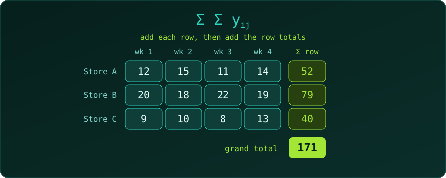

{fig-alt="A table of weekly sales for three stores over four weeks, with row totals 52, 79 and 40 and a grand total of 171."}

Whenever data sit in a table (groups in rows, observations in columns), we meet the **double summation**: a sum of sums.

$$
\sum_{i=1}^{a}\sum_{j=1}^{n} y_{ij}
$$

Read it from the inside out. For each row $i$, add the entries $y_{i1}, \dots, y_{in}$; then add those row totals over $i = 1, \dots, a$. The result is the **grand total** of the whole table. The order does not matter for a finite table: summing columns first gives the same number.

## Where Statistics Uses It

| Quantity | Formula |
| :--- | :--- |
| Grand total | $\displaystyle \sum_i\sum_j y_{ij}$ |
| Grand mean | $\displaystyle \bar y_{..} = \frac{1}{an}\sum_i\sum_j y_{ij}$ |
| Total sum of squares | $\displaystyle SST = \sum_i\sum_j \left(y_{ij}-\bar y_{..}\right)^2$ |

The total sum of squares is the starting point of one-way ANOVA, which splits it into variation between groups and variation within groups. Chi-square tests, covariance and two-way tables use double sums in the same way.

## A Short Real-World Example

A small chain wants to compare three stores. Units sold per week over four weeks:

| | Wk 1 | Wk 2 | Wk 3 | Wk 4 |
| :--- | ---: | ---: | ---: | ---: |
| Store A | 12 | 15 | 11 | 14 |
| Store B | 20 | 18 | 22 | 19 |
| Store C | 9 | 10 | 8 | 13 |

### How $i$ and $j$ Map to the Table

- $i$ is the **row index** (the store): $i = 1$ is Store A, $i = 2$ is Store B, $i = 3$ is Store C. So $a = 3$.
- $j$ is the **column index** (the week): $j = 1, \dots, 4$. So $n = 4$.
- $y_{ij}$ is the cell in row $i$, column $j$. For example, $y_{23} = 22$ (Store B, week 3) and $y_{31} = 9$ (Store C, week 1).

The **inner sum** fixes a row and runs $j$ across it:

$$
\sum_{j=1}^{4} y_{1j} = 12 + 15 + 11 + 14 = 52
$$

The **outer sum** then lets $i$ move down the rows, adding the row totals:

$$
\sum_{i=1}^{3}\sum_{j=1}^{4} y_{ij} = \underbrace{52}_{i=1} + \underbrace{79}_{i=2} + \underbrace{40}_{i=3} = 171
$$

In words: for each store $i$, add its four weeks $j$; then add the three stores.

The row totals are 52, 79 and 40, so the grand total is 52 + 79 + 40 = 171 units, and the grand mean is 171 / 12 = 14.25 units per store-week.

## The C Implementation

A double sum is a pair of **nested `for` loops**: the outer loop is the outer $\sum$ (rows) and the inner loop is the inner $\sum$ (columns). The table is a 2D array, `y[i][j]`.

```c
#include <stdio.h>

#define STORES 3
#define WEEKS  4

int main(void) {
    // y[i][j] = units sold by store i in week j
    int y[STORES][WEEKS] = {
        {12, 15, 11, 14},
        {20, 18, 22, 19},
        { 9, 10,  8, 13}
    };

    // grand total: sum over i, then over j
    int total = 0;
    for (int i = 0; i < STORES; i++) {
        for (int j = 0; j < WEEKS; j++) {
            total += y[i][j];
        }
    }
    double grand_mean = (double)total / (STORES * WEEKS);

    // total sum of squares: SST = sum_i sum_j (y_ij - grand_mean)^2
    double sst = 0.0;
    for (int i = 0; i < STORES; i++) {
        for (int j = 0; j < WEEKS; j++) {
            double d = y[i][j] - grand_mean;
            sst += d * d;
        }
    }

    printf("Grand total     = %d\n", total);
    printf("Grand mean      = %.2f\n", grand_mean);
    printf("Total sum of sq = %.2f\n", sst);
    return 0;
}
```

Compiled with `gcc -Wall -Wextra` and run:

```
Grand total     = 171
Grand mean      = 14.25
Total sum of sq = 232.25
```

::: {.callout-note}
**Two details.** The sum starts at 0 (the identity for addition), and `(double)total` converts before dividing; `171 / 12` in integer arithmetic would give 14, not 14.25. We also need the grand mean *before* the second double sum, which is why the sum of squares is a separate pass.
:::

## Summary

| Maths | C |
| :--- | :--- |
| $\sum_i$ (outer sum) | outer `for` over rows |
| $\sum_j$ (inner sum) | inner `for` over columns |
| $y_{ij}$ | `y[i][j]` |
| running total | accumulator starting at 0 |

For more practice with nested loops, see [5 nested for loop practice problems](c-nested-for-loop-practice-problems.qmd).
