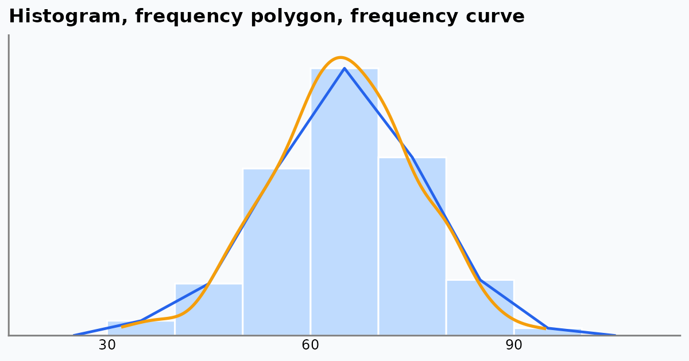

{fig-alt="A histogram of scores with a blue frequency polygon and a smooth orange frequency curve drawn over it."}

Frequency polygons and frequency curves are tools for seeing the **shape** of a frequency distribution: where the data peak, how they spread, and how they taper off. Bar and pie charts focus on separate categories, and ogives on running totals. Polygons and curves show the continuous flow of numeric data.

## How the Charts Compare

| Chart | What it shows | Best used for | Main strength |
|---|---|---|---|
| Frequency polygon | The shape of the data as straight lines joining class midpoints | Comparing several datasets on the same axes | Cleaner than overlapping histograms when plotting two or three groups |
| Frequency curve | A smoothed polygon, close to the underlying distribution | Large samples or ideal shapes such as the normal distribution | No jagged edges, so the continuous trend is clear |
| Histogram | Counts in adjacent blocks (class intervals) | A single dataset with clear class boundaries | Easy for beginners: count per interval is visible at once |
| Ogive (cumulative frequency) | A running total of frequencies | Medians, quartiles and percentiles, such as a top-10% cutoff | Answers "how many are below this value?" rather than showing the shape |
| Bar / pie chart | Counts or shares of categories | Qualitative data such as survey answers or product types | Designed for categories; polygons and curves need continuous numbers |

## Setting Up in R

We use simulated test scores for three classes. The code needs only `ggplot2`.

```{r}
library(ggplot2)

# default grey theme (as in the commute-times post), no axis ticks, legend on top
theme_set(
  theme_grey(base_size = 13) +
    theme(axis.ticks = element_blank(), legend.position = "top")
)

set.seed(42)
scores <- data.frame(
  class = rep(c("A", "B", "C"), each = 100),
  score = c(rnorm(100, mean = 65, sd = 10),
            rnorm(100, mean = 72, sd = 8),
            rnorm(100, mean = 58, sd = 12))
)
scores$score <- pmin(pmax(scores$score, 0), 100)   # keep scores in 0-100

classA <- subset(scores, class == "A")
```

## The Histogram

A histogram counts how many values fall in each class interval, here 10 marks wide.

```{r}
#| fig-width: 6.5
#| fig-height: 4
ggplot(classA, aes(score)) +
  geom_histogram(binwidth = 10, boundary = 0,
                 fill = "steelblue", colour = "white") +
  scale_y_continuous(expand = expansion(mult = c(0, 0.05))) +
  labs(title = "Histogram of Class A scores", x = "Score", y = "Frequency")
```

## The Frequency Polygon

A frequency polygon plots one point at the **midpoint** of each class interval, at the height of its frequency, and joins the points with straight lines. It is closed at both ends with an empty class (frequency 0). `geom_freqpoly()` does all of this for us:

```{r}
#| fig-width: 6.5
#| fig-height: 4
ggplot(classA, aes(score)) +
  geom_freqpoly(binwidth = 10, boundary = 0,
                colour = "steelblue", linewidth = 1) +
  scale_y_continuous(expand = expansion(mult = c(0, 0.05))) +
  labs(title = "Frequency polygon of Class A scores",
       x = "Score", y = "Frequency")
```

To see what `geom_freqpoly()` is doing, we can build the polygon by hand from a frequency table:

```{r}
breaks <- seq(0, 100, by = 10)
classes <- cut(classA$score, breaks = breaks, include.lowest = TRUE)

freq <- data.frame(
  interval = levels(classes),
  midpoint = head(breaks, -1) + 5,
  frequency = as.vector(table(classes))
)
freq
```

```{r}
#| fig-width: 6.5
#| fig-height: 4
ggplot(freq, aes(midpoint, frequency)) +
  geom_col(width = 10, fill = "grey70", colour = "white") +
  geom_line(colour = "steelblue", linewidth = 1) +
  geom_point(colour = "steelblue", size = 2.5) +
  scale_y_continuous(expand = expansion(mult = c(0, 0.05))) +
  labs(title = "Polygon joins the class midpoints",
       x = "Score (class midpoint)", y = "Frequency")
```

The points sit at the middle of each bar top. This is also why a polygon makes exact counts harder to read than a histogram: we read a height from a point rather than from a flat bar top.

## Why Polygons Are Good for Comparing Groups

Overlaying three histograms produces a messy block of overlapping bars. Three polygons stay readable as three distinct lines.

```{r}
#| fig-width: 7
#| fig-height: 4
ggplot(scores, aes(score, fill = class)) +
  geom_histogram(binwidth = 10, boundary = 0, alpha = 0.5,
                 position = "identity", colour = "white") +
  scale_y_continuous(expand = expansion(mult = c(0, 0.05))) +
  labs(title = "Overlaid histograms: hard to read",
       x = "Score", y = "Frequency", fill = "Class")
```

```{r}
#| fig-width: 7
#| fig-height: 4
ggplot(scores, aes(score, colour = class)) +
  geom_freqpoly(binwidth = 10, boundary = 0, linewidth = 1) +
  scale_y_continuous(expand = expansion(mult = c(0, 0.05))) +
  labs(title = "Overlaid frequency polygons: easy to compare",
       x = "Score", y = "Frequency", colour = "Class")
```

Class B peaks highest and furthest right, and Class C is the lowest and most spread out. We can see that straight away.

## The Frequency Curve

A frequency curve is a smoothed version of the polygon. In R the usual way to get one is a kernel density estimate, `geom_density()`. By default it is scaled so the area under the curve is 1. Multiplying by the sample size and class width puts it on the same scale as the frequency polygon:

```{r}
#| fig-width: 7
#| fig-height: 4
ggplot(classA, aes(score)) +
  geom_freqpoly(binwidth = 10, boundary = 0,
                colour = "steelblue", linewidth = 1) +
  geom_density(aes(y = after_stat(count) * 10),
               colour = "darkorange", linewidth = 1) +
  scale_y_continuous(expand = expansion(mult = c(0, 0.05))) +
  labs(title = "Frequency polygon (blue) and frequency curve (orange)",
       x = "Score", y = "Frequency")
```

The curve removes the jagged corners and shows the underlying continuous trend. Smooth curves like this lead directly to normal distributions, skewness and probability density functions.

## The Ogive (Cumulative Frequency)

An ogive tracks the running total, so it answers questions like "what score has 90% of the class below it?" rather than showing the shape.

```{r}
#| fig-width: 6.5
#| fig-height: 4
ggplot(classA, aes(score)) +
  stat_ecdf(geom = "step", colour = "steelblue", linewidth = 1) +
  geom_hline(yintercept = 0.9, linetype = "dashed", colour = "grey50") +
  scale_y_continuous(labels = scales::percent,
                     expand = expansion(mult = c(0, 0.05))) +
  labs(title = "Cumulative distribution of Class A scores",
       x = "Score", y = "Share of students at or below")
```

The dashed line marks the 90th percentile. Where the curve crosses it, we read off the score.

## Where Polygons and Curves Fall Short

- **Exact counts are harder to read.** Points joined by lines are less direct than the flat top of a histogram bar.
- **Continuous data only.** A frequency polygon of favourite colours or car brands would imply an order and spacing that do not exist. Use a [bar chart](pie-vs-bar-chart.qmd) for categories.

## Which One Should We Use?

- One dataset, class intervals clearly defined: **histogram**.
- Two or three groups to compare: **frequency polygons**.
- The overall shape or an ideal distribution: **frequency curve**.
- Percentiles, medians or cutoffs: **ogive**.
- Categories rather than numbers: **bar chart**.
