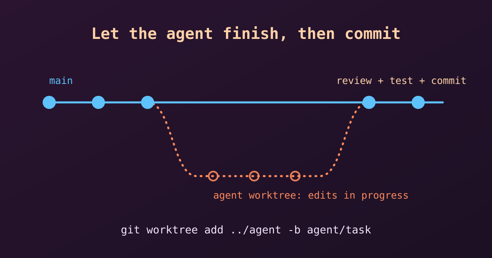

{fig-alt="A main branch of commits, with a separate agent branch in its own worktree that merges back after review and testing."}

An AI coding agent such as Claude Code edits our files directly, one step at a time. That is convenient, but it raises a practical question: can we run `git commit` while the agent is still working? The short answer is **no, wait**. Let's see why, and what to do instead.

## How an AI Agent Works on Our Files

An agent does not produce a finished feature in one go. It works in small steps:

1. It reads the relevant files.
2. It edits a file, then often another one.
3. It runs the code or the tests, sees an error, and edits again.

So at any moment in the middle of a task, our working directory may hold half-finished changes: a function that is renamed in one file but not yet in the others, or code that does not compile. These files are real and Git can see them, but they are not a state we want to keep.

## Why We Should Wait Before Committing

- **Incomplete code in the history.** `git commit -a` snapshots whatever is on disk right now. A commit made mid-task records broken or partial work, which pollutes the history and makes `git bisect` and `git revert` much less useful later.
- **Mixed-up changes.** If we commit or stage files while the agent keeps editing, the commit contains only part of its work, and the rest shows up as new unstaged changes. It becomes hard to tell which edits belong together.
- **Git lock errors.** Git allows only one operation on the index at a time. If the agent runs `git status` or `git add` at the same moment as we do, one of us may see an error such as `fatal: Unable to create '.git/index.lock': File exists`.
- **Edit conflicts.** If we edit a file ourselves while the agent is working on it, the agent may fail to apply its next edit, or may work from an outdated copy and overwrite our change.

::: {.callout-note}
Claude Code does not commit by itself. By default it commits only when we ask it to, for example "commit these changes". So waiting costs us nothing: the finished task can be committed by us, or by the agent on request.
:::

## What to Do Instead

**1. Let the agent finish.** Wait until the prompt returns or the agent says the task is complete.

**2. Review what changed.** Look at the summary first, then the details:

```bash
git status
git diff
```

Use `git diff --stat` for a quick overview of which files changed and by how much.

**3. Run the tests.** Make sure the code compiles and the tests pass before committing. The agent said it works, but we should check.

**4. Commit the finished work.** Stage deliberately and write a clear message:

```bash
git add -p
git commit -m "Add input validation to the signup form"
```

`git add -p` lets us choose hunk by hunk, so unrelated edits do not slip into the commit.

## Useful Habits

**Start from a clean state.** Before giving the agent a task, commit or stash our own work. Then `git diff` shows only the agent's changes.

```bash
git status          # should be clean
git switch -c agent/fix-signup   # optional: a branch for the task
```

**Keep tasks small.** One task, one commit. A small task finishes quickly, and its diff is easy to review.

**Undo safely.** If the result is not what we wanted, a clean starting point makes discarding it easy. To drop the agent's uncommitted changes to one file:

```bash
git restore path/to/file
```

::: {.callout-warning}
`git restore` and `git checkout -- <file>` throw away uncommitted changes for good. Check `git diff` first.
:::

## Working in Parallel with a Worktree

Sometimes we want to keep working while the agent runs. The safe way is to give the agent its own copy of the repository using `git worktree`. Each worktree has its own working directory and branch, but they share one history, so neither of us disturbs the other's files.

```bash
git worktree add ../myproject-agent -b agent/task
cd ../myproject-agent
# start the agent here, while we keep working in the original folder
```

When the agent is done, we review and commit in the worktree, then merge the branch as usual and clean up:

```bash
git worktree remove ../myproject-agent
```

## Quick Summary

| Situation | What to do |
|---|---|
| Agent is still editing | Don't stage or commit; wait |
| Agent says it is done | `git status`, `git diff`, run tests |
| Changes look good | One clean commit with a clear message |
| Want to work at the same time | Use a separate `git worktree` and branch |
| Result is wrong | `git restore` the files, or discard the branch |
