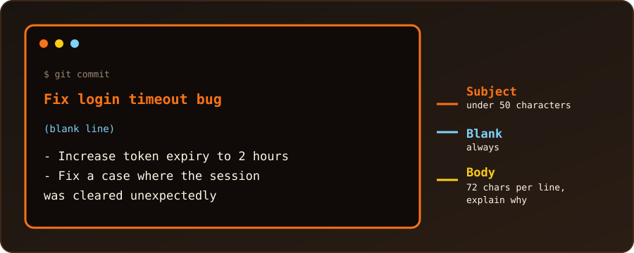

{fig-alt="A terminal showing a commit message: the subject line 'Fix login timeout bug' under 50 characters, a blank line, and a wrapped body, with labels for each part."}

A one-line `git commit -m "..."` is fine for tiny changes. When a change needs explaining, a commit message has a **subject** (one short line), a **blank line**, and a **body** (the details). Git offers four ways to write one. I tried each in a fresh repository, and the messages below are what `git log` showed.

## Method 1: The Default Text Editor (Recommended)

Leave out `-m` entirely:

```bash
git commit
```

Git opens our editor (Vim, Nano, VS Code, ...) with a template. We type the subject on the first line, leave the second line **blank**, write the body from line 3, then save and close to finish the commit. An empty message aborts the commit. Lines that start with `#` are comments and are removed.

To choose the editor once and for all:

```bash
git config --global core.editor "nano"
git config --global core.editor "code --wait"   # VS Code
```

This is the most comfortable method for long messages, because we can see the whole message and edit it freely.

## Method 2: Several `-m` Flags

Each `-m` becomes its own **paragraph**, with a blank line between them:

```bash
git commit -m "Add authentication feature" -m "This paragraph explains why the change was made."
```

Result in `git log`:

```
Add authentication feature

This paragraph explains why the change was made.
```

The first `-m` is the subject and the rest are body paragraphs. It is quick, but each `-m` is a single paragraph, so it is awkward for bullet lists.

## Method 3: Quotes That Span Several Lines

Open the quotes, press Enter inside them to start a new line, and close the quotes at the end. The shell shows a `>` continuation prompt (fish just continues on the next line):

```bash
git commit -m "Fix login timeout bug

- Increased token expiration to 2 hours
- Resolved edge case where session cleared unexpectedly"
```

Result:

```
Fix login timeout bug

- Increased token expiration to 2 hours
- Resolved edge case where session cleared unexpectedly
```

This worked in bash and in fish. Remember the blank line after the subject: press Enter twice. In bash and zsh we can also write `\n` explicitly with the `$'...'` form (plain `"...\n..."` does **not** create a line break):

```bash
git commit -m $'Quoted with dollar sign\n\nBody line from ANSI-C quoting.'
```

## Method 4: Read the Message from a File

For a long message, write it in a file first (the file name does not matter), then pass it with `-F`:

```bash
git commit -F commit_msg.txt
```

The same works without a file. In **bash or zsh** a here-document supplies the message (`-F -` means "read from standard input"; the word after `<<` marks where the message ends):

```bash
git commit -F - <<'EOF'
Add RSS link

Shown in the hero stats line.
EOF
```

**fish** has no here-documents, so pipe `printf` into it instead:

```fish
printf 'Add feature X\n\nBody via printf in fish.\n' | git commit -F -
```

Both give the usual subject, blank line and body.

## Check or Fix the Message

```bash
git log -1            # show the last commit with its full message
git commit --amend    # reopen the last message in the editor and rewrite it
```

Only amend commits that have not been pushed. Rewriting a pushed commit changes its history for everyone who pulled it.

## Which Method?

| Method | Best for | Watch out for |
| :--- | :--- | :--- |
| 1. Editor (`git commit`) | long, careful messages | needs an editor set up |
| 2. Several `-m` | a subject plus one or two paragraphs | no bullet lists |
| 3. Multi-line quotes | short messages with a list, typed in the terminal | quotes inside the message |
| 4. `-F` file or stdin | long messages, scripts | the shell syntax differs (bash vs fish) |

## Best Practices for Multiline Commits

- **Subject:** about 50 characters or fewer, starting with a capital letter, without a final period. Use the imperative mood, as if giving an order: "Fix bug", not "Fixed bug".
- **Blank line:** always leave line 2 empty. Git and many tools (`git log --oneline`, GitHub) treat the first paragraph as the title and the rest as the body.
- **Body:** wrap lines at about 72 characters and explain **why** the change was made and what it achieves, rather than how it was coded. The code already shows the "how".
