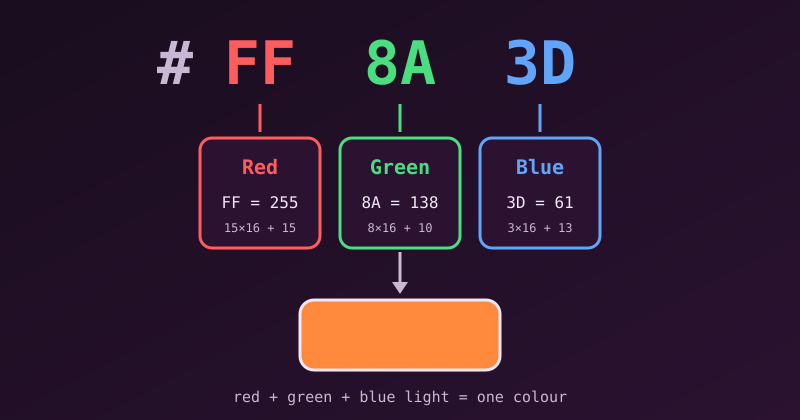

{fig-alt="The hex code FF8A3D split into three pairs: FF is red 255, 8A is green 138 and 3D is blue 61, combining into an orange swatch."}

A **hex color code** is a six-character string used in web design (and in many other tools) to tell a screen how much red, green and blue (RGB) light to mix. It always starts with a hash sign, `#`.

## Anatomy of a Hex Code

The six characters split into three pairs, and each pair controls one colour channel:

| Pair | Channel | In `#RRGGBB` |
|---|---|---|
| First | Red | **RR**GGBB |
| Second | Green | RR**GG**BB |
| Third | Blue | RRGG**BB** |

## How the Base-16 System Works

Hexadecimal is a base-16 number system. Decimal counts 0 to 9 before rolling over; hexadecimal keeps going to 16 symbols by using the letters A to F for the values 10 to 15:

| Hex digit | 0–9 | A | B | C | D | E | F |
|---|---|---|---|---|---|---|---|
| Value | 0–9 | 10 | 11 | 12 | 13 | 14 | 15 |

F is the largest value a single digit can have. A pair therefore runs from `00` (channel off, decimal 0) to `FF` (full intensity, decimal 255).

### Converting a pair to 0–255

1. Multiply the first character by 16.
2. Multiply the second character by 1.
3. Add the two results.

**Example: `FF`.** F is 15, so (15 × 16) + 15 = 240 + 15 = **255**.

**Example: `A3`.** A is 10, so (10 × 16) + 3 = 160 + 3 = **163**.

Now we can read the code from the figure, `#FF8A3D`:

| Channel | Pair | Calculation | Value |
|---|---|---|---|
| Red | `FF` | 15 × 16 + 15 | 255 |
| Green | `8A` | 8 × 16 + 10 | 138 |
| Blue | `3D` | 3 × 16 + 13 | 61 |

That is a strong red, a medium green and a little blue, which gives the orange in the figure.

## Checking It in R

[R programming language](../tags.html#tag=r) understands hex colours, so we can confirm the conversion with `col2rgb()`:

```r
col2rgb("#FF8A3D")
```

```default
      [,1]
red    255
green  138
blue    61
```

And `rgb()` goes the other way, from numbers to a hex code:

```r
rgb(255, 138, 61, maxColorValue = 255)
```

```default
[1] "#FF8A3D"
```

Hex is only one way to write the same numbers. [RGB Color Codes Explained](rgb-color-code-explained.qmd) covers the decimal form, `rgb(255, 138, 61)`, and `rgba()` for transparency.

## Common Examples

| Colour | Code | Meaning |
|---|---|---|
| Pure red | `#FF0000` | Max red, no green, no blue |
| Pure green | `#00FF00` | No red, max green, no blue |
| Pure blue | `#0000FF` | No red, no green, max blue |
| White | `#FFFFFF` | All channels at maximum |
| Black | `#000000` | All channels off |
| Grey | `#787878` | Equal values in all three pairs |

Any code whose three pairs are identical is a shade of grey. For `#787878`, each pair is 7 × 16 + 8 = 120.

::: {.callout-note}
Hex codes follow an **additive light** model: higher values make a colour brighter and closer to white, not darker as with paint.
:::

## Handy Variations

- **Short form:** when each pair has two identical digits, it can be shortened to three, so `#FF0000` becomes `#F00`.
- **With transparency:** an eight-character code adds a fourth pair for opacity, as in `#FF8A3D80` (about 50%).

## References

1. [Hex color codes](https://www.geeksforgeeks.org/computer-graphics/hex-color-codes/), GeeksforGeeks
2. [How hex code colors work](https://www.freecodecamp.org/news/how-hex-code-colors-work-how-to-choose-colors-without-a-color-picker/), freeCodeCamp
3. [Understanding hexadecimal colors](https://www.pluralsight.com/resources/blog/upskilling/understanding-hexadecimal-colors-simple), Pluralsight
4. [Hex colour codes explained](https://coreyginnivan.medium.com/%EF%B8%8F-hex-colour-codes-explained-with-a-hint-of-colour-theory-a968d3670a85), Corey Ginnivan
5. [ELI5: how hex code works](https://www.reddit.com/r/explainlikeimfive/comments/p68gj/eli5_how_hex_code_works_and_how_you_can_tell_what/), r/explainlikeimfive
