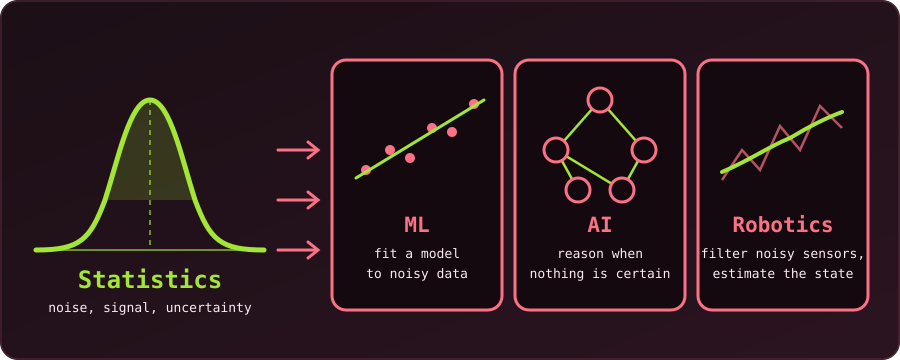

{fig-alt="A bell curve labelled Statistics feeds three cards: machine learning (a line fitted to scattered points), AI (a small network of nodes) and robotics (a smooth estimate through a noisy path)."}

Statistics is the quiet engine of machine learning, artificial intelligence and robotics. It hides beneath layers of code and hardware, yet it sits behind every prediction, decision and action: from a simple linear regression to a deep neural network, from a robot crossing a cluttered room to a language model writing a paragraph. Statistics gives these systems a way to learn from data, measure uncertainty and choose well.

In this post we look at where statistics sits in each field, and why skipping it means building on sand.

## Statistics: The Language of Learning from Data

Machine learning is about finding patterns in data. But data are noisy, incomplete and variable, and statistics supplies the tools to describe that noise, model the signal underneath and predict with a stated level of confidence.

- **Probability distributions** model how likely each outcome is.
- **Estimation theory** infers parameters from samples.
- **Hypothesis testing** decides whether a pattern is real or just chance.
- **Bayesian inference** updates our beliefs as new data arrive.

Without these, a model is little more than a guess.

## Machine Learning: Statistics in Modern Clothing

Many ML algorithms are classical statistical methods under a new name.

| ML method | Statistical view |
| :--- | :--- |
| Linear regression | A model for a continuous outcome |
| Logistic regression | A classifier built on the logistic function |
| Decision trees | Recursive partitioning, a non-parametric technique |
| Support vector machines | Maximum-margin classifiers from statistical learning theory |
| Neural networks | Nonlinear regression, usually trained by maximum likelihood |

The same holds for the core ideas. The **bias-variance tradeoff**, the **curse of dimensionality** and **cross-validation** are statistical concepts. Measuring generalisation error is statistics. L1 and L2 regularisation act as statistical priors on the parameters, and dropout can be read as an approximation to Bayesian model averaging.

Deep learning is no exception. Stochastic gradient descent is a statistical optimisation method, batch normalisation is a statistical stabilisation trick, and *probabilistic deep learning* combines neural networks with Bayesian inference.

## Artificial Intelligence: Reasoning Under Uncertainty

AI is broader than ML: it is about agents that reason, plan and act. The real world is uncertain, and statistics is the calculus of that uncertainty.

- **Bayesian networks** represent probabilistic relationships between variables.
- **Hidden Markov models** drive speech recognition and part-of-speech tagging.
- **Markov decision processes (MDPs)** and their partially observable version (**POMDPs**) are the foundation of reinforcement learning, where an agent maximises reward in a stochastic environment.
- **Natural language processing** relies on statistical language models, from n-grams to Transformers. Even the largest LLMs are trained by maximum likelihood on huge text corpora.

AI without statistics is a philosopher without logic: full of ideas, with no rigorous way to test them.

## Robotics: Where Statistics Meets the Physical World

Robots face sensor noise, imperfect actuators and changing surroundings. For them statistics is not optional; it decides whether a task succeeds or fails.

- **State estimation:** Kalman filters, extended Kalman filters and particle filters estimate a robot's position, velocity and orientation from noisy sensor readings.
- **Sensor fusion:** combining cameras, LiDAR, IMUs and GPS needs probabilistic models that weigh how reliable each source is.
- **SLAM** (simultaneous localisation and mapping): a textbook statistical problem, since both the map and the robot's own position are uncertain.
- **Control under uncertainty:** stochastic control, such as linear-quadratic-Gaussian (LQG) control, models the noise explicitly and minimises expected cost.
- **Planning under uncertainty:** POMDPs handle navigation and manipulation when the state is not fully observable.

The book *Probabilistic Robotics* by Thrun, Burgard and Fox is, in effect, a statistics text for roboticists.

## The Common Thread: From Data to Decisions

ML, AI and robotics all involve **decisions under uncertainty**, and statistics supplies each piece:

| Need | Statistical tool |
| :--- | :--- |
| Represent uncertainty | Probability distributions |
| Learn from data | Estimation and inference |
| Judge performance | Likelihood, risk, expected loss |
| Choose the best action | Bayesian decision theory, utility maximisation |

Whether we classify an email as spam, predict the next word or steer a self-driving car, we are solving a statistical problem.

## The Future: Statistics Keeps Driving Progress

As AI systems grow more complex, the need for statistical rigour grows with them. **Causal inference** moves AI beyond correlation towards causation. **Uncertainty quantification** is critical for safe autonomous systems. **Probabilistic programming** makes statistical models easier to build and deploy at scale.

The next breakthroughs in ML, AI and robotics will come from embracing statistics more deeply, not from ignoring it.

## Summary

Statistics is how these fields learn from data, reason under uncertainty and act in a noisy world. To build truly intelligent systems we must do more than respect it; we must master it, because at the heart of every smart algorithm is a statistical heartbeat.
