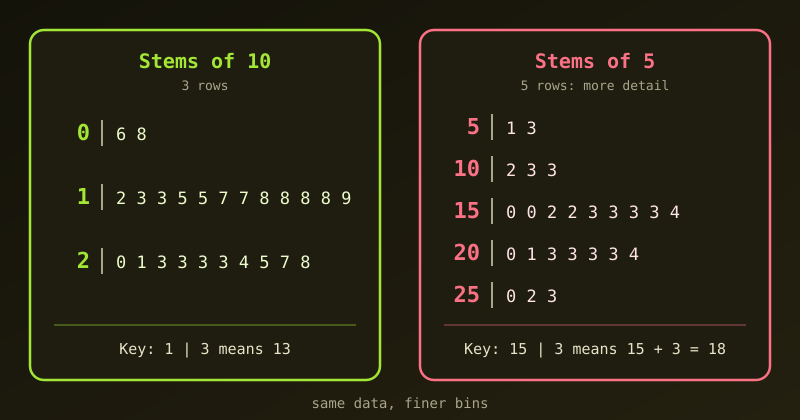

{fig-alt="Two stem-and-leaf plots of the same data: one with three rows using stems of 10, and one with five rows using stems of 5."}

A stem-and-leaf plot shows the shape of a dataset while keeping every original value. The usual version uses the tens digit as the stem, which can leave very few rows. Here is a simple fix: use stems that step by 5.

## The Data

Here are 24 values:

```default
13, 12, 6, 8, 15, 18, 17, 24, 28, 23, 27, 23,
21, 20, 15, 18, 23, 25, 23, 13, 17, 18, 19, 18
```

## The Standard Plot: Only 3 Rows

With the tens digit as the stem and the units digit as the leaf, we get:

```default
Stem | Leaf
  0  | 6 8
  1  | 2 3 3 5 5 7 7 8 8 8 8 9
  2  | 0 1 3 3 3 3 4 5 7 8

Key: 1 | 3 means 13
```

This gives only three classes, and most of the data sits in two of them. The shape is hard to see.

## The Hybrid Plot: Stems of 5

If the stems are 5, 10, 15, 20 and 25, the data fall into **bins of width 5**. Each leaf is the value minus its stem:

```default
Stem | Leaf
  5  | 1 3
 10  | 2 3 3
 15  | 0 0 2 2 3 3 3 3 4
 20  | 0 1 3 3 3 3 4
 25  | 0 2 3

Key: 15 | 3 means 15 + 3 = 18
```

For example, the stem 15 covers 15 to 19, so its leaves stand for 15, 15, 17, 17, 18, 18, 18, 18 and 19. We now see five bins instead of three, and the peak in the 15 to 19 range stands out.

::: {.callout-note}
This is a hybrid between a stem-and-leaf plot and a histogram with bins of width 5. Unlike a histogram, it keeps the exact data values.
:::

## Why It Works

1. **More bins.** Five rows show the shape of the distribution more clearly than three.
2. **Same as a split-stem plot.** It is equivalent to the usual split-stem plot, which writes each stem twice (low half, high half). Here the stems are written as numbers (`10`, `15`) instead of symbols (`1*`, `1.`).
3. **A bridge to histograms.** The rows are the bars of a histogram turned sideways, but every value is still readable.

## The Catch

A standard plot needs no arithmetic: `1 | 4` is simply 14. With stems of 5 the reader has to add (`15 + 3 = 18`). A clear **Key** fixes this, so always include one.

## Doing It in R

R's `stem()` function draws this kind of plot. The `scale` argument controls how many rows we get. With `scale = 0.5` we get the three-row plot:

```r
x <- c(13, 12, 6, 8, 15, 18, 17, 24, 28, 23, 27, 23,
       21, 20, 15, 18, 23, 25, 23, 13, 17, 18, 19, 18)

stem(x, scale = 0.5)
```

```default
  The decimal point is 1 digit(s) to the right of the |

  0 | 68
  1 | 233557788889
  2 | 0133334578
```

By default (`scale = 1`) R splits each stem in two, which is exactly the width-5 bins:

```r
stem(x)
```

```default
  The decimal point is 1 digit(s) to the right of the |

  0 | 68
  1 | 233
  1 | 557788889
  2 | 0133334
  2 | 578
```

Here the lower `1` row holds 12 to 14 and the upper `1` row holds 15 to 19. This layout avoids the arithmetic problem, because each leaf is simply the units digit.

## Summary

If the data are tightly clustered and a standard stem-and-leaf plot gives too few rows, use stems of 5 (or R's default split stems). We get more bins without losing the raw values. Just include a clear key.
