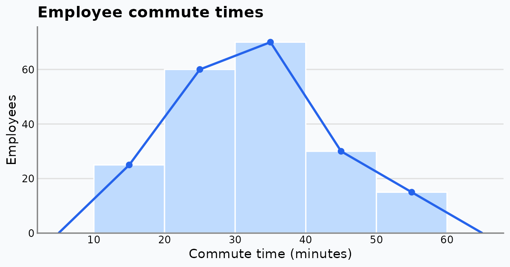

{fig-alt="Histogram bars for commute-time classes from 10 to 60 minutes with a blue frequency polygon peaking in the 30 to 40 minute class."}

To see how a frequency distribution and a histogram work in practice, let's use a continuous dataset: the daily one-way commute times of employees at a large office.

## The Dataset: Daily Commute Times

Suppose we surveyed 200 employees. Their commute times (in minutes) give this frequency distribution:

| Commute time (min) | Employees | Typical commute |
|:---|---:|:---|
| 10–20 | 25 | Short, local |
| 20–30 | 60 | Standard city transit or driving |
| 30–40 | 70 | Most common; typical suburban commute |
| 40–50 | 30 | Longer, some traffic |
| 50–60 | 15 | Heavy traffic or distant suburbs |

## Visualizing the Distribution

We plot the table as a **histogram** (bars) with a **frequency polygon** (a line joining the class midpoints). The polygon is closed at both ends with an empty class of frequency 0.

```{r}
library(ggplot2)

commute <- data.frame(
  interval  = c("10–20", "20–30", "30–40", "40–50", "50–60"),
  midpoint  = c(15, 25, 35, 45, 55),
  employees = c(25, 60, 70, 30, 15)
)

# polygon points: add an empty class at each end
polygon_pts <- rbind(
  data.frame(midpoint = 5,  employees = 0),
  commute[, c("midpoint", "employees")],
  data.frame(midpoint = 65, employees = 0)
)
```

```{r}
#| fig-width: 7
#| fig-height: 4.5
ggplot(commute, aes(midpoint, employees)) +
  geom_col(width = 10, fill = "#375faf", colour = "#5b7cbd") +
  geom_line(data = polygon_pts, colour = "#002266", linewidth = 1) +
  geom_point(colour = "#002266", size = 2.5) +
  geom_text(aes(label = employees), vjust = -0.8) +
  scale_x_continuous(breaks = seq(10, 60, 10)) +
  scale_y_continuous(limits = c(0, 80), expand = c(0, 0)) +
  labs(title = "Daily commute times of 200 employees",
       x = "Commute time (minutes)", y = "Number of employees") +
  theme(axis.ticks = element_blank())
```

## Key Insights

- **Mode:** the 30–40 minute class is the largest (70 employees). The polygon peaks at its midpoint, 35 minutes, so a commute of about 35 minutes is the most common.
- **Shape:** the distribution is roughly symmetric around that peak. The mean and median, computed below, are close to each other.
- **Concentration:** 130 of the 200 employees (65%) travel 20–40 minutes. That range is a sensible baseline for thinking about core hours or hybrid-work policy.

We can check these numbers from the frequency table:

```{r}
n <- sum(commute$employees)

# mean from class midpoints
mean_est <- sum(commute$midpoint * commute$employees) / n

# median by interpolation inside the median class (30-40)
cum_before <- sum(commute$employees[1:2])      # employees below 30
median_est <- 30 + (n / 2 - cum_before) / 70 * 10

# share in the 20-40 minute range
share <- sum(commute$employees[2:3]) / n

c(n = n, mean = mean_est, median = median_est, share_20_40 = share)
```

## Histogram vs Polygon: What Each Shows

- **Histogram bars** show how much data sits in each class. The 20–30 and 30–40 bars clearly hold most employees.
- **Frequency polygon** smooths the hard class edges and shows the shape of the rise and fall. It would also let us overlay a second office on the same axes and compare the two commute profiles easily.

See [Frequency Polygons and Frequency Curves](frequency-polygon-and-curve.qmd) for more on when to use each chart.
