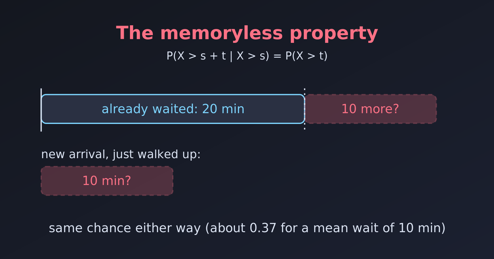

{.bk-adapt fig-alt="A timeline with a person who has already waited 20 minutes at a bus stop and a bar showing 10 more minutes, with the note that the chance of waiting 10 more minutes is the same as for a new arrival."}

A waiting time is **memoryless** if how long we have already waited tells us nothing about how much longer we will wait. Think of waiting for a random event, such as a call or a bus: after 20 minutes of waiting, we are no closer to the event than when we started. Does the Poisson distribution have this property?

Strictly speaking, **the Poisson distribution itself is not memoryless**. What is memoryless is the **exponential distribution** of the waiting time between events in a Poisson process. The two are closely linked, which is why they get confused. Let's separate them.

## What the Memoryless Property Means

A waiting time $X$ is memoryless if the past does not change the chance of a future outcome:

$$
P(X > s + t \mid X > s) = P(X > t).
$$

- $s$ is the time we have **already waited**.
- $t$ is the **additional** time we are asking about.

In plain words: if we have waited $s$ minutes and nothing has happened, the probability of waiting at least $t$ more minutes is exactly what it would be for someone who has just arrived. The process "forgets" how long it has run.

## Poisson Count vs Exponential Waiting Time

| | Poisson | Exponential |
|---|---|---|
| What it models | The **number** of events in a fixed interval | The **waiting time** between events |
| Type of variable | Discrete (0, 1, 2, ...) | Continuous ($x > 0$) |
| Example | Emails arriving in an hour | Minutes between one email and the next |
| Memoryless? | No | **Yes**, and it is the only continuous distribution that is |

The Poisson process has **independent increments**: counts in non-overlapping time windows do not affect each other. That is a different idea from memorylessness, which is a property of one waiting time.

If events arrive as a Poisson process with rate $\lambda$, the counts in a unit interval are Poisson($\lambda$), and the waiting times between events are exponential with the same rate $\lambda$.

## Checking the Memoryless Property in R

For an exponential waiting time, the probability of waiting longer than $x$ is $e^{-\lambda x}$. Let's take a rate of $\lambda = 0.1$ events per minute (one event every 10 minutes on average), and ask: having waited $s = 20$ minutes, what is the chance of waiting at least $t = 10$ more?

```{r}
rate <- 0.1
s <- 20
t <- 10

# P(X > s + t | X > s) = P(X > s + t) / P(X > s)
pexp(s + t, rate, lower.tail = FALSE) / pexp(s, rate, lower.tail = FALSE)

# P(X > t), for someone who has just arrived
pexp(t, rate, lower.tail = FALSE)
```

The two numbers are identical, $e^{-1} \approx 0.368$. We can also check it by simulation, using only the waits that already exceeded $s$:

```{r}
set.seed(1)
waits <- rexp(1e6, rate)

mean(waits[waits > s] > s + t)   # among those who waited s, share who waited t more
mean(waits > t)                  # share of all waits longer than t
```

Both are about $0.37$, as the property says.

## A Waiting Time That Is Not Memoryless

For contrast, think of a bus that comes **on a timetable**, every 30 minutes. If we arrive at a random moment, the wait is uniform from 0 to 30 minutes. Now the past matters.

```{r}
#| fig-width: 8
#| fig-height: 4
library(tidyverse)

wait <- seq(0, 60, by = 0.5)
curves <- tibble(
  minutes = wait,
  Exponential = pexp(wait, 1 / 15, lower.tail = FALSE),
  Timetable   = punif(wait, 0, 30, lower.tail = FALSE)
) %>%
  pivot_longer(-minutes, names_to = "bus", values_to = "chance_still_waiting")

ggplot(curves, aes(minutes, chance_still_waiting, colour = bus)) +
  geom_line(linewidth = 1.1) +
  labs(title = "Chance that we are still waiting after x minutes",
       x = "Minutes since we arrived", y = "Probability", colour = NULL)
```

For the timetable bus, once we have waited 20 minutes the bus is certain to come within 10 more. A new arrival could wait up to 30. The wait does depend on the past. For the exponential bus, the chance of waiting $t$ more minutes is the same no matter how long we have already waited.

## Example: The Bus at a Random Stop

Suppose buses at a stop arrive at random, as a Poisson process, with $\lambda = 0.1$ per minute.

- If we have already waited **20 minutes**, the chance that we wait at least **10 more** is $e^{-1} \approx 0.368$.
- A new passenger who has just walked up has exactly the same $0.368$ chance of waiting at least 10 minutes.
- The bus does not become "due" because we have waited longer, and the process does not accumulate wear or memory.

::: {.callout-note}
This is why waiting for a random event is frustrating. It is not that a long wait makes the event more likely. For truly random arrivals, the future is the same however long we have waited. A timetable is different, because there the past does carry information.
:::

## Summary

- The **Poisson** distribution counts events in an interval, and is not memoryless.
- The **exponential** distribution models the waiting time between those events, and **is** memoryless: $P(X > s + t \mid X > s) = P(X > t)$.
- It is the only continuous distribution with this property.
- Related reading: [Why Is the Poisson Distribution Used?](why-is-poisson-distribution-used.html)
