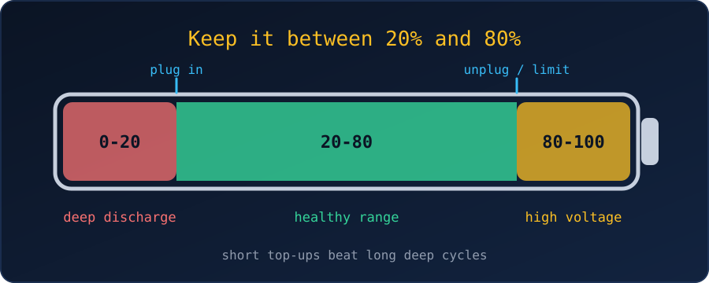

{fig-alt="A battery bar split into three zones: 0 to 20 percent deep discharge, 20 to 80 percent healthy range, and 80 to 100 percent high voltage."}

Modern laptops and phones use lithium-ion batteries, and they age according to how we charge them. The short version: keep the charge between roughly **20% and 80%**, and avoid heat.

## Should we charge at 20%?

Yes. Plugging in around 20% is a good habit. Letting the battery drain to 0% puts stress on the cells and wears them faster, so we should not wait until the laptop dies.

## Why the 20–80% range works

- **Avoid deep discharges.** Running to empty is hard on the battery chemistry.
- **Avoid sitting at 100%.** A full battery is held at high voltage, which also speeds up wear, especially when it is warm.
- **Longer life.** Staying in the middle of the range is commonly reported to give many more charge cycles than going 0–100% every time. The exact numbers vary by battery, so treat any specific figure with caution.

## Is it fine to charge at 40% or 60%?

Absolutely. Lithium-ion batteries are under the least stress near the middle of their range, and a top-up from 40% to 80% is only a partial cycle, which is gentler than a deep discharge.

There is no "memory effect" in lithium-ion cells (that was an old nickel-cadmium problem), so we never need to drain the battery before charging, and we do not need to calibrate it every month. We can top up whenever it is convenient.

## Best practices

1. **Recharge around 20%**, before the laptop drops into single digits.
2. **Use a charge limiter** if the laptop mostly stays plugged in at a desk. Most makers provide one that caps the charge at about 80%:
    - ASUS: Battery Health Charging
    - Lenovo: Conservation Mode
    - Dell: Dell Power Manager
    - macOS: Optimized Battery Charging
3. **Watch the heat.** Gaming or video editing makes the laptop hot, and a hot, fully charged battery ages fastest. Keep the vents clear and avoid charging on a bed or sofa.

::: {.callout-tip}
Staying plugged in is fine as long as a limit is set. Without one, the battery sits at 100% all day, which is the habit we want to avoid.
:::

## The same rules apply to phones

Phones use the same lithium-ion technology, so everything above carries over: short, frequent top-ups are easier on the battery than long sessions, we should avoid dropping below 20%, and we should avoid leaving the phone at 100% for hours overnight.

Both major platforms can manage this automatically:

- **iPhone:** Settings → Battery → Battery Health & Charging. Turn on *Optimized Battery Charging*, or on iPhone 15 and newer set an *80% Limit*.
- **Android:** Look for *Protect Battery* or *Adaptive Charging* in the battery settings (Samsung, Pixel, OnePlus and others). It caps the charge at about 80% or slows charging overnight.

## Summary

| Do | Avoid |
|---|---|
| Charge between 20% and 80% | Draining to 0% |
| Top up whenever convenient | Sitting at 100% for hours |
| Enable the built-in charge limit | Charging a hot laptop under heavy load |

## References

- [Student laptop battery health (Chargie)](https://chargie.org/student-laptop-battery-health/)
- [Should I leave my laptop plugged in all the time? (How-To Geek)](https://www.howtogeek.com/124715/should-i-leave-my-laptop-plugged-in-all-the-time/)
- [Battery 20-80 rule (SmartAction)](https://www.smartaction.tech/en/blog/batterei-20-80)
