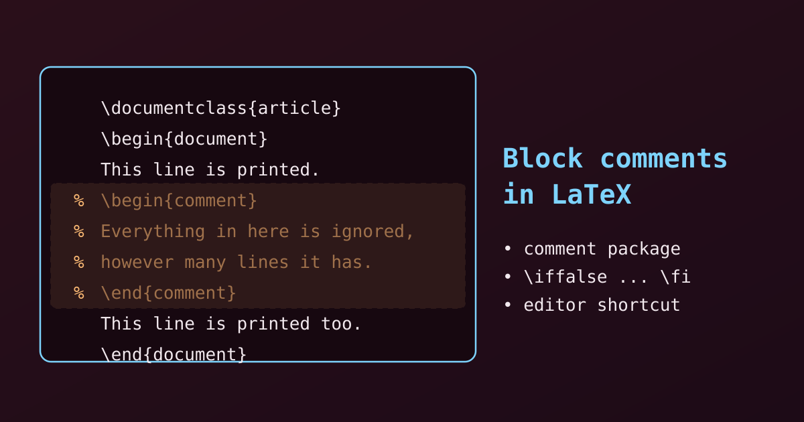

{fig-alt="A short LaTeX source file where the lines between begin comment and end comment are dimmed and marked with percent signs, showing that they are not printed."}

Plain LaTeX has only one kind of comment: everything after a `%` to the end of the line is ignored. To hide a whole paragraph, table or block of code, we have three options. Let's look at each, and at when it can go wrong.

## 1. The Fastest Way: an Editor Shortcut

Select the block and press the editor's comment shortcut. The editor puts a `%` in front of every selected line for us.

| Editor | Windows / Linux | macOS |
|---|---|---|
| Overleaf, TeXstudio, VS Code, Texmaker | `Ctrl` + `/` | `Cmd` + `/` |

The same shortcut removes the percent signs again. (Some editors use other keys: older TeXstudio versions use `Ctrl` + `T` to comment and `Ctrl` + `U` to uncomment. Check the editor's menu if the shortcut does not work.)

This is the safest method, because the hidden lines are real comments. The cost is that the source now has a `%` on every line.

## 2. The Cleanest Way: the comment Package

The `comment` package gives us an environment that ignores everything inside it.

1. Load the package in the preamble: `\usepackage{comment}`.
2. Wrap the block in `\begin{comment}` and `\end{comment}`.

```latex
\documentclass{article}
\usepackage{comment} % required in the preamble

\begin{document}

This text will be visible in the compiled PDF.

\begin{comment}
Everything written in this environment is completely ignored.
You can write several paragraphs, tables or code
without adding percent signs.
\end{comment}

This text will also be visible.

\end{document}
```

The PDF contains the first and the last paragraph only.

::: {.callout-note}
The `verbatim` package also defines a `comment` environment, so `\usepackage{verbatim}` works in the same way. Some LaTeX installations load it already.
:::

::: {.callout-warning}
`\end{comment}` must be on a line of its own, with nothing else before or after it on that line.
:::

## 3. The Package-Free Trick: \\iffalse and \\fi

Without any package, we can use a TeX conditional that is always false. TeX skips everything between `\iffalse` and `\fi`.

```latex
This text will print normally.

\iffalse
This is a multi-line comment.
LaTeX skips this whole section because the condition is false.
Change \iffalse to \iftrue to switch the block back on.
\fi

This text will also print normally.
```

This is handy for blocks we may want to bring back, since changing one word turns the block on again.

::: {.callout-warning}
TeX still reads the skipped text to find the matching `\fi`. If the hidden block contains its own conditional, such as `\ifnum` or `\ifx`, then it must also contain the matching `\fi`. Otherwise LaTeX stops with "Incomplete \\iffalse; all text was ignored". Unknown commands and unmatched braces inside the block are fine.
:::

### A Switch for Draft Notes

The same idea gives a named switch, which is useful for notes that should appear only in a draft:

```latex
\newif\ifdraft
\draftfalse   % change to \drafttrue to show the draft notes

\ifdraft
Note to self: check this section before submitting.
\fi
```

## Which Method Should We Use?

| Method | Needs a package? | Best for |
|---|---|---|
| Editor shortcut | No | Quick debugging and ad-hoc hiding of lines |
| `comment` environment | Yes (`comment` or `verbatim`) | Clean, readable blocks and large sections |
| `\iffalse` ... `\fi` | No | Package-free fixes and blocks we may switch back on |

In short: use the shortcut for quick edits, the `comment` environment for large blocks we want to keep tidy, and `\iffalse` when we cannot add a package.
