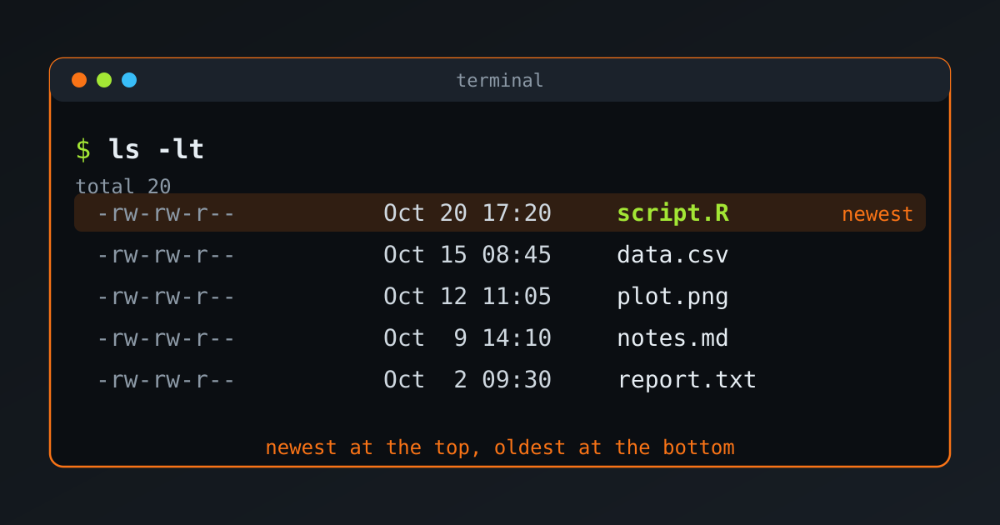

{fig-alt="A terminal window showing the output of ls -lt: five files listed from the most recently modified, script.R, to the oldest, report.txt, with the newest highlighted."}

Which file did we edit last? On Linux, the `ls` command can sort a folder by modification time. Let's see the options, with real output from a small example folder.

## The Basic Command

```bash
ls -lt
```

- `-l` shows the long format: permissions, owner, size and date.
- `-t` sorts by modification time, newest first.

```default
total 20
-rw-rw-r-- 1 abdullah abdullah 2 Oct 20 17:20 script.R
-rw-rw-r-- 1 abdullah abdullah 2 Oct 15 08:45 data.csv
-rw-rw-r-- 1 abdullah abdullah 2 Oct 12 11:05 plot.png
-rw-rw-r-- 1 abdullah abdullah 2 Oct  9 14:10 notes.md
-rw-rw-r-- 1 abdullah abdullah 2 Oct  2 09:30 report.txt
```

## Oldest First

Add `-r` to reverse the order:

```bash
ls -ltr
```

```default
total 20
-rw-rw-r-- 1 abdullah abdullah 2 Oct  2 09:30 report.txt
-rw-rw-r-- 1 abdullah abdullah 2 Oct  9 14:10 notes.md
-rw-rw-r-- 1 abdullah abdullah 2 Oct 12 11:05 plot.png
-rw-rw-r-- 1 abdullah abdullah 2 Oct 15 08:45 data.csv
-rw-rw-r-- 1 abdullah abdullah 2 Oct 20 17:20 script.R
```

The newest file is now at the bottom, right above the prompt. This is handy in a long listing.

## Only the Most Recent Files

To see just the newest few, pipe the listing to `head`:

```bash
ls -lt | head -n 3
```

```default
total 20
-rw-rw-r-- 1 abdullah abdullah 2 Oct 20 17:20 script.R
-rw-rw-r-- 1 abdullah abdullah 2 Oct 15 08:45 data.csv
```

The first line of `ls -l` is the `total` line, so `head -n 3` shows only two files. To see the newest five files, use `head -n 6`. Or drop `-l` and list names only, with no `total` line:

```bash
ls -t | head -n 5
```

## A Clearer Date Format

By default `ls` shows the time for recent files and the year for old ones. For an unambiguous date and time, use the ISO style (GNU `ls`):

```bash
ls -lt --time-style=long-iso
```

```default
total 20
-rw-rw-r-- 1 abdullah abdullah 2 2026-10-20 17:20 script.R
-rw-rw-r-- 1 abdullah abdullah 2 2026-10-15 08:45 data.csv
```

## Other Timestamps

Every file has three timestamps. `-t` uses the modification time unless we ask for another one.

| Timestamp | Meaning | Sort by it |
|---|---|---|
| mtime | Last time the contents changed | `ls -lt` |
| ctime | Last time the file or its metadata (permissions, owner) changed | `ls -ltc` |
| atime | Last time the file was read | `ls -ltu` |

::: {.callout-warning}
Be careful with `-c` and `-u` on their own. `ls -lc` only *shows* the ctime, but still sorts by name. We need `-t` as well, as in `ls -ltc`, to sort by that time.
:::

For the exact timestamps of one file, use `stat`:

```bash
stat report.txt
```

## Is It Different in the fish Shell?

The commands are the same. The sorting options belong to `ls` itself, not to the shell, and pipes work the same way, so `ls -lt | head -n 6` runs unchanged in fish.

The one difference is that in fish, `ls` is a small wrapper function that adds colours and type indicators, and then calls the real `ls`. We can see it with `type ls`. To bypass the wrapper, use `command ls`.

fish also makes it easy to save a shortcut. This function lists the five newest files, and `funcsave` stores it permanently:

```bash
function lt
    ls -lt $argv | head -n 6
end
funcsave lt
```

After that, `lt` shows the newest files in the current folder, and `lt ~/Documents` shows them for another folder. A shorter alternative is an abbreviation, which expands as we type:

```bash
abbr -a lt 'ls -lt'
```

## Quick Reference

| Goal | Command |
|---|---|
| Newest first | `ls -lt` |
| Oldest first | `ls -ltr` |
| Five newest files | `ls -lt \| head -n 6` |
| Names of the five newest | `ls -t \| head -n 5` |
| ISO dates | `ls -lt --time-style=long-iso` |
| Sort by change time | `ls -ltc` |
| Sort by access time | `ls -ltu` |
