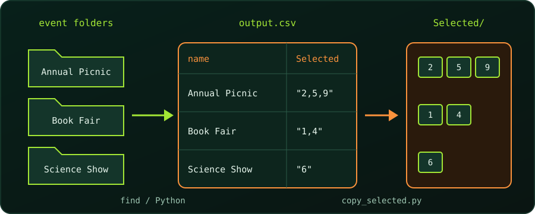

{fig-alt="Three steps from left to right. Event folders are listed into a file named output.csv, where a Selected column holds file numbers, and the chosen files are then copied into a folder named Selected."}

## The job

I had many folders, one per event, with numbered files inside (`1.pdf`, `2.jpg`, `3.docx`, ...). From each folder I needed only a few of them, collected in one place, still grouped by event.

By hand, that meant opening a folder, finding the files, copying them, making a matching folder at the destination, pasting, and starting over with the next one. It is slow, and it is easy to miss a file.

The Linux command line offered a shorter way: list the folders, write down which files I want, and let a script do the copying. I did not have to write the code alone: Claude and Gemini helped me with it at every step.

The folder names and numbers below are sample data that show each step.

## Step 1: I listed the folders

I did not want to type the folder names, so I let `find`, `sort` and `awk` write them into a CSV file. I ran this in the folder that holds all the others:

```bash
find . -mindepth 1 -maxdepth 1 ! -name output.csv \
  -printf '%f\t%y\t%s\t%TY-%Tm-%Td %TH:%TM:%TS\n' |
sort -f |
awk -F'\t' '
BEGIN { OFS = ","; print "name,type,size_bytes,modified" }
{
  gsub(/"/, "\"\"", $1)                  # double any quotes in the name
  type = $2
  if ($2 == "d") type = "dir"
  if ($2 == "f") type = "file"
  if ($2 == "l") type = "link"
  print "\"" $1 "\"", type, $3, substr($4, 1, 19)
}' > output.csv
```

For a sample with five event folders, a text file and a symbolic link, `output.csv` looks like this:

```default
name,type,size_bytes,modified
"Annual Picnic",dir,4096,2026-11-26 20:54:55
"Book Fair",dir,4096,2026-11-26 20:54:55
"fair-link",link,9,2026-11-26 20:54:55
"Farewell",dir,4096,2026-11-26 20:54:55
"notes ""draft"".txt",file,6,2026-11-26 20:54:55
"Science Show",dir,4096,2026-11-26 20:54:55
"Sports (Indoor, Outdoor)",dir,4096,2026-11-26 20:54:55
```

Each tool does one small job, and the pipe (`|`) passes the result to the next:

- `find` lists what is directly inside the current folder (`-mindepth 1 -maxdepth 1`), leaving out the output file itself (`! -name output.csv`).
- `-printf` writes the name (`%f`), type (`%y`), size in bytes (`%s`) and modification time, separated by tabs.
- `sort -f` sorts by name, ignoring case.
- `awk` turns the lines into CSV. It quotes each name, so commas and quotes inside it stay in one column, and `substr()` cuts off the fraction that `find` adds to the seconds.

## Step 2: I marked the files I wanted

I opened `output.csv` in a spreadsheet, kept the folder rows, and added a `Selected` column with the numbers of the files I wanted. Only the `name` and `Selected` columns matter from here on, so the others can go:

```default
name,Selected
Annual Picnic,"2,5,9"
Book Fair,"1,4"
"Sports (Indoor, Outdoor)","03,12"
Science Show,"6,71"
Farewell,
```

::: {.callout-warning}
Format the `Selected` column as text before typing in it. Otherwise the spreadsheet may turn an entry such as `2,5` into a number.
:::

This was the only manual part, and it is the part that needs a human: deciding what to keep.

## Step 3: A script did the copying

I saved this script as `copy_selected.py` next to `output.csv`:

```python
import csv
import shutil
from pathlib import Path

with open("output.csv", newline="", encoding="utf-8-sig") as f:
    rows = list(csv.DictReader(f))

copied = 0
for row in rows:
    folder = Path(row["name"])
    numbers = [n.strip() for n in (row["Selected"] or "").split(",") if n.strip()]
    if not numbers:
        print(f"Skipped (nothing selected): {folder}")
        continue
    if not folder.is_dir():
        print(f"Folder not found: {folder}")
        continue

    # Map each number to its files, whatever the extension
    items = {}
    for p in folder.iterdir():
        if p.is_file() and p.stem.isdecimal():
            items.setdefault(int(p.stem), []).append(p)

    for n in numbers:
        matches = items.get(int(n), []) if n.isdecimal() else []
        if len(matches) != 1:
            print(f"Check {folder}: '{n}' matches {len(matches)} files")
            continue
        target = Path("Selected") / folder.name / matches[0].name
        target.parent.mkdir(parents=True, exist_ok=True)
        if not target.exists():
            shutil.copy2(matches[0], target)  # copy2 keeps timestamps
            copied += 1

print(f"Copied {copied} files")
```

Then I ran it from the same folder:

```bash
python3 copy_selected.py
```

## The result

In the sample, the folders hold 10, 6, 15, 8 and 5 files respectively (in the order of the CSV rows). The script reports:

```default
Check Science Show: '71' matches 0 files
Skipped (nothing selected): Farewell
Copied 8 files
```

And here is what it builds:

```default
Selected/
├── Annual Picnic/
│   ├── 2.jpg
│   ├── 5.jpg
│   └── 9.pdf
├── Book Fair/
│   ├── 1.pdf
│   └── 4.docx
├── Science Show/
│   └── 6.mp4
└── Sports (Indoor, Outdoor)/
    ├── 3.csv
    └── 12.jpg
```

The first message is worth having. There is no file `71` in `Science Show` (probably a typo), and the script says so instead of silently skipping it. I can correct the CSV and run the script again: files already in `Selected` are not copied twice.

## Why it was so easy

- The computer typed the folder names, so I only typed the numbers.
- The originals are copied, not moved, so nothing is lost if a number is wrong.
- `03` and `3` refer to the same file.
- `utf-8-sig` handles the hidden byte order mark that some spreadsheet programs add to CSV files.
- The same steps work again for the next batch of folders.

That is what makes the command line great: a few small tools and a short script turn a repetitive chore into a quick job.

## No GNU `find`? Use Python for step 1

`-printf` belongs to GNU `find`, found on most Linux distributions. The `find` on macOS and BSD does not have it. The `awk` command also breaks on names containing a tab or a line break. In these cases, Python can make the list. We save this as `list_csv.py`:

```python
import csv
import os
from datetime import datetime

with open("output.csv", "w", newline="", encoding="utf-8") as f:
    writer = csv.writer(f)
    writer.writerow(["name", "type", "size_bytes", "modified"])
    for entry in sorted(os.scandir("."), key=lambda e: e.name.lower()):
        if entry.name == "output.csv":
            continue
        if entry.is_symlink():
            kind = "link"
        elif entry.is_dir():
            kind = "dir"
        elif entry.is_file():
            kind = "file"
        else:
            kind = "other"
        info = entry.stat(follow_symlinks=False)
        modified = datetime.fromtimestamp(info.st_mtime)
        writer.writerow([entry.name, kind, info.st_size,
                         modified.strftime("%Y-%m-%d %H:%M:%S")])
```

Then we run it in the folder we want to list (if the script sits there too, it appears in the list):

```bash
python3 list_csv.py
```

The result has the same columns. The only visible difference is that Python adds quotes only where a value needs them.
