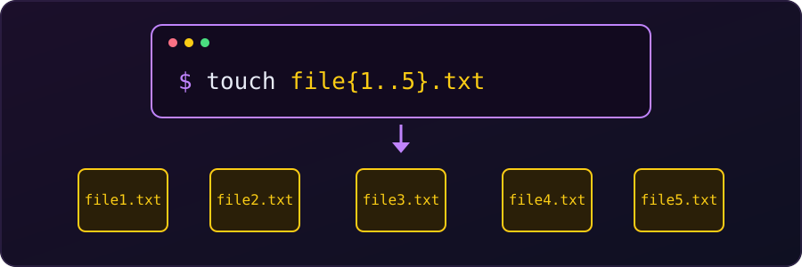

{fig-alt="A terminal running touch file{1..5}.txt with an arrow pointing down to five file icons named file1.txt to file5.txt."}

Creating files one by one in a file manager is slow. In the terminal, a single `touch` command can create as many as we like. It works the same way in Linux and macOS shells such as bash and zsh.

`touch` creates an empty file if it does not exist. If the file already exists, it only updates the modification time and leaves the contents alone.

## 1. Files with different names

When the names have nothing in common, we list them separated by spaces:

```bash
touch index.html styles.css script.js
```

## 2. Numbered or lettered files (brace expansion)

A range inside curly braces, `{start..end}`, is expanded by the shell before `touch` runs, so one pattern becomes many names:

```bash
# file1.txt, file2.txt, ..., file5.txt
touch file{1..5}.txt

# log_A.txt, log_B.txt, ..., log_E.txt
touch log_{A..E}.txt
```

To pad the numbers with zeros, write the first number with the zeros:

```bash
# bspl0001.c, bspl0002.c, bspl0003.c
touch bspl{0001..0003}.c
```

To preview what a pattern expands to without creating anything, use `echo`:

```bash
echo file{1..5}.txt
```

```
file1.txt file2.txt file3.txt file4.txt file5.txt
```

## 3. A chosen set of names

For specific names that share a prefix or extension, list the variations separated by commas. There must be no spaces inside the braces:

```bash
# test.js, demo.js, final.js
touch {test,demo,final}.js
```

## 4. Files inside a folder

Brace expansion also works after a path, so we can create files somewhere else without changing the current directory. The folder must already exist:

```bash
mkdir my_folder
touch my_folder/{file1.txt,file2.txt,file3.txt}
```

To create the folders at the same time, `mkdir -p` accepts braces too:

```bash
mkdir -p proj/{src,docs}
touch proj/src/{main,util}.c proj/docs/readme.md
```

```bash
ls -R proj
```

```
proj:
docs  src

proj/docs:
readme.md

proj/src:
main.c  util.c
```

## 5. Files with some starting text

`touch` always makes empty files. If each file needs a line of text, a short loop does it:

```bash
for i in 1 2 3; do echo "This is note $i" > note$i.txt; done
```

::: {.callout-note}
Brace expansion is a feature of the shell, not of `touch`, so it works with any command (`mkdir`, `cp`, `rm`). The `{1..5}` range form needs bash or zsh: fish and a plain `sh` leave `file{1..3}.txt` unexpanded. All the examples above were run in bash.
:::
