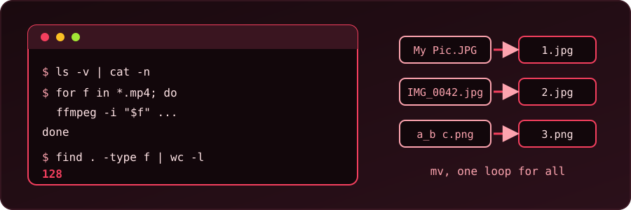

{fig-alt="A terminal window shows an ls command, a for loop over mp4 files, and find piped to wc -l. Beside it, three messy file names are renamed to 1.jpg, 2.jpg and 3.png."}

These are small commands we keep coming back to. Each one was run in Bash before we wrote it down here, and the outputs are real.

::: {.callout-warning}
Bulk renaming and in-place editing change files for good. Try each command in a scratch folder first, or on a copy.
:::

## Where are we?

```bash
pwd
```

`pwd` prints the current working directory.

## Open a file with its default application

```bash
xdg-open filename
```

`xdg-open` uses the application the desktop has chosen for that file type, so a PDF opens in the PDF viewer and a folder opens in the file manager.

## Look inside protected system folders

```bash
sudo nautilus    # or dolphin, thunar
```

This opens the file manager with administrator rights. Use it only to look. Anything we create or change this way can end up owned by root, and then our normal user cannot edit it. Close it when we are done.

## Clean up text with `sed`

We will use a small file in which blank lines separate the lines:

```bash
printf 'a\n\nb\n\n\nc\n' > file.txt
```

### Remove blank lines

```bash
sed '/^$/d' file.txt
```

```
a
b
c
```

### Add a hyphen before each line

```bash
sed 's/^/-/' file.txt
```

```
-a
-
-b
-
-
-c
```

Blank lines get a hyphen too. To skip them, run the blank-line removal first, or use `sed '/./s/^/-/' file.txt`.

### Put a blank line after every line

```bash
sed -i 's/$/\n/' file.txt
```

With GNU `sed` (the one on most Linux systems), this turns every newline into a double newline. The `-i` option edits the file in place. To keep a backup, write `-i.bak` instead. We get the original as `file.txt.bak`.

## Count files

```bash
find . -type f | wc -l
```

`find` lists every regular file below the current folder, including subfolders, and `wc -l` counts the lines. In a test folder with two files and one more inside a subfolder, it printed `3`. To count only the files directly in the folder, limit the depth:

```bash
find . -maxdepth 1 -type f | wc -l
```

That printed `2` for the same folder.

## Rename many files

### Number files in order

```bash
ls -v | cat -n | while read n f; do mv -n "$f" "$n.jpg"; done
```

Here `ls -v` sorts names in natural order (`z2` before `z10`), `cat -n` puts a number in front of each name, and the loop renames each file to that number. The example renames everything to `.jpg`, so change the extension to suit. The `-n` option stops `mv` from overwriting an existing file.

On six files (`a.jpg`, `b.jpg`, `c.jpg`, `my pic.jpg`, `z2.jpg`, `z10.jpg`) this gave `1.jpg` to `6.jpg`, and the name with a space worked too.

### Number files from a chosen start, with the same extension

```bash
num=0; for i in *; do mv "$i" "$(printf '%04d' $num).${i##*.}"; ((num++)); done
```

This pads the number to four digits and keeps each file's own extension. Set `num=10` to start at 10. Three files named `a.jpg`, `b.jpg` and `c.jpg` became `0010.jpg`, `0011.jpg` and `0012.jpg`.

We use `${i##*.}` (the part after the last dot), so a name such as `my.photo.jpg` keeps `jpg`. The `*` also matches folders, so run this where only the files to rename are present.

For a longer discussion of the numbering approach, see [this Stack Overflow answer](https://stackoverflow.com/questions/3211595/renaming-files-in-a-folder-to-sequential-numbers).

### Replace underscores with hyphens

```bash
for f in *_*; do mv -- "$f" "${f//_/-}"; done
```

`${f//_/-}` replaces every `_` in the name. Starting from `Report_Final_v2.TXT`, we got `Report-Final-v2.TXT`.

### Replace spaces with hyphens

```bash
for file in *' '*; do mv -- "$file" "${file// /-}"; done
```

`My Photo One.JPG` became `My-Photo-One.JPG`.

### Rename to lowercase

```bash
for f in *; do mv -n -- "$f" "${f,,}"; done
```

`${f,,}` lowercases the name. Together, the three steps above turned `My Photo One.JPG` into `my-photo-one.jpg` and `Report_Final_v2.TXT` into `report-final-v2.txt`.

### The same with Perl `rename`

Many systems also have a `rename` command that takes a Perl expression (on Debian and Ubuntu, `sudo apt install rename`). These forms do the same jobs:

```bash
rename 's/_/-/g' *         # underscores to hyphens
rename 'y/A-Z/a-z/' *      # to lowercase
```

We did not have this `rename` installed here, so we only tested the expressions themselves in Perl. `My_File_Name_v2.JPG` became `My-File-Name-v2.JPG` with `s/_/-/g`, and `My_File.JPG` became `my_file.jpg` with `y/A-Z/a-z/`. Note the `g`: without it, only the first underscore changes (`a_b_c` became `a-b_c`).

## Convert all mp4 files to mp3

```bash
for f in *.mp4; do
  ffmpeg -i "$f" -b:a 192K -vn "${f%.mp4}.mp3"
done
```

`-vn` drops the video, `-b:a 192K` sets the audio bitrate, and `${f%.mp4}` removes the `.mp4` ending from the name. Because `"$f"` is in quotes, names with spaces work. A test folder with `clip one.mp4` and `second.mp4` ended up with `clip one.mp3` and `second.mp3` next to them.

::: {.callout-tip}
An older version of this script looped over `ls . | grep .mp4` and changed `IFS`. That breaks on names with spaces and also matches any name with "mp4" inside it. A plain `for f in *.mp4` loop avoids both problems.
:::
