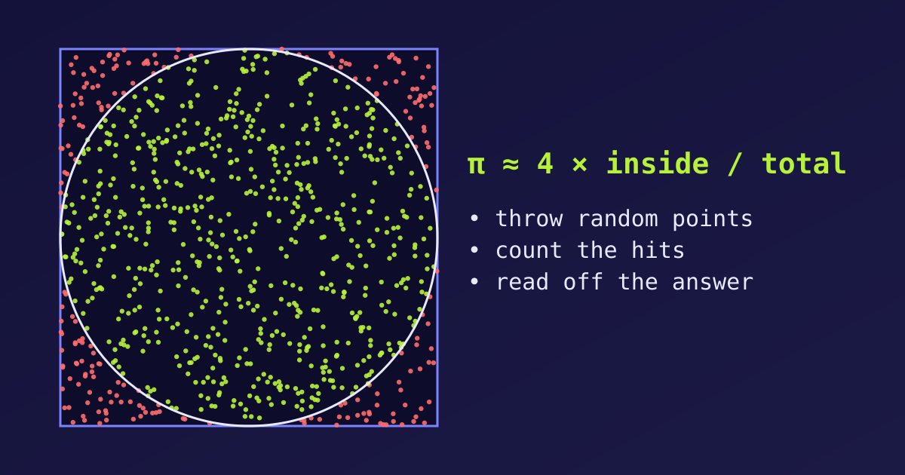

{fig-alt="A square with a circle drawn inside it and hundreds of random points scattered over it; points inside the circle are green and points outside are red."}

Some problems are too messy for a neat formula: the chance that a portfolio crashes, the path of a particle through a material, the best move in a board game. The **Monte Carlo method** solves them by brute-force randomness. We simulate the situation many times with random inputs, and read the answer off the results. Let's see the idea on the simplest example, and then build it in R.

## What Is the Monte Carlo Method?

A Monte Carlo method estimates a quantity by repeating a random experiment many times and averaging what happens. The name comes from the Monte Carlo casino in Monaco, a nod to the role of chance. The recipe has the same four steps every time:

1. Define the range of possible inputs.
2. Generate random inputs from it.
3. Compute the result for each input (here, a simple yes/no).
4. Combine the results, usually by averaging, into the estimate.

It works because of the **law of large numbers**: the more random samples we use, the closer their average gets to the true value. The error shrinks roughly like $1/\sqrt{n}$, so ten times the accuracy costs a hundred times the samples. This is slow, but it works for almost any problem, however complicated.

## The Dirt-Throwing Analogy

Imagine a perfectly round circle drawn inside a square on a wall. We want the area of the circle, but we pretend we do not know its formula. So we play a game:

1. **Throw blindfolded.** We throw 1,000 handfuls of dirt at the wall.
2. **One rule.** Every throw must land somewhere inside the square.
3. **Count.** We count how many splatters landed inside the circle, and how many landed outside.

If 785 of 1,000 splatters land inside the circle, the circle covers about 78.5% of the square. Since the square's area is easy (width × height), the circle's area is that area times 0.785.

- With **10 throws** the estimate is poor, because of pure luck.
- With **a million throws** the splatters fill the shape evenly and the estimate is very accurate.

## Estimating π

Take a square from $-1$ to $1$ on both axes, with a circle of radius 1 inside it. The square has area $2 \times 2 = 4$ and the circle has area $\pi r^2 = \pi$. So the share of points inside the circle should be $\pi / 4$, which gives

$$\pi \approx 4 \times \frac{\text{points inside the circle}}{\text{total points}}.$$

A point $(x, y)$ is inside the circle when $x^2 + y^2 \le 1$.

### Throwing the points in R

```{r}
library(tidyverse)

set.seed(2026)
n <- 2000

points <- tibble(
  x = runif(n, -1, 1),
  y = runif(n, -1, 1)
) %>%
  mutate(inside = x^2 + y^2 <= 1)

4 * mean(points$inside)
```

`runif()` draws uniform random numbers, and `mean()` of a logical column is the share of `TRUE` values, so `4 * mean(inside)` is exactly the formula above. The true value is `r round(pi, 4)`.

### Seeing the points

```{r}
#| fig-width: 5.5
#| fig-height: 5.5
circle <- tibble(t = seq(0, 2 * pi, length.out = 300)) %>%
  mutate(x = cos(t), y = sin(t))

ggplot(points, aes(x, y, colour = inside)) +
  geom_point(size = 1) +
  geom_path(data = circle, aes(x, y), colour = "black", inherit.aes = FALSE) +
  coord_fixed() +
  scale_colour_manual(values = c("TRUE" = "seagreen", "FALSE" = "tomato"),
                      labels = c("TRUE" = "Inside", "FALSE" = "Outside")) +
  labs(title = "2000 random points in the square", colour = NULL)
```

The green points inside the circle make up about $\pi/4 \approx 78.5\%$ of all points.

## More Throws, Better Estimate

How many points do we need? Let's keep a running estimate as the points arrive and plot it.

```{r}
#| fig-width: 7
#| fig-height: 4.2
set.seed(2026)
N <- 100000

running <- tibble(
  n = 1:N,
  inside = runif(N, -1, 1)^2 + runif(N, -1, 1)^2 <= 1
) %>%
  mutate(estimate = 4 * cumsum(inside) / n)

ggplot(running, aes(n, estimate)) +
  geom_line(colour = "steelblue") +
  geom_hline(yintercept = pi, colour = "tomato", linetype = "dashed") +
  scale_x_log10(labels = scales::comma) +
  labs(title = "The estimate settles down as n grows",
       x = "Number of points (log scale)", y = "Estimate of π")
```

At the start the line jumps around, which is the "pure luck" of few throws. After a few thousand points it hugs the dashed line at $\pi$. A table shows the same story:

```{r}
running %>%
  filter(n %in% c(10, 100, 1000, 10000, 100000)) %>%
  transmute(n, estimate = round(estimate, 4), error = round(abs(estimate - pi), 4))
```

The error shrinks as $n$ grows, though not steadily: a lucky small sample can beat an unlucky larger one.

::: {.callout-tip}
Run the code again with a different `set.seed()`. The numbers change, but the pattern (wild at first, then steady) does not. That is the Monte Carlo method at work.
:::

## Why This Matters in Real Life

Computers use this "dirt-throwing" logic to simulate millions of random scenarios in seconds. It is used when the problem is too complex for a straight formula:

- **Finance:** throwing random market events at a portfolio to see how often it crashes.
- **Physics:** simulating billions of random paths a particle might take.
- **Games:** letting an AI play thousands of random futures in chess or Go to choose a move.
- **Statistics:** approximating integrals, p-values and posterior distributions that have no closed form.

Estimating π is not a good use of Monte Carlo, since much better methods exist. We use it because we know the answer, which lets us watch the method work.
