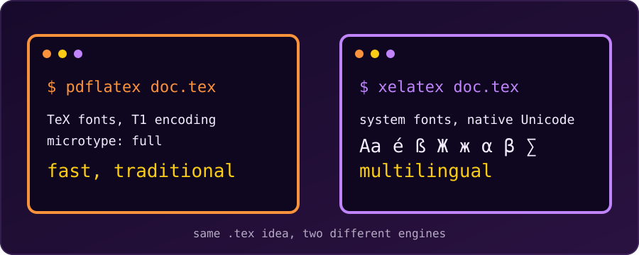

{fig-alt="Two terminal windows side by side: pdflatex labelled fast and traditional, and xelatex labelled multilingual, showing sample text in several scripts."}

**pdfLaTeX** is the traditional, default LaTeX engine. It compiles quickly and works with almost every package ever written. **XeLaTeX** is a newer engine built for **Unicode** and for **system fonts** (TrueType and OpenType). Both produce a PDF from the same kind of `.tex` file, but they handle fonts and text differently, so the preamble we write has to match the engine we choose.

(A third engine, **LuaLaTeX**, also supports Unicode and system fonts, and lets us script the document in Lua. Everything below about XeLaTeX applies to it in broad strokes.)

## The Key Differences

| Feature | pdfLaTeX | XeLaTeX |
| :--- | :--- | :--- |
| Default engine | Yes (historical standard) | No |
| System fonts (`.ttf` / `.otf`) | No (needs TeX-ready font packages) | Yes, through `fontspec` |
| Unicode text | Limited to what the font encoding covers | Native UTF-8 |
| Non-Latin scripts (Arabic, Bengali, Chinese) | Difficult; needs extra workarounds | Supported with a suitable font |
| Compile speed | Fast | Slower |
| Micro-typography (`microtype`) | Full support | Partial (character protrusion only) |
| Old pdfLaTeX-only packages | Work | Some fail |

### Speed

XeLaTeX does extra work: it loads system fonts and shapes the text. On our machine a one-line document compiled in about 0.13 s with pdfLaTeX and about 0.7 s with XeLaTeX (TeX Live 2026). The gap is far less dramatic than the ratio sounds, and on a real thesis the time goes to packages, figures and bibliographies. Still, pdfLaTeX is the faster engine for quick edit-compile cycles.

### Fonts and Unicode

pdfLaTeX works with TeX fonts and font encodings such as T1. Modern LaTeX reads UTF-8 input by default, but a character only prints if the font encoding has it. Try Bengali text with pdfLaTeX and it stops:

```
! LaTeX Error: Unicode character আ (U+0986)
               not set up for use with LaTeX.
```

XeLaTeX has no such limit. With `fontspec` we name any installed font, and the same text compiles:

```latex
\documentclass{article}
\usepackage{fontspec}
\setmainfont{Noto Serif Bengali}

\begin{document}
আমার দেশ বাংলাদেশ
\end{document}
```

### Typography and Compatibility

`microtype` makes subtle spacing and margin adjustments that improve the look of a page. It gives its full effect in pdfLaTeX; with XeLaTeX only part of it is available. pdfLaTeX also has the longest track record with journals and publishers, so for an academic submission we should check the journal's instructions, because many still ask for pdfLaTeX.

## Which One Should We Choose?

- **Choose pdfLaTeX** for a standard paper, report or thesis in a Latin script, when we want speed and maximum package compatibility.
- **Choose XeLaTeX** (or LuaLaTeX) when we need an operating-system font such as Times New Roman or a designer font, or when we write in a non-Latin script or mix several languages.

## 1. Compiling from the Terminal

Use the executable that matches the engine:

```bash
pdflatex document.tex
```

```bash
xelatex document.tex
```

pdfLaTeX reads the source, uses TeX fonts and writes the PDF directly. XeLaTeX reads the source, fetches fonts through the operating system, produces an intermediate `.xdv` file, and passes it to a driver (`xdvipdfmx`) that writes the final PDF. We don't see the second step; it happens inside the single `xelatex` command.

## 2. Switching the Engine in an Editor

In an editor we change the engine in the settings instead of on the command line.

**Overleaf**

1. Click the **Menu** button at the top left.
2. Under **Compiler**, change the dropdown from pdfLaTeX to XeLaTeX.
3. Click **Recompile**.

**TeXstudio**

1. Go to **Options → Configure TeXstudio**.
2. Open the **Build** tab.
3. Set **Default Compiler** to PdfLaTeX or XeLaTeX.

## 3. The Preamble Each Engine Needs

The preamble (the setup code above `\begin{document}`) must match the engine.

### pdfLaTeX

```latex
\documentclass{article}

% Rendering options for pdfLaTeX
\usepackage[utf8]{inputenc} % Allows typing Unicode characters directly
\usepackage[T1]{fontenc}    % 8-bit font encoding: better hyphenation and copy-paste
\usepackage{lmodern}        % Latin Modern, a scalable vector font
\usepackage{microtype}      % Subtle spacing and margin adjustments

\begin{document}
Hello World! This is rendered via pdfLaTeX.
\end{document}
```

### XeLaTeX

Drop `inputenc`, `fontenc` and `lmodern`, and load `fontspec` instead:

```latex
\documentclass{article}

% Rendering options for XeLaTeX
\usepackage{fontspec}

% Use any font installed on the computer
\setmainfont{Times New Roman}
\setsansfont{Arial}
\setmonofont{Courier New}

\begin{document}
Hello World! This is rendered via XeLaTeX using system fonts.
\end{document}
```

::: {.callout-warning}
**The fonts must be installed.** `\setmainfont{Times New Roman}` fails on a machine without that font: `fontspec Error: The font "Times New Roman" cannot be found`. On Debian and Ubuntu, Times New Roman and Arial come from the `ttf-mscorefonts-installer` package. For documents that must compile anywhere, pick a font that ships with TeX Live, or an open font such as Noto or DejaVu.
:::

::: {.callout-note}
**Don't mix the two preambles.** `\usepackage[utf8]{inputenc}` and `\usepackage[T1]{fontenc}` are for pdfLaTeX; with XeLaTeX they are unnecessary; XeLaTeX warns that `inputenc` is "ignored with utf8 based engines". `fontspec` only works with XeLaTeX and LuaLaTeX, and stops with an error under pdfLaTeX.
:::

## Summary

For plain English (or other Latin-script) documents, pdfLaTeX is quick and safe. The moment we need a specific system font or a non-Latin script, switch to XeLaTeX, change the preamble to use `fontspec`, and compile again.
