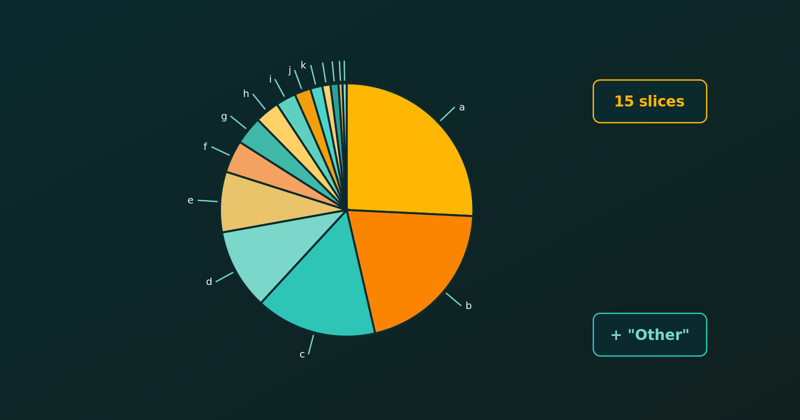

{.bk-adapt fig-alt="A pie chart with fifteen slices, each labelled outside the circle with a leader line."}

With many categories a pie chart becomes unreadable: the slices are narrow, the labels overlap and the colours are hard to tell apart. Experts usually advise either lumping the small categories into an "Other" group or switching to a bar chart. Let's see how to do both, and how to keep every category visible when we must, using `ggplot2`.

::: {.callout-note}
All the plots here keep the default `ggplot2` grey panel. For a pie we only hide the axis text, ticks and titles, which carry no meaning in polar coordinates. The same recipe works for the pie charts in [Pie Chart vs Bar Chart](pie-vs-bar-chart.html).
:::

## The Data: Fifteen Categories

Here are fifteen categories with very uneven values. We reuse this data throughout.

```{r}
library(tidyverse)

data <- data.frame(
  category = letters[1:15],
  value    = c(50, 40, 30, 20, 15, 8, 7, 6, 5, 4, 3, 2, 2, 1, 1)
)
```

A small helper theme hides the useless polar axes while keeping the default grey background.

```{r}
pie_theme <- theme(
  axis.title  = element_blank(),
  axis.text   = element_blank(),
  axis.ticks  = element_blank(),
  panel.grid  = element_blank()
)
```

## The Problem: All Fifteen Slices

```{r}
#| fig-width: 6
#| fig-height: 4.5
ggplot(data, aes(x = "", y = value, fill = category)) +
  geom_col(width = 1, colour = "white") +
  coord_polar(theta = "y") +
  pie_theme +
  labs(title = "Fifteen slices", fill = NULL)
```

The last six slices are slivers, and fifteen colours are too many to match against the legend.

## Lump Small Categories into "Other"

The best fix is to keep the largest categories and merge the rest. `fct_lump_n()` from `forcats` (part of the tidyverse) keeps the top `n` and groups everything else as "Other". The argument `w` tells it to rank by `value`, not by row count.

```{r}
#| fig-width: 6
#| fig-height: 4.5
clean_data <- data %>%
  mutate(category = fct_lump_n(category, n = 5, w = value)) %>%
  group_by(category) %>%
  summarise(value = sum(value)) %>%
  mutate(percentage = value / sum(value) * 100)

ggplot(clean_data, aes(x = "", y = value, fill = category)) +
  geom_col(width = 1, colour = "white") +
  coord_polar(theta = "y") +
  geom_text(aes(label = paste0(round(percentage), "%")),
            position = position_stack(vjust = 0.5), colour = "white") +
  scale_fill_brewer(palette = "Dark2") +
  pie_theme +
  labs(title = "Top five categories plus Other", fill = NULL)
```

Now six slices remain and each can carry a percentage label. The price is that the detail of the small categories is hidden inside "Other".

## Showing Every Category: Labels with Leader Lines

If every category must appear, put the labels outside the circle and join them to their slices with lines. The `ggrepel` package (`install.packages("ggrepel")`) pushes labels apart automatically, so they do not overlap.

First we compute the middle of each slice. Because `geom_col()` stacks the first level on top, we reverse the order before taking the cumulative sum.

```{r}
#| fig-width: 7
#| fig-height: 5.5
library(ggrepel)

labelled <- data %>%
  mutate(category = factor(category, levels = rev(category)),
         prop = value / sum(value) * 100,
         ypos = cumsum(prop) - 0.5 * prop)

ggplot(labelled, aes(x = "", y = prop, fill = category)) +
  geom_col(width = 1, colour = "white") +
  coord_polar(theta = "y") +
  geom_label_repel(aes(y = ypos, label = paste0(category, ": ", round(prop, 1), "%")),
                   nudge_x = 0.8,
                   segment.colour = "grey30",
                   size = 3.5,
                   show.legend = FALSE) +
  pie_theme +
  theme(legend.position = "none") +
  labs(title = "All fifteen categories, labelled outside")
```

`nudge_x` moves the labels outward, and the segments are drawn automatically. This stays readable up to roughly ten to fifteen categories.

## A Bar Chart Handles Dozens of Categories

When there are many categories, a sorted horizontal bar chart is the standard replacement. It needs no legend and leaves room for long labels.

```{r}
#| fig-width: 6
#| fig-height: 4.5
ggplot(data, aes(x = value, y = reorder(category, value))) +
  geom_col(fill = "steelblue") +
  labs(title = "The same fifteen categories", x = "Value", y = NULL)
```

## An Interactive Option

For dashboards and web pages, an interactive pie lets readers hover to see values and click the legend to hide categories. The `plotly` package does this (`install.packages("plotly")`).

```r
library(plotly)

plot_ly(data, labels = ~category, values = ~value, type = "pie")
```

## Which Should We Choose?

| Strategy | When to use | Pros | Cons |
|---|---|---|---|
| `fct_lump_n()` + pie | Reports, papers, slides | Clean and instantly readable | Hides the small categories |
| `ggrepel` labels | All categories must show, up to about 15 | Keeps every category | Still busy |
| Interactive `plotly` | Dashboards, websites | Keeps all information | Not for print |
| Bar chart | General best practice | Handles dozens of categories | Loses the part-to-whole look |

In short, lump first, label outside if every category is needed, and prefer a bar chart when the categories are many.
